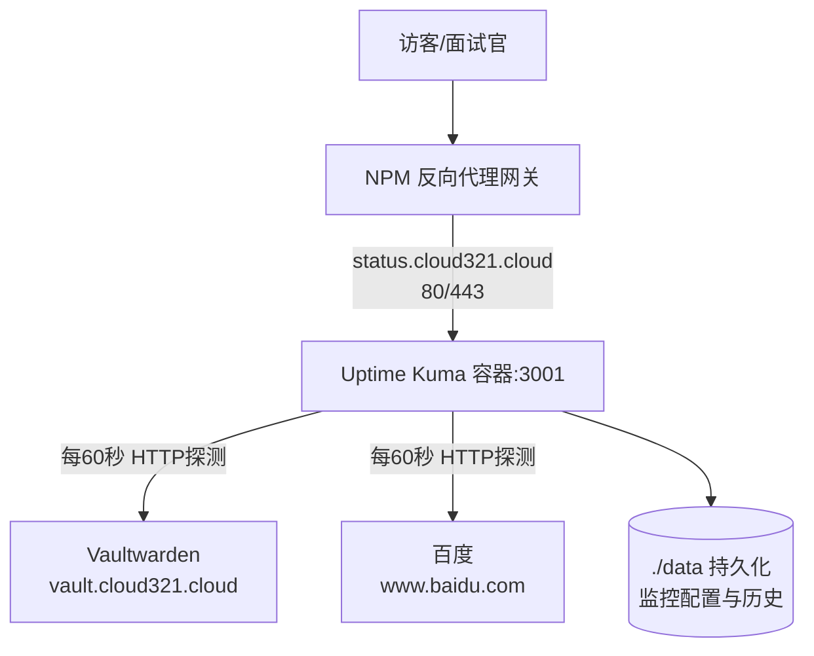

# 06 Uptime Kuma 服务状态监控

> 定位：CloudLab 的"服务可用性监控 + 对外状态页"，面试官能直接看到服务实时运行状态
> 服务器：华为云 Flexus · 目录 `/opt/cloudlab/uptime-kuma`
> 日期：2026-10-19

---

## 一、项目介绍

**Uptime Kuma** 是一个开源的**服务可用性监控**工具：定时探测目标（网站/端口/主机），判断是否在线，记录响应时间和可用率，挂了可触发告警，并能生成对外公开的**只读状态页**。

- 技术栈：Docker、Node.js、Uptime Kuma、HTTP/HTTPS 探测、WebSocket
- 运行环境：Docker 容器，端口 3001
- 规划域名：`status.cloud321.cloud`
- 与"主机资源监控"的分工：Kuma 管**服务/网站是否可用**（黑盒探测）；Grafana 管主机 CPU/内存等指标（白盒指标，见后续 08）。

### 部署架构



### 监控原理

```mermaid
flowchart LR
    A[按心跳间隔<br/>60s] --> B[向目标发请求]
    B --> C{预期状态码?<br/>如200}
    C -->|是| D[Up 绿色<br/>记录响应时间]
    C -->否/超时| E[按重试次数复测]
    E --> F[仍失败 → Down 红色<br/>可触发告警]
```

---

## 二、要做什么（功能清单）

1. Docker 部署 Uptime Kuma 容器，数据持久化
2. 创建管理员账号
3. 添加监控项（Vaultwarden + 百度外部对照）
4. 创建对外公开状态页
5. 在 NPM 配置子域名反代 + HTTPS

---

## 三、可能遇到的问题（部署前预告）

1. 镜像标签过时：`:1`/`:latest` 停留在不再维护的 v1
2. 新监控显示 N/A：容易误以为是"没放行"
3. 81 端口：NPM 管理后台，不开放则无法配置反代
4. HTTPS 证书 HTTP 验证失败：验证路径被转发给后端
5. 域名 80/443 曾被"未备案"阻断（2026-10-29 备案通过后解除，见 [[07 网站ICP备案]]）

---

## 四、实际部署经历

### 1. 编写编排文件、启动容器

```bash
mkdir -p /opt/cloudlab/uptime-kuma && cd /opt/cloudlab/uptime-kuma
cat > docker-compose.yml << 'EOF'
services:
  uptime-kuma:
    image: louislam/uptime-kuma:1
    container_name: uptime-kuma
    restart: unless-stopped
    ports:
      - '3001:3001'
    volumes:
      - ./data:/app/data
EOF
docker-compose up -d
```

- 容器内默认端口 **3001**，映射宿主机 3001；
- 挂载 `./data:/app/data`，配置和历史数据落盘；
- 放行端口：`iptables -I INPUT -p tcp --dport 3001 -j ACCEPT && service iptables save`，并在华为云安全组入方向添加 3001。

### 2. 踩坑：镜像标签过时 → 升级到 v2

- **现象**：页面提示 `This Uptime Kuma version is outdated! Current Version: 1.23.17 (Outdated!)`，`:1` 标签指向 v1，已停止维护；
- **查证**：Uptime Kuma 发布 v2，官方推荐标签 **`:2`**；
- **解决**：
```bash
sed -i 's|louislam/uptime-kuma:1|louislam/uptime-kuma:2|' docker-compose.yml
docker-compose up -d
```

**标签知识：**
| 标签 | 含义 |
|---|---|
| `:1` / `:latest` | 均指向 v1（1.23.17），**已弃用** |
| `:2` | v2 最新稳定版，自动更新，**推荐** |
| `:2.x.x` | 锁定具体版本，便于变更控制 |
| `:2-slim` | 精简版（无内置数据库，适合外接 DB） |

> 经验：网上教程标签可能过时，要对照官方 Wiki（Docker Tags）。

### 3. 初始化管理员账号

- 先访问 `http://公网IP:3001` 创建管理员账号，**先验证服务本身、再配反代**；
- 这样把"应用可用"和"反代配置"分开，出问题能快速定位；
- Kuma 账号是它自己的，与 Vaultwarden 无关。

### 4. 添加监控项（核心）

Uptime Kuma 支持的监控类型：

| 类型 | 监控什么 |
|---|---|
| HTTP(s) | 定时请求网址，看状态码（最常用） |
| TCP Port | IP:端口是否连通 |
| Ping | 主机能否 ping 通 |
| Keyword | 请求页面并检查关键词 |
| DNS | 域名解析是否正常 |
| Docker | 容器运行状态 |
| 其他 | gRPC、Redis、MySQL、Mqtt 等 |

**① Vaultwarden（被监控的自有服务）**
- 类型 HTTP(s)、URL `https://vault.cloud321.cloud`、心跳间隔 60s、重试 1；
- 结果：**100% Up、200 OK**；
- 响应时间：首个点 **230ms**（首次 DNS+TCP+TLS 握手），后续稳定 **20~30ms**（Kuma 复用连接，只发请求）——属于正常现象。

**② 百度（外部对照）**
- 类型 HTTP(s)、URL `https://www.baidu.com`；
- 初次显示 **N/A、心跳全白**，一度以为是"没放行"；
- **澄清（出站 vs 入站）**：
  - "放行端口"控制的是**外部能否访问你**（入站）；
  - Kuma 主动连百度是**出站**，云服务器出方向默认允许，容器经 Docker NAT 共享宿主机 IP 上网，**无需放行**；
  - N/A 只是尚未完成第一个心跳周期，等待约 60s 后变绿；
- 最终结果：100% Up，当前 30ms，平均 36.5ms，证书有效期 97 天。

> 外部对照的作用：所有自有服务都红、但百度绿 → 是你服务器问题；连百度都红 → 可能断网或 Kuma 本身故障。

### 5. 创建公开状态页

- **仪表盘（Dashboard）**：带增删改的管理后台，不对外；
- **状态页（Status Page）**：只读，专门对外发布；
- 操作：右上角"状态页面" → 新建状态页：
  - 标题 `CloudLab 服务状态`
  - Slug `cloudlab`（决定网址 `.../status/cloudlab`）
  - 勾选展示 Vaultwarden、百度
- "编辑状态页/前往仪表盘"按钮**只有登录管理员可见**，访客看到的是只读页。

### 6. NPM 反代 + HTTPS

- 在状态页编辑里设置 **Custom Domain** = `status.cloud321.cloud`（让 Kuma 知道该域名对应哪个状态页）；
- **81 端口**：NPM 管理后台，关闭后无法登录配置，需在安全组/iptables 临时放行，配完可关；
- **第一次 HTTP 验证失败**：
  - 现象：certbot 报 `Invalid response ... /.well-known/acme-challenge/...: 403`；
  - 根因：现有 Proxy Host 把**验证路径也转发给 Kuma**，Kuma 作为 SPA 对未知路径返回 HTML，Let's Encrypt 拿不到验证文件；
  - 验证：`curl -I http://status.cloud321.cloud/.well-known/acme-challenge/test123` 返回 Kuma 页面（200/1200字节），证实路径被转发；
- **改用 DNS 验证（成功）**：
  - 建 RAM 子用户 `dns-certbot`（仅 OpenAPI 访问），授权 `AliyunDNSFullAccess`，取 AccessKey ID/Secret；
  - NPM 编辑 SSL 时选"申请新证书" → 勾选 **Use a DNS Challenge** → Provider 选 Aliyun → 填凭证；
  - 不依赖 80 端口，证书申请成功（还可申请通配符 `*.cloud321.cloud`）；
  - 概念扫盲（HTTP-01 / DNS-01 / 通配符证书 / `*.` 的含义）见 [[07 网站ICP备案]] 附录 A。

### 7. 备案通过后的状态（2026-10-29）

- 证书成功后，域名 80/443 曾因**未 ICP 备案被合规阻断**（排查全过程见 [[07 网站ICP备案]]）；
- 2026-10-29 备案通过，阻断解除；服务器内部一直正常，当前对外演示仍用 `http://公网IP:3001`；
- 收尾待办（清单见 [[07 网站ICP备案]] §7.2）：NPM 补 `status.cloud321.cloud` 反代与证书、Kuma 监控目标切到 `https://status.cloud321.cloud` 并监控证书到期。

---

## 五、Kuma 使用补充

- **添加监控**：选类型 → 填目标/心跳 → 保存，等一个心跳周期；
- **重试设置**：失败后按 Retries 复测，避免网络抖动误报 Down；
- **通知（进阶）**：可在 Settings → Notifications 配置邮件/钉钉/企微/Telegram，挂了自动推送；
- **状态页自定义**：可改主题、图标、描述、自定义 CSS；
- **关键监控建议**：所有对外服务都用**公开域名**监控（端到端真实），自有服务 + 外部对照搭配。

---

## 六、踩坑记录与关键经验

| 问题 | 根因 | 解决 |
|---|---|---|
| 提示版本过时 | `:1`/`:latest` 停留在 v1 | 换 `:2` 标签 |
| 百度显示 N/A | 未到首个心跳周期；属出站非入站 | 等待即可，无需放行 |
| 证书 403 | acme-challenge 被转发给后端 | 改用 DNS 验证 |
| 域名最终打不开 | 未 ICP 备案 | 2026-10-29 备案通过（07），阻断解除；域名反代切换见 07 §7.2 |

> 核心经验：
> 1. **监控要区分入站/出站**，出站默认允许、不需要放行；
> 2. 首响时间包含 TLS 握手、后续复用连接，是正常变化；
> 3. 反向代理申请证书优先"创建即申请"，已有转发规则会干扰 HTTP 验证；
> 4. 内部正常、外部不通要想到合规层。

---

## 七、项目不足与扩展

- 仅做黑盒可用性探测，**不含主机资源指标**（交给后续 Grafana，08）；
- 尚未配置通知渠道，告警可扩展邮件/钉钉；
- 状态页默认样式，可进一步美化；
- 对外访问已随备案通过开放；NPM 域名反代切换见 [[07 网站ICP备案]] §7.2。
