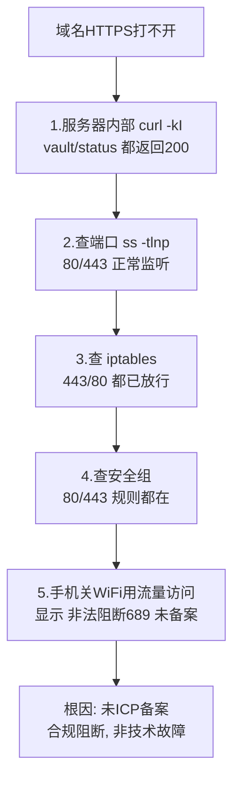
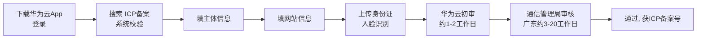

# 07 网站ICP备案

> 定位：国内服务器"上线"的合规必经环节，含一次真实的"未备案被阻断"排障全过程
> 服务器：华为云 Flexus（中国大陆）· 域名 cloud321.cloud
> 日期：2026-10-19

---

## 一、什么是 ICP 备案，为什么必须做

- **ICP 备案**：使用**中国大陆节点服务器**对外提供互联网信息服务（网站），必须先在**服务器提供商处**提交备案，由工信部/通信管理局审核，通过后取得**备案号**；
- 备案**跟着服务器走**：华为云服务器就在华为云备、阿里云就在阿里云备；
- 海外/中国香港服务器**不需要**备案；
- 个人备案主体下可以备**多个网站**，但一个账号只能有一个主体。

> [!important] 备案实际有"两个"
> 1. **ICP 备案**（工信部，本文重点，通过华为云提交）
> 2. **公安备案**（ICP 通过后 **30 日内**，在全国互联网安全管理服务平台 `beian.mps.gov.cn` 办理，个人网站一般也要）

---

## 二、真实经历：未备案被阻断（完整排查过程）

### 2.1 现象
- 域名 `https://vault.cloud321.cloud`、`https://status.cloud321.cloud` 突然**都打不开**；
- 此前几天能访问（云厂商合规检测有延迟，并非永久放行）。

### 2.2 排查过程（由内到外）

### 2.3 关键判断
- **内部正常 + 外部不通 + 防火墙（安全组/iptables）都放行** → 问题不在技术层，而在**合规层**；
- 手机页面原文：`非法阻断689`、`您的网站尚未进行备案，网站需要先备案后接入`。

### 2.4 阻断的边界（实测）
| 访问方式 | 结果 |
|---|---|
| 域名 80/443（vault/status.cloud321.cloud） | ❌ 被阻断 |
| 公网IP + 非标端口 `:8080` | 能访问（但 Vaultwarden 需 HTTPS，提示"未使用安全上下文"） |
| 公网IP + `:3001`（Kuma） | ✅ 正常 |
| 公网IP + `:81`（NPM） | ✅ 正常 |

> 结论：阻断主要针对**域名的 80/443**；IP+非标端口可作为备案期间的演示入口。

---

## 三、备案条件核对

| 条件 | 我的情况 |
|---|---|
| 华为云中国站实名认证账号 | ✅ |
| 域名注册者为本人、已实名 | ✅ cloud321.cloud |
| 域名后缀可备案 | ✅ `.cloud` 在工信部许可名单（许可证号 D2-0002） |
| 服务器包周期 **≥3 个月** | ✅ 包年 1 年 |
| 公网 IP | ✅ |

---

## 四、材料清单（全程电子化，不用打印）

### 手边要有的
- 本人身份证原件（拍正反面）
- 智能手机（华为云 App，光线充足做人脸识别）
- 能收短信的本机号码

### 事先要想好的信息
1. **网站名称**（准备 2~3 个备选，可能被驳回）：
   - 稳妥："俊豪的学习笔记"、"俊豪的个人主页"、"小唐的学习空间"
   - 避免：公司、中心、平台、运维、监控、论坛、社区、新闻等词
2. 网站服务内容：选"技术学习 / 个人主页"
3. 身份证住址（一字不差）
4. 实际通信地址 + 邮编（如与身份证不同）
5. 常用邮箱
6. 应急联系人（部分管局要：姓名 + 电话）

### 其他
- 真实性核验单、承诺书：App 内手写**电子签名**，不用打印
- 若域名核验不通过：去阿里云下载电子域名证书上传（不用打印）

---

## 五、备案流程（华为云 App）

具体：
1. 应用商店下载"华为云"App，用购买服务器账号登录；
2. 控制台或搜索"ICP备案" → 开始备案/新增网站；
3. 自动校验服务器、域名；
4. 填主体（个人）信息；
5. 填网站信息（名称、内容）；
6. 上传身份证 + 人脸识别；
7. 等待华为云初审 → 管局审核；
8. 通过后短信/邮件通知，拿到备案号。

---

## 六、注意事项

- **个人备案内容限制**：不得做经营性、论坛、新闻、医疗等；技术学习/个人工具/运维演示可以；
- **网站名称**要中性、符合个人站规范；
- 备案通过后**必须在网站底部放置备案号**，并链接到 `https://beian.miit.gov.cn`；
- 保持手机畅通，可能接核验电话，要能答出自己填的信息；
- 被驳回按提示改完重新提交，不影响后续；
- ICP 通过后 **30 日内做公安备案**（`beian.mps.gov.cn`）。

---

## 七、备案期间项目安排

- **面试演示**：用 `http://公网IP:3001`（Kuma 状态页）、`http://公网IP:81`（NPM）；
- Vaultwarden 暂停对外（必须 HTTPS，等备案）；
- 继续部署 Grafana、Halo 等（服务器内部可访问），备案下来一起对外开放；
- 注意：备案期间不要提前用域名开放 80/443。

---

## 八、关键经验

> 1. 国内服务器域名开 80/443，**ICP 备案是硬门槛**，项目设计初期就要把备案时间算进去；
> 2. 排障遇到"内部正常、外部不通、防火墙都放行"，要想到**合规/备案阻断**，而不是只盯技术；
> 3. 云平台有**双层防火墙**：安全组（外层）+ 服务器内 iptables（内层），都要查；
> 4. 备案是"理解国内互联网合规"的真实经验，面试讲"我知道为什么要备案、流程是什么"，是加分项。
