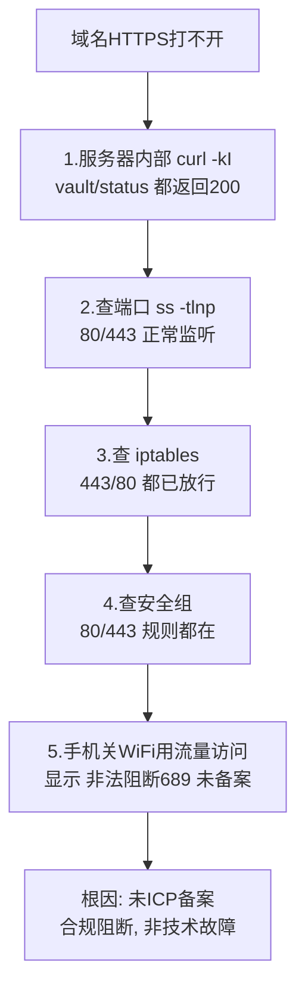
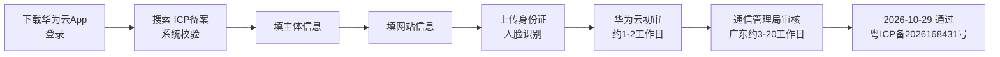
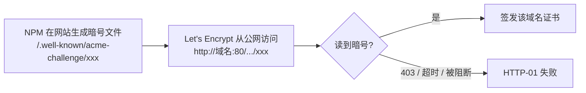
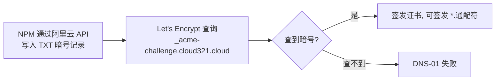

# 07 网站ICP备案

> 定位：国内服务器"上线"的合规必经环节，含一次真实的"未备案被阻断"排障全过程
> 服务器：华为云 Flexus（中国大陆）· 域名 cloud321.cloud
> 备案：2026-10-29 通过（华为云 · 个人备案）· 备案号 **粤ICP备2026168431号** · 状态：✅ 已通过，服务器侧收尾清单见第七节
> 日期：2026-10-19 提交 · 2026-10-29 通过

---

## 一、什么是 ICP 备案，为什么必须做

- **ICP 备案**：使用**中国大陆节点服务器**对外提供互联网信息服务（网站），必须先在**服务器提供商处**提交备案，由工信部/通信管理局审核，通过后取得**备案号**；
- 备案**跟着服务器走**：华为云服务器就在华为云备、阿里云就在阿里云备；
- 海外/中国香港服务器**不需要**备案；
- 个人备案主体下可以备**多个网站**，但一个账号只能有一个主体。

> [!important] 备案实际有"两个"
> 1. **ICP 备案**（工信部，本文重点，通过华为云提交）
> 2. **公安备案**（ICP 通过后 **30 日内**，在全国互联网安全管理服务平台 `beian.mps.gov.cn` 办理，个人网站一般也要）

---

## 二、真实经历：未备案被阻断（完整排查过程）

### 2.1 现象
- 域名 `https://vault.cloud321.cloud`、`https://status.cloud321.cloud` 突然**都打不开**；
- 此前几天能访问（云厂商合规检测有延迟，并非永久放行）。

### 2.2 排查过程（由内到外）



### 2.3 关键判断
- **内部正常 + 外部不通 + 防火墙（安全组/iptables）都放行** → 问题不在技术层，而在**合规层**；
- 手机页面原文：`非法阻断689`、`您的网站尚未进行备案，网站需要先备案后接入`。

### 2.4 阻断的边界（实测）
| 访问方式 | 结果 |
|---|---|
| 域名 80/443（vault/status.cloud321.cloud） | ❌ 被阻断 |
| 公网IP + 非标端口 `:8080` | 能访问（但 Vaultwarden 需 HTTPS，提示"未使用安全上下文"） |
| 公网IP + `:3001`（Kuma） | ✅ 正常 |
| 公网IP + `:81`（NPM） | ✅ 正常 |

> 结论：阻断主要针对**域名的 80/443**；IP+非标端口可作为备案期间的演示入口。
>
> **现状（2026-10-29）**：备案通过后，域名 80/443 的合规阻断已解除；上表"❌ 被阻断"是备案前的历史实测结果，不再代表当前状态。

---

## 三、备案条件核对

| 条件 | 我的情况 |
|---|---|
| 华为云中国站实名认证账号 | ✅ |
| 域名注册者为本人、已实名 | ✅ cloud321.cloud |
| 域名后缀可备案 | ✅ `.cloud` 在工信部许可名单（许可证号 D2-0002） |
| 服务器包周期 **≥3 个月** | ✅ 包年 1 年 |
| 公网 IP | ✅ |

---

## 四、材料清单（全程电子化，不用打印）

### 手边要有的
- 本人身份证原件（拍正反面）
- 智能手机（华为云 App，光线充足做人脸识别）
- 能收短信的本机号码

### 事先要想好的信息
1. **网站名称**（准备 2~3 个备选，可能被驳回）：
   - 稳妥："阿豪的学习笔记"、"阿豪的个人主页"、"小唐的学习空间"
   - 避免：公司、中心、平台、运维、监控、论坛、社区、新闻等词
2. 网站服务内容：选"技术学习 / 个人主页"
3. 身份证住址（一字不差）
4. 实际通信地址 + 邮编（如与身份证不同）
5. 常用邮箱
6. 应急联系人（部分管局要：姓名 + 电话）

### 其他
- 真实性核验单、承诺书：App 内手写**电子签名**，不用打印
- 若域名核验不通过：去阿里云下载电子域名证书上传（不用打印）

---

## 五、备案流程（华为云 App）



具体：
1. 应用商店下载"华为云"App，用购买服务器账号登录；
2. 控制台或搜索"ICP备案" → 开始备案/新增网站；
3. 自动校验服务器、域名；
4. 填主体（个人）信息；
5. 填网站信息（名称、内容）；
6. 上传身份证 + 人脸识别；
7. 等待华为云初审 → 管局审核；
8. 通过后短信/邮件通知，拿到备案号：**粤ICP备2026168431号**（以华为云备案后台与工信部备案系统显示为准，悬挂前核对编号逐字一致）。

---

## 六、注意事项

### 备案期间（已完成，备查）

- **个人备案内容限制**：不得做经营性、论坛、新闻、医疗等；技术学习/个人工具/运维演示可以；
- **网站名称**要中性、符合个人站规范；
- 保持手机畅通，可能接核验电话，要能答出自己填的信息；
- 被驳回按提示改完重新提交，不影响后续。

### 备案通过后的强制义务（2026-10-29 起适用）

- **悬挂备案号**：网站主页底部标明备案编号 `粤ICP备2026168431号`，并链接到 `https://beian.miit.gov.cn/`（《非经营性互联网信息服务备案管理办法》第十三条）；本项目对外内容站点是 Halo 博客，备案号挂在 Halo 主题页脚；
- **公安备案**：ICP 通过后 **30 日内**（截止 **2026-11-28**）在全国互联网安全管理服务平台 `beian.mps.gov.cn` 办理；
- **个人备案边界**：对外主页只放个人文章/学习笔记；Vaultwarden、Alist、Grafana 等自用后台放在子域名、不做公开入口和开放注册；不得出现企业、经营性、论坛评论类功能；
- **域名解析必须指向备案接入商（华为云）的服务器**，换接入商需先做新增接入备案；
- 备案通过后信息同步可能有延迟，当天域名仍打不开先等一个工作日，不要急着改配置。

---

## 七、备案通过后的收尾清单（2026-10-29）

### 7.1 已解除的限制

- 域名（所有子域名，写法 `*.cloud321.cloud`，含义见附录 A）的 **80/443 合规阻断已解除**，可以走 NPM 对外提供 HTTPS 站点；
- 80 端口可达后，**新站点证书**可直接用最简单的 **HTTP-01** 方式签发；如果要申请一张覆盖全部子域名的**通配符证书**，只能用 **DNS-01**（阿里云 RAM 子账号，见 [[06 Uptime Kuma服务状态监控]] §6）；这两个术语是什么，先读**附录 A**；
- 此前"IP + 非标端口"只是备案期间的临时演示入口，收尾完成后统一收敛到 NPM 80/443，管理端口（81）与监控端口（9090/9100）不暴露公网。

### 7.2 服务器侧待办（自己动手，逐项勾选）

> 现状：备案刚通过，服务器尚未切换；以下完成前，对外演示仍用 IP + 端口。

- [ ] **等待备案信息同步**：当天域名仍打不开属正常，最多等一个工作日再排查，不要先改 NPM/防火墙；
- [ ] **核对 DNS 解析**：阿里云 DNS 控制台确认两条 A 记录——泛解析 `*` 与根记录 `@` 都指向华为云 EIP；再用 `nslookup vault.cloud321.cloud 223.5.5.5` 验证，看到 Address 等于 EIP 才算通过（记录含义、命令拆解与异常对照见附录 A.9）；
- [ ] **核对防火墙**：华为云安全组与宿主机 iptables 放行 80/443；81（NPM 后台）、9090（Prometheus）、9100（Exporter）不对公网；
- [ ] **NPM 逐站补反代 + 证书**（目标映射，端口以各服务笔记为准）：

  | 子域名 | 后端 | 备注 |
  |---|---|---|
  | `vault.cloud321.cloud` | `172.17.0.1:8080` | 勾选 WebSocket、Force SSL、HTTP/2 |
  | `status.cloud321.cloud` | `172.17.0.1:3001` | Kuma 状态页 |
  | `blog.cloud321.cloud` | `172.17.0.1:8090` | Halo，探活路径 `/console` |
  | `files.cloud321.cloud` | `172.17.0.1:5244` | Alist（10 笔记旧写 `drive.`，统一时以 NPM 实际域名为准） |
  | `monitor.cloud321.cloud` | `172.17.0.1:3000` | Grafana，建议加访问密码，不做公开入口 |

- [ ] **逐站验证**：浏览器访问各 `https://<子域名>.cloud321.cloud`，地址栏小锁正常；`curl -I https://<子域名>.cloud321.cloud` 返回 200/302；
- [ ] **Halo 页脚悬挂备案号**：主题页脚添加 `粤ICP备2026168431号`，链接 `https://beian.miit.gov.cn/`；
- [ ] **Vaultwarden 后台**：服务器地址改为 `https://vault.cloud321.cloud`，确认 WebSocket 实时同步正常；
- [ ] **Kuma 监控切换**：监控目标从 `http://IP:端口` 改为 `https://<子域名>.cloud321.cloud`，同时监控证书到期；
- [ ] **个人备案边界自查**：关闭各服务公开注册；Grafana/Alist/Vaultwarden 不做公开导航入口；主页只展示 Halo 博客内容。

### 7.3 合规待办

- [ ] **公安备案**：2026-11-28 前在 `beian.mps.gov.cn` 提交，完成后把公安备案号一并挂到 Halo 页脚；
- [ ] 备案主体、网站内容保持与备案填报一致；后续更换服务器接入商前先办新增接入备案。

---

## 八、关键经验

> 1. 国内服务器域名开 80/443，**ICP 备案是硬门槛**，项目设计初期就要把备案时间算进去；
> 2. 排障遇到"内部正常、外部不通、防火墙都放行"，要想到**合规/备案阻断**，而不是只盯技术；
> 3. 云平台有**双层防火墙**：安全组（外层）+ 服务器内 iptables（内层），都要查；
> 4. 备案是"理解国内互联网合规"的真实经验，面试讲"我知道为什么要备案、流程是什么"，是加分项；
> 5. **备案通过 ≠ 网站自动上线**：阻断解除后还要完成 NPM 反代、HTTPS 证书、页脚备案号悬挂、公安备案这一整套收尾，备案只是合规准入的第一步。

---

## 附录 A：证书、域名与验证方式扫盲（初学者先读这节）

> 这一节专门解释正文反复出现的五个词：`*.cloud321.cloud`、HTTPS 证书、HTTP-01、DNS-01、通配符证书。不假设你已经懂，先讲概念，再对应到本项目。

### A.1 三种域名写法：主域名、子域名、`*.cloud321.cloud`

- **主域名 `cloud321.cloud`**：你在阿里云花钱注册的那一个名字，你拥有的是它。
- **子域名**：在主域名前面加一段前缀，自己在 DNS 里创建，**不需要单独注册、不用再花钱**。本项目五个：

  | 子域名 | 对应服务 |
  |---|---|
  | `vault.cloud321.cloud` | Vaultwarden |
  | `status.cloud321.cloud` | Uptime Kuma |
  | `blog.cloud321.cloud` | Halo 博客 |
  | `files.cloud321.cloud` | Alist |
  | `monitor.cloud321.cloud` | Grafana |

- **`*.cloud321.cloud`**：星号 `*` 是"**任意一个前缀**"的占位符号，**它本身不是一个能在浏览器里打开的网址**，只是用来统称"所有子域名"。
  - DNS 里配一条**泛解析** `*.cloud321.cloud → 服务器IP`：让任意子域名都先解析到这台服务器，以后加新子域名不用再改 DNS；
  - 但 **NPM 面板里仍要为每个站点单独加反代规则**——DNS 只负责"找到服务器"，NPM 才负责"把请求分发给哪个容器"（原理见 [[02 NPM反向代理网关扩展]]）。

### A.2 HTTPS 证书是什么？"新站点证书"指什么？

**先知道为什么需要证书**

- HTTP 是**明文**传输：路上任何人（运营商、机房、中间人）都能偷看甚至篡改内容；
- HTTPS = HTTP + TLS 加密通道，它要同时解决两件事：
  1. **身份确认**：浏览器连的确实是 `vault.cloud321.cloud`，不是冒充它的钓鱼网站；
  2. **传输加密**：之后的通信内容加密，别人偷看不到。

**证书就是网站的"身份凭证 + 加密公钥"**

- 证书由第三方机构 **CA（Certificate Authority，证书颁发机构）**签发，主流浏览器出厂就内置信任这些机构；
- 证书里写明：这张证书属于哪个域名、由谁签发、有效期到什么时候，并带一把加密用的**公钥**；
- 浏览器访问 HTTPS 站点时，服务器先把证书交出来；浏览器核对"CA 是否可信、域名是否匹配、有没有过期"，全部通过才建立加密连接，地址栏才出现小锁。

**"新站点证书"是什么**

- 证书是**绑定域名**的：一张普通证书通常只对应一个（或你明确指定的几个）域名；
- 你每在 NPM 接入一个新子域名，就要向 Let's Encrypt（免费 CA）申请一张绑定该域名的证书——笔记里说的"**新站点证书**"就是这个意思。

### A.3 发证前为什么要"验证"？验证的是什么？

- 如果谁报一个域名就能拿证书，任何人都能给 `cloud321.cloud` 发证去冒充你的网站；
- 所以 CA 发证前必须先确认一件事：**申请这张证书的人，真的控制这个域名（以及这台服务器）**；
- 这套确认机制叫 **Challenge（挑战 / 验证）**，NPM 常用两种：**HTTP-01** 和 **DNS-01**。

### A.4 HTTP-01 验证（网站文件挑战）

**原理三步**

1. NPM 按 Let's Encrypt 的指示，在网站上生成一个临时文件，路径固定为：
   `http://<域名>/.well-known/acme-challenge/<一串随机暗号>`，文件内容就是这串暗号；
2. Let's Encrypt 自己从公网访问这个 URL，读到暗号；
3. 读得到 → 证明你能在该网站放文件、控制这台服务器 → 签发证书。

**前提与限制**

- 域名 **80 端口必须从公网直接访问到这台服务器**；
- 备案期间 80/443 被合规阻断，HTTP-01 走不通；
- 已有的反代规则如果把这个 `/.well-known/` 路径也转发给后端容器，CA 就读不到暗号（06 笔记当时报 403 就是这个原因）。

**本项目对应**：备案通过、80 可达后，`blog` / `files` / `monitor` 等新站点用 HTTP-01 最省事，不需要碰 DNS。

### A.5 DNS-01 验证（DNS 记录挑战）

**原理三步**

1. Let's Encrypt 让你在该域名的 DNS 里，给 `_acme-challenge.cloud321.cloud` 加一条 **TXT 记录**，内容是指定暗号；
2. CA 去查询这条 DNS 记录，查到暗号；
3. 查得到 → 证明你拥有这个域名的管理权 → 签发证书。

**前提与限制**

- 只要你能修改这个域名的 DNS 记录即可，**不要求 80 端口对外可达**；
- NPM 不直接操作 DNS，而是通过阿里云 **RAM 子账号的 AccessKey** 自动添加、验证通过后再删掉这条临时 TXT 记录（配置过程见 06 §6）。

**本项目对应**：备案阻断期间 80 不通时，仍可用 DNS-01 发证；06 当时 HTTP-01 被反代干扰报 403，最后就是改用 DNS-01 成功的。

### A.6 通配符证书是什么

- 一张证书，域名栏写的是 `*.cloud321.cloud`，**一次覆盖所有子域名**；以后新增子域名，这张证书照样有效，不用逐个申请；
- 两条硬限制：
  1. **只有 DNS-01 能申请通配符证书**：HTTP-01 只能证明"你控制某一个具体站点"，证明不了你控制全部子域名；
  2. `*.cloud321.cloud` 只匹配**一层**前缀，**不覆盖**主域名 `cloud321.cloud` 本身；
- 取舍：本项目只有 5 个子域名，逐站申请普通证书完全够用；站点多、以后还会持续新增时，通配符证书才更省事。

### A.7 两种验证方式对比（一眼看懂）

| 对比项 | HTTP-01 | DNS-01 |
|---|---|---|
| 验证位置 | 服务器网站目录（80 端口） | 域名 DNS 的 TXT 记录 |
| 需要 80 端口公网可达 | **需要** | 不需要 |
| 需要 DNS 管理权限 | 不需要 | **需要**（NPM 用阿里云 RAM 子账号操作） |
| 能否签发通配符证书 | 不能 | **能** |
| 配置复杂度 | 简单 | 略复杂（要配 API 凭证） |
| 本项目何时用 | 备案通过后的新站点 | 阻断期间发证 / 需要通配符证书时（06 已用） |

### A.8 流程对比图

**HTTP-01：**



**DNS-01：**



> 本节只讲概念；实际操作过程见 [[06 Uptime Kuma服务状态监控]] §6（DNS-01 配置与 HTTP-01 踩坑）和 [[05 部署Vaultwarden密码管理服务]] §4.7（NPM 反代 + 证书）。

### A.9 DNS 记录与 nslookup 验证（对应 §7.2 第二条待办）

#### A.9.1 DNS 解析在干什么

浏览器输入域名时，服务器不能直接按名字被找到，必须先把**域名翻译成公网 IP** 才能连上。这张"域名 ↔ IP"对照表就存在 DNS 服务器上；域名在阿里云注册，解析记录就在阿里云域名控制台维护。

#### A.9.2 A 记录是什么

- **A 记录**：一条"域名 → IPv4 地址"的对照记录；记录类型选 `A`，记录值填一个 IPv4 地址。

#### A.9.3 两条记录：`*` 泛解析 和 `@` 根记录

| 主机记录 | 含义 | 覆盖范围 |
|---|---|---|
| `*` | 任意前缀的子域名（泛解析） | `vault.` / `status.` / `blog.` / `files.` / `monitor.` 以及以后新增的子域名，全部指向同一个 IP |
| `@` | 主域名本身 `cloud321.cloud`（不带任何前缀） | 只有根域名 |

> 为什么要配两条：`*` 只匹配子域名，**不匹配根域名本身**（和 A.6 通配符证书"星号只匹配一层"是同一条规则）；想让直接访问 `cloud321.cloud` 也能到达服务器，必须单独给 `@` 配一条 A 记录。

#### A.9.4 记录值为什么是华为云 EIP

- **EIP（Elastic IP，弹性公网 IP）**：服务器对外的固定公网 IP，本项目为 `110.41.63.156`；
- DNS 记录值**只能填公网 IP**；内网 IP（`172.31.2.150`）、docker0 网关（`172.17.0.1`）都不能填，外部访问者根本到不了这些地址。

#### A.9.5 命令逐段拆解：`nslookup vault.cloud321.cloud 223.5.5.5`

| 命令片段 | 含义 |
|---|---|
| `nslookup` | Name Server Lookup，专门查询 DNS 记录的命令行工具 |
| `vault.cloud321.cloud` | 要查询的域名；用任意一个子域名都能检验泛解析是否生效 |
| `223.5.5.5` | 指定去问哪台 DNS 服务器：**阿里云公共 DNS**。指定它是为了绕过本机/路由器缓存，直接看线上最新配置（用腾讯 DNS `119.29.29.29` 也可以） |

#### A.9.6 预期输出（Windows PowerShell / cmd）

```text
服务器:  public1.alidns.com
Address:  223.5.5.5

名称:    vault.cloud321.cloud
Address:  110.41.63.156
```

**判断标准**：最后一行 `Address` 等于华为云 EIP，说明泛解析已经生效。

#### A.9.7 异常对照

| 现象 | 原因 | 处理 |
|---|---|---|
| `*** 找不到 ...` / `NXDOMAIN` | `*` 记录没配好，或刚改完还没生效（DNS 缓存几分钟到几十分钟） | 回阿里云控制台核对；等待后重查；本机执行 `ipconfig /flushdns` 刷新缓存 |
| `Address` 是别的 IP | 记录值填错，或指向了旧服务器 | 改回 EIP |
| 子域名正常、根域名 `cloud321.cloud` 查不到 | `@` 记录缺失 | 补 `@` 的 A 记录 |

> 补充：查根域名用 `nslookup cloud321.cloud 223.5.5.5`；`ping vault.cloud321.cloud` 第一行也会显示解析到的 IP。

#### A.9.8 这条待办的完整动作

1. 阿里云控制台 → 域名 → DNS 解析，确认 `*` 与 `@` 两条 A 记录都指向 EIP；
2. 本机或服务器执行 `nslookup vault.cloud321.cloud 223.5.5.5`；
3. `Address` 等于 EIP，这一项才算完成、可以勾选。
