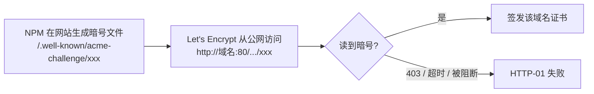
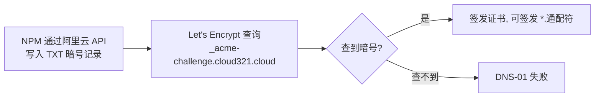
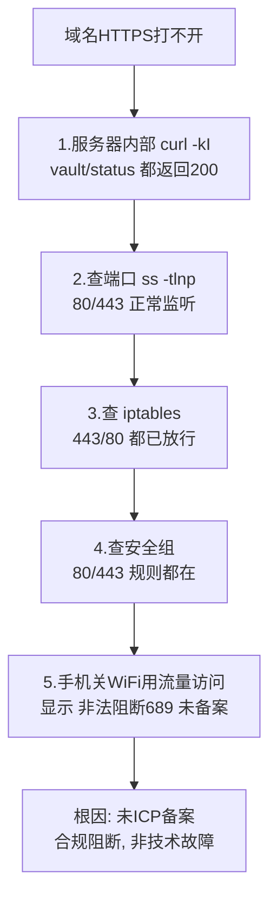
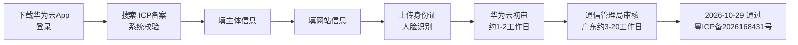

# 07 网站ICP备案

> 定位：国内服务器"上线"的合规必经环节，含一次真实的"未备案被阻断"排障全过程，以及备案通过后的服务器侧收尾实操手册
> 服务器：华为云 Flexus（中国大陆）· 域名 cloud321.cloud · 公网 EIP `110.41.63.156`
> 备案：2026-10-29 通过（华为云 · 个人备案）· 备案号 **粤ICP备2026168431号**（悬挂前以华为云备案后台 / 工信部系统显示为准，逐字核对）
> 日期：2026-10-19 提交 · 2026-10-29 通过

---

## 一、这篇笔记怎么用

### 1.1 当前状态（2026-10-29 实测）

- ICP 备案**已经通过**，域名 80/443 的合规阻断已解除；
- `blog` / `status` / `files` / `vault` 四个子域名**已经接入 NPM 并持有 Let's Encrypt 证书**，可正常 HTTPS 访问；
- 仍缺三处：**根域名门户**（访问 `cloud321.cloud` 目前返回 NPM 默认页）、`monitor` 反代、全部站点的 Force SSL —— 做法见 [[12 根域名门户与域名收尾配置]]；
- 剩余合规项：**公安备案**（截止 2026-11-28，见第八章）。

### 1.2 阅读路线

| 你是谁 / 你想干什么 | 按这个顺序读 |
|---|---|
| 新手，第一次接触域名、证书、DNS | 第二章（基础概念）→ 第六章（实操手册） |
| 已经懂概念，现在要动手收尾 | 直接跳到第六章，卡住时回第二章查对应小节 |
| 想回顾备案申请过程、阻断排障 | 第三章、第四章、第五章（历史备查） |
| 面试前复习 | 第九章 关键经验 |

> 全文章节关系：**第二章讲"是什么" → 第三、四、五章讲"过去发生了什么"（备查）→ 第六章讲"现在怎么做" → 第七、八章讲"合规要求" → 第九章讲"经验总结"**。

---

## 二、动手前先懂：基础概念

> 这一章解释收尾操作里反复出现的词：域名写法、HTTPS 证书、HTTP-01、DNS-01、通配符证书、DNS 记录、nslookup。先读完这一章，第六章的每一步才看得懂。

### 2.1 主域名、子域名、`*.cloud321.cloud`

- **主域名 `cloud321.cloud`**：你在阿里云花钱注册的那一个名字，你拥有的是它。
- **子域名**：在主域名前面加一段前缀，自己在 DNS 里创建，**不需要单独注册、不用再花钱**。本项目五个：

  | 子域名 | 对应服务 |
  |---|---|
  | `vault.cloud321.cloud` | Vaultwarden |
  | `status.cloud321.cloud` | Uptime Kuma |
  | `blog.cloud321.cloud` | Halo 博客 |
  | `files.cloud321.cloud` | Alist |
  | `monitor.cloud321.cloud` | Grafana |

- **`*.cloud321.cloud`**：星号 `*` 是"**任意一个前缀**"的占位符号，**它本身不是一个能在浏览器里打开的网址**，只是用来统称"所有子域名"。
  - DNS 里配一条**泛解析** `*.cloud321.cloud → 服务器IP`：让任意子域名都先解析到这台服务器，以后加新子域名不用再改 DNS；
  - 但 **NPM 面板里仍要为每个站点单独加反代规则**——DNS 只负责"找到服务器"，NPM 才负责"把请求分发给哪个容器"（原理见 [[02 NPM反向代理网关扩展]]）。

### 2.2 HTTPS 证书是什么？"新站点证书"指什么？

**先知道为什么需要证书**

- HTTP 是**明文**传输：路上任何人（运营商、机房、中间人）都能偷看甚至篡改内容；
- HTTPS = HTTP + TLS 加密通道，它要同时解决两件事：
  1. **身份确认**：浏览器连的确实是 `vault.cloud321.cloud`，不是冒充它的钓鱼网站；
  2. **传输加密**：之后的通信内容加密，别人偷看不到。

**证书就是网站的"身份凭证 + 加密公钥"**

- 证书由第三方机构 **CA（Certificate Authority，证书颁发机构）**签发，主流浏览器出厂就内置信任这些机构；本项目用免费的 **Let's Encrypt**；
- 证书里写明：这张证书属于哪个域名、由谁签发、有效期到什么时候，并带一把加密用的**公钥**；
- 浏览器访问 HTTPS 站点时，服务器先把证书交出来；浏览器核对"CA 是否可信、域名是否匹配、有没有过期"，全部通过才建立加密连接，地址栏才出现小锁。

**"新站点证书"是什么**

- 证书是**绑定域名**的：一张普通证书通常只对应一个（或你明确指定的几个）域名；
- 你每在 NPM 接入一个新子域名，就要向 Let's Encrypt 申请一张绑定该域名的证书——第六章说的"新站点证书"就是这个意思。

### 2.3 发证前为什么要"验证"？验证的是什么？

- 如果谁报一个域名就能拿证书，任何人都能给 `cloud321.cloud` 发证去冒充你的网站；
- 所以 CA 发证前必须先确认一件事：**申请这张证书的人，真的控制这个域名（以及这台服务器）**；
- 这套确认机制叫 **Challenge（挑战 / 验证）**，NPM 常用两种：**HTTP-01** 和 **DNS-01**。

### 2.4 HTTP-01 验证（网站文件挑战）

**原理三步**

1. NPM 按 Let's Encrypt 的指示，在网站上生成一个临时文件，路径固定为：
   `http://<域名>/.well-known/acme-challenge/<一串随机暗号>`，文件内容就是这串暗号；
2. Let's Encrypt 自己从公网访问这个 URL，读到暗号；
3. 读得到 → 证明你能在该网站放文件、控制这台服务器 → 签发证书。

**前提与限制**

- 域名 **80 端口必须从公网直接访问到这台服务器**；
- 备案期间 80/443 被合规阻断，HTTP-01 走不通；
- 已有的反代规则如果把这个 `/.well-known/` 路径也转发给后端容器，CA 就读不到暗号（06 笔记当时报 403 就是这个原因）。

**本项目对应**：备案通过、80 可达后，`blog` / `files` / `monitor` 等新站点用 HTTP-01 最省事，不需要碰 DNS。

### 2.5 DNS-01 验证（DNS 记录挑战）

**原理三步**

1. Let's Encrypt 让你在该域名的 DNS 里，给 `_acme-challenge.cloud321.cloud` 加一条 **TXT 记录**，内容是指定暗号；
2. CA 去查询这条 DNS 记录，查到暗号；
3. 查得到 → 证明你拥有这个域名的管理权 → 签发证书。

**前提与限制**

- 只要你能修改这个域名的 DNS 记录即可，**不要求 80 端口对外可达**；
- NPM 不直接操作 DNS，而是通过阿里云 **RAM 子账号的 AccessKey** 自动添加、验证通过后再删掉这条临时 TXT 记录（配置过程见 [[06 Uptime Kuma服务状态监控]] §四.6）。

**本项目对应**：备案阻断期间 80 不通时，仍可用 DNS-01 发证；06 当时 HTTP-01 被反代干扰报 403，最后就是改用 DNS-01 成功的。

### 2.6 通配符证书是什么

- 一张证书，域名栏写的是 `*.cloud321.cloud`，**一次覆盖所有子域名**；以后新增子域名，这张证书照样有效，不用逐个申请；
- 两条硬限制：
  1. **只有 DNS-01 能申请通配符证书**：HTTP-01 只能证明"你控制某一个具体站点"，证明不了你控制全部子域名；
  2. `*.cloud321.cloud` 只匹配**一层**前缀，**不覆盖**主域名 `cloud321.cloud` 本身；
- 取舍：本项目只有 5 个子域名，逐站申请普通证书完全够用；站点多、以后还会持续新增时，通配符证书才更省事。

### 2.7 两种验证方式对比与流程图

| 对比项 | HTTP-01 | DNS-01 |
|---|---|---|
| 验证位置 | 服务器网站目录（80 端口） | 域名 DNS 的 TXT 记录 |
| 需要 80 端口公网可达 | **需要** | 不需要 |
| 需要 DNS 管理权限 | 不需要 | **需要**（NPM 用阿里云 RAM 子账号操作） |
| 能否签发通配符证书 | 不能 | **能** |
| 配置复杂度 | 简单 | 略复杂（要配 API 凭证） |
| 本项目何时用 | 备案通过后的新站点 | 阻断期间发证 / 需要通配符证书时（06 已用） |

**HTTP-01：**



**DNS-01：**



### 2.8 DNS 记录：A 记录、`*`、`@`、EIP

**DNS 解析在干什么**

浏览器输入域名时，服务器不能直接按名字被找到，必须先把**域名翻译成公网 IP** 才能连上。这张"域名 ↔ IP"对照表就存在 DNS 服务器上；域名在阿里云注册，解析记录就在阿里云域名控制台维护。

**A 记录**：一条"域名 → IPv4 地址"的对照记录；记录类型选 `A`，记录值填一个 IPv4 地址。

**本项目要配的两条 A 记录**：

| 主机记录 | 含义 | 覆盖范围 |
|---|---|---|
| `*` | 任意前缀的子域名（泛解析） | `vault.` / `status.` / `blog.` / `files.` / `monitor.` 以及以后新增的子域名，全部指向同一个 IP |
| `@` | 主域名本身 `cloud321.cloud`（不带任何前缀） | 只有根域名 |

> 为什么要配两条：`*` 只匹配子域名，**不匹配根域名本身**（和 2.6 通配符证书"星号只匹配一层"是同一条规则）；想让直接访问 `cloud321.cloud` 也能到达服务器，必须单独给 `@` 配一条 A 记录。

**记录值为什么是华为云 EIP**

- **EIP（Elastic IP，弹性公网 IP）**：服务器对外的固定公网 IP，本项目为 `110.41.63.156`；
- DNS 记录值**只能填公网 IP**；内网 IP（`172.31.2.150`）、docker0 网关（`172.17.0.1`）都不能填，外部访问者根本到不了这些地址。

### 2.9 nslookup 验证命令拆解

**命令**：`nslookup vault.cloud321.cloud 223.5.5.5`

| 命令片段 | 含义 |
|---|---|
| `nslookup` | Name Server Lookup，专门查询 DNS 记录的命令行工具 |
| `vault.cloud321.cloud` | 要查询的域名；用任意一个子域名都能检验泛解析是否生效 |
| `223.5.5.5` | 指定去问哪台 DNS 服务器：**阿里云公共 DNS**。指定它是为了绕过本机/路由器缓存，直接看线上最新配置（用腾讯 DNS `119.29.29.29` 也可以） |

**预期输出（Windows PowerShell / cmd）**：

```text
服务器:  public1.alidns.com
Address:  223.5.5.5

名称:    vault.cloud321.cloud
Address:  110.41.63.156
```

**判断标准**：最后一行 `Address` 等于华为云 EIP，说明泛解析已经生效。

**异常对照**：

| 现象 | 原因 | 处理 |
|---|---|---|
| `*** 找不到 ...` / `NXDOMAIN` | `*` 记录没配好，或刚改完还没生效（DNS 缓存几分钟到几十分钟） | 回阿里云控制台核对；等待后重查；本机执行 `ipconfig /flushdns` 刷新缓存 |
| `Address` 是别的 IP | 记录值填错，或指向了旧服务器 | 改回 EIP |
| 子域名正常、根域名 `cloud321.cloud` 查不到 | `@` 记录缺失 | 补 `@` 的 A 记录 |

> 补充：查根域名用 `nslookup cloud321.cloud 223.5.5.5`；`ping vault.cloud321.cloud` 第一行也会显示解析到的 IP。

---

## 三、备案是什么，为什么必须做

- **ICP 备案**：使用**中国大陆节点服务器**对外提供互联网信息服务（网站），必须先在**服务器提供商处**提交备案，由工信部/通信管理局审核，通过后取得**备案号**；
- 备案**跟着服务器走**：华为云服务器就在华为云备、阿里云就在阿里云备；
- 海外/中国香港服务器**不需要**备案；
- 个人备案主体下可以备**多个网站**，但一个账号只能有一个主体。

> [!important] 备案实际有"两个"
> 1. **ICP 备案**（工信部，本文重点，通过华为云提交，已于 2026-10-29 通过）
> 2. **公安备案**（ICP 通过后 **30 日内**，在全国互联网安全管理服务平台 `beian.mps.gov.cn` 办理，见第八章）

---

## 四、历史备查：未备案被阻断全过程

> 本章是备案前的真实排障记录，供复盘和面试讲述；表格中的"被阻断"是当时状态，现已解除。

### 4.1 现象
- 域名 `https://vault.cloud321.cloud`、`https://status.cloud321.cloud` 突然**都打不开**；
- 此前几天能访问（云厂商合规检测有延迟，并非永久放行）。

### 4.2 排查过程（由内到外）



### 4.3 关键判断
- **内部正常 + 外部不通 + 防火墙（安全组/iptables）都放行** → 问题不在技术层，而在**合规层**；
- 手机页面原文：`非法阻断689`、`您的网站尚未进行备案，网站需要先备案后接入`。

### 4.4 阻断的边界（实测，备案前历史结果）

| 访问方式 | 当时结果 |
|---|---|
| 域名 80/443（vault/status.cloud321.cloud） | ❌ 被阻断 |
| 公网IP + 非标端口 `:8080` | 能访问（但 Vaultwarden 需 HTTPS，提示"未使用安全上下文"） |
| 公网IP + `:3001`（Kuma） | ✅ 正常 |
| 公网IP + `:81`（NPM） | ✅ 正常 |

> 结论：阻断主要针对**域名的 80/443**；IP+非标端口只是备案期间的临时演示入口。
>
> **现状（2026-10-29）**：备案通过后，域名 80/443 的合规阻断已解除，上表"❌ 被阻断"不再代表当前状态。

---

## 五、备案申请过程（已完成，备查）

### 5.1 备案条件核对

| 条件 | 当时情况 |
|---|---|
| 华为云中国站实名认证账号 | ✅ |
| 域名注册者为本人、已实名 | ✅ cloud321.cloud |
| 域名后缀可备案 | ✅ `.cloud` 在工信部许可名单（许可证号 D2-0002） |
| 服务器包周期 **≥3 个月** | ✅ 包年 1 年 |
| 公网 IP | ✅ |

### 5.2 材料清单（全程电子化，不用打印）

**手边要有的**
- 本人身份证原件（拍正反面）
- 智能手机（华为云 App，光线充足做人脸识别）
- 能收短信的本机号码

**事先要想好的信息**
1. **网站名称**（准备 2~3 个备选，可能被驳回）：
   - 稳妥："阿豪的学习笔记"、"阿豪的个人主页"、"小唐的学习空间"
   - 避免：公司、中心、平台、运维、监控、论坛、社区、新闻等词
2. 网站服务内容：选"技术学习 / 个人主页"
3. 身份证住址（一字不差）
4. 实际通信地址 + 邮编（如与身份证不同）
5. 常用邮箱
6. 应急联系人（部分管局要：姓名 + 电话）

**其他**
- 真实性核验单、承诺书：App 内手写**电子签名**，不用打印
- 若域名核验不通过：去阿里云下载电子域名证书上传（不用打印）

### 5.3 华为云 App 备案流程



具体步骤：
1. 应用商店下载"华为云"App，用购买服务器账号登录；
2. 控制台或搜索"ICP备案" → 开始备案/新增网站；
3. 自动校验服务器、域名；
4. 填主体（个人）信息；
5. 填网站信息（名称、内容）；
6. 上传身份证 + 人脸识别；
7. 等待华为云初审 → 管局审核；
8. 通过后短信/邮件通知，拿到备案号：**粤ICP备2026168431号**（以华为云备案后台与工信部备案系统显示为准，悬挂前核对编号逐字一致）。

> 备案期间备查要点：个人备案不得做经营性、论坛、新闻、医疗等；网站名称要中性；保持手机畅通，可能接核验电话；被驳回按提示改完重新提交，不影响后续。

---

## 六、收尾实操手册（现在动手，按步骤顺序执行）

> **现状前提**：备案已通过；`vault` / `status` / `blog` / `files` 四个子域名已完成反代与证书（2026-10-29 实测），步骤 4 只剩 `monitor` 一项，根域名门户另见 [[12 根域名门户与域名收尾配置]]。
> **执行顺序**：步骤 1 → 2 → 3 → 4 → 5 是一条链，前一步不通不要急着做后一步；步骤 6～9 在站点都能打开后再做。
> 每一步都按 **目标 / 入口 / 操作 / 预期结果 / 验证** 写；卡住时先回第二章查对应概念。

### 步骤 1：等待备案信息同步

- **目标**：等备案状态从"通过"同步到网络侧，域名 DNS / 80、443 放开。
- **入口**：无需操作，等待即可。
- **操作**：备案通过当天域名仍打不开属正常，**最多等一个工作日**；不要先去改 NPM 配置、防火墙或重启服务。
- **预期结果**：一个工作日内，公网访问域名 80/443 不再返回"未备案阻断"页面。
- **验证**：用手机流量（不连 WiFi）打开 `http://cloud321.cloud`，不再出现备案阻断提示，再进入步骤 2。

### 步骤 2：核对 DNS 解析（`*` 与 `@` 两条 A 记录）

- **目标**：确认所有子域名和根域名都解析到华为云 EIP `110.41.63.156`。
- **入口**：阿里云控制台 → 域名 → 域名列表 → `cloud321.cloud` → **解析设置 / DNS 解析**。
- **操作**：核对存在以下两条 A 记录（含义见 2.8）：

  | 记录类型 | 主机记录 | 记录值 |
  |---|---|---|
  | A | `*` | `110.41.63.156` |
  | A | `@` | `110.41.63.156` |

- **预期结果**：两条记录都在，记录值为公网 EIP；不是内网 IP、不是 docker0 网关。
- **验证**（Windows PowerShell / cmd，命令拆解见 2.9）：

  ```powershell
  nslookup vault.cloud321.cloud 223.5.5.5
  nslookup cloud321.cloud 223.5.5.5
  ```

  两条结果的 `Address` 都等于 `110.41.63.156` 才算通过；异常对照见 2.9 表格。

### 步骤 3：核对防火墙放行 80 / 443

- **目标**：外部能访问 NPM 的 80、443；管理端口和监控端口不对公网开放。
- **入口**：华为云控制台 → 实例 → 安全组；服务器内 `iptables`。
- **操作**：
  1. 安全组入方向放行 **TCP 80、443**（来源 `0.0.0.0/0`）；
  2. 服务器内查看规则：

     ```bash
     iptables -L INPUT -n --line-numbers
     ```

     确认 80、443 在放行链上；
  3. 确认 **81（NPM 后台）、9090（Prometheus）、9100（Exporter）不对公网开放**，只允许本机或内网访问。
- **预期结果**：外部机器能访问 `http://110.41.63.156:80`；81/9090/9100 从公网连接超时。
- **验证**：

  ```bash
  # 外部视角测试 80（在本机浏览器或另一台机器上 curl）
  curl -I http://110.41.63.156
  ```

  能拿到 HTTP 响应（NPM 默认页或 403 均可）即说明端口已通；若连接超时，回头查安全组和 iptables，排查方法见 [[01 购买和使用云服务器]] §二。

### 步骤 4：NPM 逐站配置反代 + 证书

- **目标**：五个子域名全部经 NPM 80/443 反代到对应容器，并签发 HTTPS 证书。
- **入口**：`http://110.41.63.156:81` 登录 NPM → **Proxy Hosts** → **Add Proxy Host**。
- **操作**：逐站按下表填写；Details 标签页 `Scheme` 填 `http`，`Forward Hostname` 填 `172.17.0.1`，`Forward Port` 填对应端口，勾选 `Block Common Exploits`；SSL 标签页申请证书，勾选 `Force SSL`、`HTTP/2 Support`。

  | 子域名 | 后端 | 额外勾选 | 备注 |
  |---|---|---|---|
  | `vault.cloud321.cloud` | `172.17.0.1:8080` | Websockets Support | Vaultwarden 实时同步需要 |
  | `status.cloud321.cloud` | `172.17.0.1:3001` | — | Kuma 状态页 |
  | `blog.cloud321.cloud` | `172.17.0.1:8090` | — | Halo，根路径 404 属正常，探活用 `/console`，见 [[09 Halo博客部署]] |
  | `files.cloud321.cloud` | `172.17.0.1:5244` | — | Alist（10 笔记旧写 `drive.`，统一时以本表为准） |
  | `monitor.cloud321.cloud` | `172.17.0.1:3000` | — | Grafana，建议加访问密码，不做公开入口 |

- **证书方式选择**（原理见 2.4、2.5）：
  - 80 端口已可达时，新站点可直接用 **HTTP-01** 申请，配置最简单；
  - 或沿用已配置好的 **DNS-01**（阿里云 RAM 子账号 `dns-certbot`，配置过程见 [[06 Uptime Kuma服务状态监控]] §四.6）；
  - 本项目站点少，逐站申请普通证书即可，不需要通配符证书。
- **预期结果**：每个 Proxy Host 保存后，NPM 的 **Certificates** 页面显示对应域名证书状态有效、未过期。
- **踩坑提醒**：若 HTTP-01 返回 403，通常是已有反代规则把 `/.well-known/acme-challenge/` 路径转发给了后端，处理过程见 [[06 Uptime Kuma服务状态监控]] §四.6。

### 步骤 5：逐站端到端验证

- **目标**：从公网真实访问每个域名，确认 HTTPS 正常、状态码正确。
- **入口**：本机浏览器 + PowerShell / 终端 `curl`。
- **操作**：逐个访问下表地址，浏览器看地址栏小锁；命令行看状态码：

  ```powershell
  curl -I https://vault.cloud321.cloud
  curl -I https://status.cloud321.cloud
  curl -I https://blog.cloud321.cloud/console
  curl -I https://files.cloud321.cloud
  curl -I https://monitor.cloud321.cloud
  ```

- **预期结果**：
  - 浏览器小锁正常、证书不报警；
  - `curl -I` 返回 `200` 或 `302`（Halo 根路径 404 是已知现象，探测 `/console` 应为 302）；
  - 状态码异常对照表见 [[01 购买和使用云服务器]] §二.5。
- **不通过怎么办**：先看 NPM 对应 Proxy Host 是否存在、端口是否填错；再回步骤 2 查 DNS、步骤 3 查防火墙；最后看后端容器是否在运行（`docker ps`）。

### 步骤 6：页脚悬挂备案号（门户 + Halo）

- **目标**：公开访问的页面底部显示备案号，并链接到工信部查询系统。本项目有两处需要挂：**根域名门户页**和 **Halo 博客**。
- **入口**：
  - 门户页：`站点/index.html` 页脚（已内置，见 [[12 根域名门户与域名收尾配置]]）；
  - Halo：后台 `https://blog.cloud321.cloud/console` → 主题设置 → 页脚 / 版权区域。
- **操作**：
  1. 门户页页脚确认有 `<a href="https://beian.miit.gov.cn/">粤ICP备2026168431号</a>`，改完重新上传即可（bind 挂载，无需重启容器）；
  2. 在 Halo 页脚文本区填写 `粤ICP备2026168431号`，并加链接 `https://beian.miit.gov.cn/`；
  3. 若当前主题没有自定义页脚字段，再改主题 footer 模板文件（操作前先备份主题配置）；
  4. **悬挂前逐字核对**备案号与华为云备案后台、工信部备案系统显示完全一致（尤其"备"字）。
- **预期结果**：打开博客前台任意页面，页脚底部中央显示备案号，点击跳转到 `beian.miit.gov.cn`。
- **规范依据**：《非经营性互联网信息服务备案管理办法》第十三条，网站主页底部中央标明备案编号并链接工信部系统。

### 步骤 7：Vaultwarden 后台切换服务器地址

- **目标**：客户端和后台都连到新的 `https://vault.cloud321.cloud`，确认实时同步正常。
- **入口**：Vaultwarden Web 后台与浏览器扩展 / 手机 App 设置。
- **操作**：
  1. Web 后台把服务器地址改为 `https://vault.cloud321.cloud`；
  2. 各客户端"自定义服务器"地址同步改为该域名；
  3. 确认 WebSocket 实时同步正常（新增密码后另一端秒同步）。
- **预期结果**：客户端不再提示"非安全上下文"，双向同步无报错。

### 步骤 8：Kuma 监控切换到域名并监控证书

- **目标**：监控目标从 `http://IP:端口` 改为 `https://域名`，同时纳入证书到期监控。
- **入口**：Kuma 状态页管理后台（`https://status.cloud321.cloud`）。
- **操作**：
  1. 逐个编辑监控项，URL 改为对应 `https://<子域名>.cloud321.cloud`；
  2. 保留百度等外部对照项；
  3. 增加证书到期监控（Kuma 支持证书过期时间检测）；
  4. 注意：不要用公网 IP 监控本机自身，会走 NAT hairpin 造成误报，原理见 [[06 Uptime Kuma服务状态监控]] §四.4；
- **预期结果**：所有自有站点显示 Up；证书剩余天数能在状态页看到。

### 步骤 9：个人备案边界自查

- **目标**：符合个人备案内容边界，避免被判定违规。
- **操作与检查点**：
  - [ ] 关闭各服务公开注册（Vaultwarden 保持 `SIGNUPS_ALLOWED=false`）；
  - [ ] Grafana / Alist / Vaultwarden 不做公开导航入口，不在主页列出；
  - [ ] 对外主页只展示 Halo 博客的个人文章 / 学习笔记；
  - [ ] 不出现企业宣传、经营性功能、论坛评论、新闻、医疗等内容；
  - [ ] 备案主体、网站内容与备案填报保持一致。

---

## 七、合规义务与内容边界（备案通过后长期适用）

- **悬挂备案号**：网站主页底部标明备案编号 `粤ICP备2026168431号`，并链接到 `https://beian.miit.gov.cn/`；本项目对外内容站点是 Halo 博客，备案号挂在 Halo 主题页脚（步骤 6）；
- **域名解析必须指向备案接入商（华为云）的服务器**；以后更换服务器接入商，要先办新增接入备案；
- **个人备案边界**：对外主页只放个人文章/学习笔记；Vaultwarden、Alist、Grafana 等自用后台放在子域名、不做公开入口和开放注册；不得出现企业、经营性、论坛评论类功能；
- 备案通过后信息同步可能有延迟，当天域名仍打不开先等一个工作日，不要急着改配置；
- 备案号、公安备案号一旦取得，长期挂在页脚，站点关闭或停用前保持状态一致。

---

## 八、公安备案（截止 2026-11-28）

- **时限**：ICP 通过后 **30 日内**办理，本项目截止 **2026-11-28**；
- **入口**：全国互联网安全管理服务平台 `beian.mps.gov.cn`；
- **操作**：注册账号 → 填写主体与网站信息 → 上传材料 → 等待审核；完成后取得公安备案号；
- **悬挂**：公安备案号取得后，与 ICP 备案号一起挂到 Halo 页脚；
- 注意：公安备案是独立于 ICP 的第二项备案，不能省略。

---

## 九、关键经验

> 1. 国内服务器域名开 80/443，**ICP 备案是硬门槛**，项目设计初期就要把备案时间算进去；
> 2. 排障遇到"内部正常、外部不通、防火墙都放行"，要想到**合规/备案阻断**，而不是只盯技术；
> 3. 云平台有**双层防火墙**：安全组（外层）+ 服务器内 iptables（内层），都要查；
> 4. 备案是"理解国内互联网合规"的真实经验，面试讲"我知道为什么要备案、流程是什么"，是加分项；
> 5. **备案通过 ≠ 网站自动上线**：阻断解除后还要完成 NPM 反代、HTTPS 证书、页脚备案号悬挂、公安备案这一整套收尾，备案只是合规准入的第一步。
