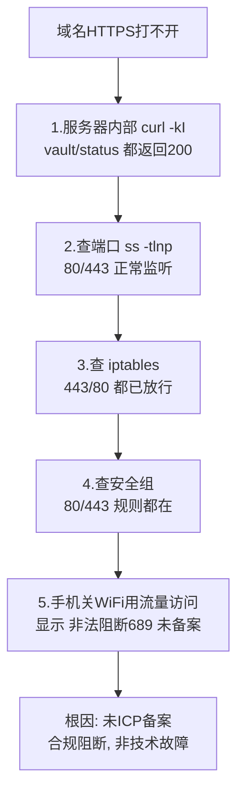
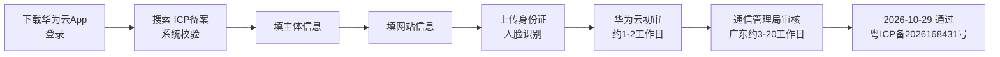

# 07 网站ICP备案

> 定位：国内服务器"上线"的合规必经环节，含一次真实的"未备案被阻断"排障全过程
> 服务器：华为云 Flexus（中国大陆）· 域名 cloud321.cloud
> 备案：2026-10-29 通过（华为云 · 个人备案）· 备案号 **粤ICP备2026168431号** · 状态：✅ 已通过，服务器侧收尾清单见第七节
> 日期：2026-10-19 提交 · 2026-10-29 通过

---

## 一、什么是 ICP 备案，为什么必须做

- **ICP 备案**：使用**中国大陆节点服务器**对外提供互联网信息服务（网站），必须先在**服务器提供商处**提交备案，由工信部/通信管理局审核，通过后取得**备案号**；
- 备案**跟着服务器走**：华为云服务器就在华为云备、阿里云就在阿里云备；
- 海外/中国香港服务器**不需要**备案；
- 个人备案主体下可以备**多个网站**，但一个账号只能有一个主体。

> [!important] 备案实际有"两个"
> 1. **ICP 备案**（工信部，本文重点，通过华为云提交）
> 2. **公安备案**（ICP 通过后 **30 日内**，在全国互联网安全管理服务平台 `beian.mps.gov.cn` 办理，个人网站一般也要）

---

## 二、真实经历：未备案被阻断（完整排查过程）

### 2.1 现象
- 域名 `https://vault.cloud321.cloud`、`https://status.cloud321.cloud` 突然**都打不开**；
- 此前几天能访问（云厂商合规检测有延迟，并非永久放行）。

### 2.2 排查过程（由内到外）

### 2.3 关键判断
- **内部正常 + 外部不通 + 防火墙（安全组/iptables）都放行** → 问题不在技术层，而在**合规层**；
- 手机页面原文：`非法阻断689`、`您的网站尚未进行备案，网站需要先备案后接入`。

### 2.4 阻断的边界（实测）
| 访问方式 | 结果 |
|---|---|
| 域名 80/443（vault/status.cloud321.cloud） | ❌ 被阻断 |
| 公网IP + 非标端口 `:8080` | 能访问（但 Vaultwarden 需 HTTPS，提示"未使用安全上下文"） |
| 公网IP + `:3001`（Kuma） | ✅ 正常 |
| 公网IP + `:81`（NPM） | ✅ 正常 |

> 结论：阻断主要针对**域名的 80/443**；IP+非标端口可作为备案期间的演示入口。
>
> **现状（2026-10-29）**：备案通过后，域名 80/443 的合规阻断已解除；上表"❌ 被阻断"是备案前的历史实测结果，不再代表当前状态。

---

## 三、备案条件核对

| 条件 | 我的情况 |
|---|---|
| 华为云中国站实名认证账号 | ✅ |
| 域名注册者为本人、已实名 | ✅ cloud321.cloud |
| 域名后缀可备案 | ✅ `.cloud` 在工信部许可名单（许可证号 D2-0002） |
| 服务器包周期 **≥3 个月** | ✅ 包年 1 年 |
| 公网 IP | ✅ |

---

## 四、材料清单（全程电子化，不用打印）

### 手边要有的
- 本人身份证原件（拍正反面）
- 智能手机（华为云 App，光线充足做人脸识别）
- 能收短信的本机号码

### 事先要想好的信息
1. **网站名称**（准备 2~3 个备选，可能被驳回）：
   - 稳妥："俊豪的学习笔记"、"俊豪的个人主页"、"小唐的学习空间"
   - 避免：公司、中心、平台、运维、监控、论坛、社区、新闻等词
2. 网站服务内容：选"技术学习 / 个人主页"
3. 身份证住址（一字不差）
4. 实际通信地址 + 邮编（如与身份证不同）
5. 常用邮箱
6. 应急联系人（部分管局要：姓名 + 电话）

### 其他
- 真实性核验单、承诺书：App 内手写**电子签名**，不用打印
- 若域名核验不通过：去阿里云下载电子域名证书上传（不用打印）

---

## 五、备案流程（华为云 App）

具体：
1. 应用商店下载"华为云"App，用购买服务器账号登录；
2. 控制台或搜索"ICP备案" → 开始备案/新增网站；
3. 自动校验服务器、域名；
4. 填主体（个人）信息；
5. 填网站信息（名称、内容）；
6. 上传身份证 + 人脸识别；
7. 等待华为云初审 → 管局审核；
8. 通过后短信/邮件通知，拿到备案号：**粤ICP备2026168431号**（以华为云备案后台与工信部备案系统显示为准，悬挂前核对编号逐字一致）。

---

## 六、注意事项

### 备案期间（已完成，备查）

- **个人备案内容限制**：不得做经营性、论坛、新闻、医疗等；技术学习/个人工具/运维演示可以；
- **网站名称**要中性、符合个人站规范；
- 保持手机畅通，可能接核验电话，要能答出自己填的信息；
- 被驳回按提示改完重新提交，不影响后续。

### 备案通过后的强制义务（2026-10-29 起适用）

- **悬挂备案号**：网站主页底部标明备案编号 `粤ICP备2026168431号`，并链接到 `https://beian.miit.gov.cn/`（《非经营性互联网信息服务备案管理办法》第十三条）；本项目对外内容站点是 Halo 博客，备案号挂在 Halo 主题页脚；
- **公安备案**：ICP 通过后 **30 日内**（截止 **2026-11-28**）在全国互联网安全管理服务平台 `beian.mps.gov.cn` 办理；
- **个人备案边界**：对外主页只放个人文章/学习笔记；Vaultwarden、Alist、Grafana 等自用后台放在子域名、不做公开入口和开放注册；不得出现企业、经营性、论坛评论类功能；
- **域名解析必须指向备案接入商（华为云）的服务器**，换接入商需先做新增接入备案；
- 备案通过后信息同步可能有延迟，当天域名仍打不开先等一个工作日，不要急着改配置。

---

## 七、备案通过后的收尾清单（2026-10-29）

### 7.1 已解除的限制

- 域名 `*.cloud321.cloud` 的 **80/443 合规阻断已解除**，可以走 NPM 对外提供 HTTPS 站点；
- 80 端口可达后，新站点证书可直接用 **HTTP-01** 验证签发；**通配符证书**仍沿用 DNS-01（阿里云 RAM 子账号，见 [[06 Uptime Kuma服务状态监控]] §6）；
- 此前"IP + 非标端口"只是备案期间的临时演示入口，收尾完成后统一收敛到 NPM 80/443，管理端口（81）与监控端口（9090/9100）不暴露公网。

### 7.2 服务器侧待办（自己动手，逐项勾选）

> 现状：备案刚通过，服务器尚未切换；以下完成前，对外演示仍用 IP + 端口。

- [ ] **等待备案信息同步**：当天域名仍打不开属正常，最多等一个工作日再排查，不要先改 NPM/防火墙；
- [ ] **核对 DNS 解析**：阿里云 DNS 确认泛解析 `*.cloud321.cloud` 与根记录 `@` 的 A 记录指向华为云 EIP；`nslookup vault.cloud321.cloud 223.5.5.5` 验证；
- [ ] **核对防火墙**：华为云安全组与宿主机 iptables 放行 80/443；81（NPM 后台）、9090（Prometheus）、9100（Exporter）不对公网；
- [ ] **NPM 逐站补反代 + 证书**（目标映射，端口以各服务笔记为准）：

  | 子域名 | 后端 | 备注 |
  |---|---|---|
  | `vault.cloud321.cloud` | `172.17.0.1:8080` | 勾选 WebSocket、Force SSL、HTTP/2 |
  | `status.cloud321.cloud` | `172.17.0.1:3001` | Kuma 状态页 |
  | `blog.cloud321.cloud` | `172.17.0.1:8090` | Halo，探活路径 `/console` |
  | `files.cloud321.cloud` | `172.17.0.1:5244` | Alist（10 笔记旧写 `drive.`，统一时以 NPM 实际域名为准） |
  | `monitor.cloud321.cloud` | `172.17.0.1:3000` | Grafana，建议加访问密码，不做公开入口 |

- [ ] **逐站验证**：浏览器访问各 `https://<子域名>.cloud321.cloud`，地址栏小锁正常；`curl -I https://<子域名>.cloud321.cloud` 返回 200/302；
- [ ] **Halo 页脚悬挂备案号**：主题页脚添加 `粤ICP备2026168431号`，链接 `https://beian.miit.gov.cn/`；
- [ ] **Vaultwarden 后台**：服务器地址改为 `https://vault.cloud321.cloud`，确认 WebSocket 实时同步正常；
- [ ] **Kuma 监控切换**：监控目标从 `http://IP:端口` 改为 `https://<子域名>.cloud321.cloud`，同时监控证书到期；
- [ ] **个人备案边界自查**：关闭各服务公开注册；Grafana/Alist/Vaultwarden 不做公开导航入口；主页只展示 Halo 博客内容。

### 7.3 合规待办

- [ ] **公安备案**：2026-11-28 前在 `beian.mps.gov.cn` 提交，完成后把公安备案号一并挂到 Halo 页脚；
- [ ] 备案主体、网站内容保持与备案填报一致；后续更换服务器接入商前先办新增接入备案。

---

## 八、关键经验

> 1. 国内服务器域名开 80/443，**ICP 备案是硬门槛**，项目设计初期就要把备案时间算进去；
> 2. 排障遇到"内部正常、外部不通、防火墙都放行"，要想到**合规/备案阻断**，而不是只盯技术；
> 3. 云平台有**双层防火墙**：安全组（外层）+ 服务器内 iptables（内层），都要查；
> 4. 备案是"理解国内互联网合规"的真实经验，面试讲"我知道为什么要备案、流程是什么"，是加分项；
> 5. **备案通过 ≠ 网站自动上线**：阻断解除后还要完成 NPM 反代、HTTPS 证书、页脚备案号悬挂、公安备案这一整套收尾，备案只是合规准入的第一步。
