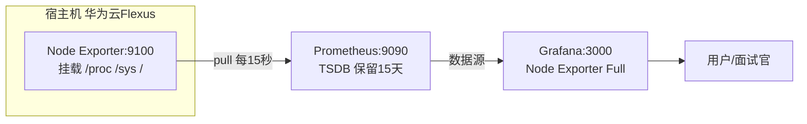

# 08 Grafana + Prometheus 资源监控

> 定位：CloudLab 的"主机资源监控"，面试官可实时查看服务器 CPU/内存/磁盘/负载图表
> 服务器：华为云 Flexus · 目录 `/opt/cloudlab/monitor`
> 日期：2026-10-19

---

## 一、项目介绍

一套**白盒指标监控**，由三个开源组件组成，是云原生监控的事实标准：

| 组件 | 职责 | 端口 |
|---|---|---|
| **Node Exporter** | 采集**主机指标**（CPU/内存/磁盘/网络/负载），暴露给 Prometheus | 9100 |
| **Prometheus** | 定时**拉取（pull）**指标，存为时间序列（TSDB） | 9090 |
| **Grafana** | 可视化，把 Prometheus 数据做成仪表盘（对外展示） | 3000 |

### 与 Uptime Kuma 的分工

| | Uptime Kuma（06） | 本套（08） |
|---|---|---|
| 视角 | 黑盒：服务/网站**是否可用** | 白盒：主机**资源多少** |
| 判断 | 探测状态码（Up/Down） | 采集指标（CPU/内存数值） |
| 数据 | 响应时间、可用率 | 时序指标、趋势 |

### 部署架构



---

## 二、要做什么

1. 评估内存，加 Swap 兜底
2. 一个 Compose 部署三个容器（只对外暴露 Grafana）
3. 配置 Prometheus 采集 Node Exporter
4. Grafana 添加 Prometheus 数据源
5. 导入现成 Node Exporter 仪表盘
6. （收尾项）NPM 反代 `monitor.cloud321.cloud`；**注意必须先设 `GF_SERVER_ROOT_URL`**，否则域名访问时登录会被重定向回 `localhost` —— 完整步骤见 [[12 根域名门户与域名收尾配置]] 第五、六节

---

## 三、可能遇到的问题

1. 2G 内存紧张、无 Swap → OOM 风险
2. Node Exporter 不挂载宿主机就读不到真实指标
3. 数据源 URL 填 127.0.0.1 会连不通
4. 导入仪表盘大量空白/No data（时间窗口）
5. 域名 80/443 曾被未备案阻断（2026-10-29 备案通过后解除）

---

## 四、实际部署经历

### 1. 内存评估 + 加 Swap

```bash
free -h
docker stats --no-stream
```

- available 1.1G，现有容器（Kuma 164MB、Vaultwarden 22MB、NPM 98MB）共约 283MB；
- 但**无 Swap**，峰值有 OOM 风险，加 1G Swap 兜底：

```bash
dd if=/dev/zero of=/swapfile bs=1M count=1024
chmod 600 /swapfile
mkswap /swapfile
swapon /swapfile
grep -q '/swapfile' /etc/fstab || echo '/swapfile none swap sw 0 0' >> /etc/fstab
```

### 2. 采集配置 prometheus.yml

```yaml
global:
  scrape_interval: 15s        # 采集间隔
  evaluation_interval: 15s

scrape_configs:
  - job_name: 'prometheus'
    static_configs:
      - targets: ['localhost:9090']
  - job_name: 'node'
    static_configs:
      - targets: ['node-exporter:9100']   # 用服务名
```

### 3. 编排 docker-compose.yml

```yaml
services:
  node-exporter:
    image: prom/node-exporter:latest
    container_name: node-exporter
    restart: unless-stopped
    command:
      - '--path.procfs=/host/proc'
      - '--path.sysfs=/host/sys'
      - '--path.rootfs=/rootfs'
      - '--collector.filesystem.mount-points-exclude=^/(sys|proc|dev|host|etc)($$|/)'
    volumes:
      - /proc:/host/proc:ro
      - /sys:/host/sys:ro
      - /:/rootfs:ro
    expose: ['9100']

  prometheus:
    image: prom/prometheus:latest
    container_name: prometheus
    restart: unless-stopped
    command:
      - '--config.file=/etc/prometheus/prometheus.yml'
      - '--storage.tsdb.path=/prometheus'
      - '--storage.tsdb.retention.time=15d'
      - '--web.enable-lifecycle'
    volumes:
      - ./prometheus/prometheus.yml:/etc/prometheus/prometheus.yml:ro
      - prometheus-data:/prometheus
    expose: ['9090']

  grafana:
    image: grafana/grafana:latest
    container_name: grafana
    restart: unless-stopped
    ports: ['3000:3000']
    volumes:
      - grafana-data:/var/lib/grafana

volumes:
  prometheus-data:
  grafana-data:
```

要点：
- **Node Exporter 挂载宿主机** `/proc /sys /`（只读），并改 `--path.procfs` 等，才能读到真实主机指标；
- **`expose`（非 ports）**：Prometheus/Node Exporter 只在内部网络可见，**不暴露公网**；
- 三容器同一网络，用**服务名**互通；
- **只对外暴露 Grafana 3000**；
- 保留期 **15 天**，省内存和磁盘。

### 4. 启动 + 验证采集

```bash
docker-compose up -d
docker-compose ps
# targets 健康
docker exec prometheus wget -qO- http://localhost:9090/api/v1/targets | grep -oE '"(job|health)":"[^"]*"'
# 指标样例
docker exec node-exporter wget -qO- http://localhost:9100/metrics | grep node_cpu_seconds_total
```

结果：node、prometheus 两个 job 均 **up**；`node_cpu_seconds_total`、`node_load1` 有数据。

### 5. 放行 3000 + 登录 Grafana

```bash
iptables -I INPUT -p tcp --dport 3000 -j ACCEPT
service iptables save
```

安全组入方向也加 3000。访问 `http://公网IP:3000`，默认 **admin/admin**，首次强制改密。

### 6. 添加 Prometheus 数据源

- 左侧 **Connections → Data sources → Add data source → Prometheus**
- **Prometheus server URL**：`http://prometheus:9090`（**服务名**，非 127.0.0.1）
- Save & test，出现 "Successfully queried the Prometheus API"。

### 7. 导入仪表盘

- **Dashboards → Import**，输入模板 ID **1860**（Node Exporter Full）
- 选择 Prometheus 数据源 → Import
- 立即看到全套主机监控图。

### 8. 时间窗口 No data + 指标解读

- **现象**：Last 24 hours 窗口大量空白、P 显示 No data；
- **原因**：数据从现在才开始采集，24 小时窗口里只有最右侧有数据；
- **解决**：时间范围改成 **Last 15 minutes**，全部填充；
- 验证 `node_load1 = 0.14`（采集正常，只是窗口问题）。

当前指标：CPU 2核/2.7%、内存 2GiB/64.1%、Swap 1024MiB/0%、磁盘 39GiB/29.9%、Uptime 1.3 天。

---

## 五、核心概念深入（面试重点）

### 1. Pull（拉）模型 vs Push（推）

| | Pull（Prometheus） | Push（Zabbix Agent 等） |
|---|---|---|
| 方向 | Server **主动定时来拉**目标 | Agent **主动上报**给 Server |
| 优点 | 集中控制、目标健康可见（`up`）、易调试 | 适合短任务/ NAT 后目标 |
| 缺点 | 不适合短命任务（用 Pushgateway 补） | 服务端被动、难发现失联 |

### 2. 指标类型

| 类型 | 特点 | 例子 |
|---|---|---|
| **Counter** | 单调递增，只增不减（重启归零） | `node_cpu_seconds_total`、网络收发字节 |
| **Gauge** | 瞬时值，可大可小 | `node_load1`、`node_memory_MemFree` |
| **Histogram** | 采样分布，分桶计数 | 请求延迟分布 |
| **Summary** | 直接给分位数 | P99 延迟 |

### 3. Exporter 模式

- Exporter 把各系统/服务的数据转换成 Prometheus 文本格式，在 HTTP 端点（`/metrics`）暴露；
- 常见：Node Exporter（主机）、MySQL Exporter、Blackbox Exporter（黑盒）；
- Prometheus 只需拉取对应端点。

### 4. PromQL 基础（看懂仪表盘）

```promql
up                                              # 目标是否在线(1/0)
node_load1                                      # 1分钟负载
node_memory_MemAvailable_bytes / node_memory_MemTotal_bytes * 100   # 可用内存%
100 - (avg by(instance)(rate(node_cpu_seconds_total{mode="idle"}[5m])) * 100)  # CPU使用率
```

- `rate()`：求 Counter 每秒增长率（只用于 Counter）；
- `[5m]`：取最近 5 分钟窗口；
- `by(instance)`：按实例分组聚合。

### 5. TSDB 与保留期

- Prometheus 内置**时序数据库（TSDB）**，数据按"指标名+标签+时间戳"存储；
- `--storage.tsdb.retention.time=15d` 控制保留时长，小服务器设短以省空间；
- 长期存储可对接 Thanos、VictoriaMetrics（单机学习用不到）。

---

## 六、踩坑记录与关键经验

| 问题 | 根因 | 解决 |
|---|---|---|
| OOM 风险 | 2G 内存无 Swap | 加 1G Swap |
| 主机指标缺失 | 未挂载宿主机命名空间 | 挂载 /proc /sys / 并改路径 |
| 数据源连不通 | 填了 127.0.0.1 | 用服务名 `prometheus:9090` |
| 大量 No data | 时间窗口 24h、数据刚采 | 改 15 分钟，等待 |
| 域名访问不了 | 未备案 | 2026-10-29 备案通过（07），阻断解除；反代切换见 07 第六章 |
| 整机 wa 飙高、IO 拥塞 | Grafana 3000 以 `0.0.0.0` 直绑公网被境外扫描直连，2G 内存排队超时后内部任务反复冷读插件与索引 | 安全组先收口止血；后续清理无用插件、加 `mem_limit`、端口收口到 NPM 后面；完整复盘见 [[16 Grafana公网暴露触发IO饱和排障实录]]，通用排查方法见 [[03 Linux-IO拥塞排查方法论与proc采样工具集]] |

> 核心经验：
> 1. Prometheus 是 **Pull 模型**，目标暴露 `/metrics` 即可被采集；
> 2. 容器采集宿主机指标，必须**挂载宿主命名空间**；
> 3. 内部服务用 `expose` 收敛、只暴露必要端口，缩小攻击面；
> 4. 监控数据需要时间积累，时间窗口要匹配数据采集时长。

---

## 七、项目不足与扩展

- 仅监控单机，未做多目标/服务发现；
- 未配置**告警规则**（Prometheus Alertmanager + Grafana Alerting 可扩展）；
- 数据保留短（15天），无长期存储；
- 对外访问现状（2026-10-29 实测）：`monitor.cloud321.cloud` **尚未建反代规则**，访问返回 NPM 默认页、443 无证书；当前仍用 `http://公网IP:3000` 直连。
- 接入方案见 [[12 根域名门户与域名收尾配置]]：改 `GF_SERVER_ROOT_URL` → NPM 建规则 + 签证书 → 开 Force SSL；对外开放采用**匿名只读（Viewer）**，管理仍用 admin 登录。
- Grafana 属展示型后台，公开暴露的取舍与替代方案（分享快照）见 12 第六节。
- 可增加 MySQL Exporter、Nginx Exporter 等，覆盖更多服务。
- **2026-10-30 线上事故补充**：3000 直绑公网被境外扫描触发整机 IO 饱和，事件经过、根因链条与未完成整改（无用插件清理、`mem_limit`、端口收口）见 [[16 Grafana公网暴露触发IO饱和排障实录]]；本篇 §4.3 的 `ports: ['3000:3000']` 是调试期写法，生产态应按该篇第七章收口。
