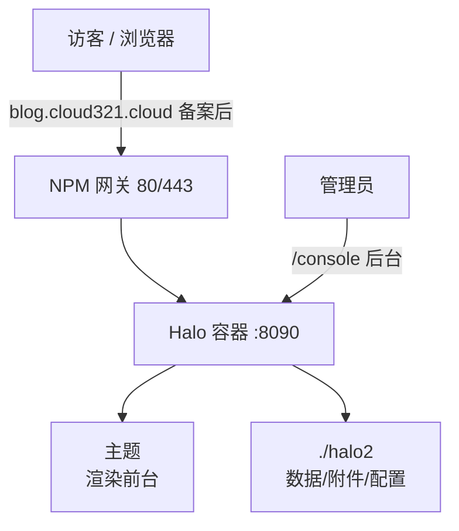

# 09 部署 Halo 博客

> 定位：CloudLab 的"内容/站点服务"，一个可深度定制的个人博客与建站系统
> 服务器：华为云 Flexus · 目录 `/opt/cloudlab/halo`
> 日期：2026-10-20

---

## 一、项目介绍

**Halo** 是一个强大易用的**开源建站工具 / 博客系统**：支持文章与页面管理、Markdown 编辑、主题与插件生态、评论、附件管理、多用户权限等，可快速搭建个人博客、文档站或内容站点。

- 技术栈：Java（新版 JRE 21）、Spring Boot WebFlux（Reactive / Netty）、默认 H2 数据库（也可接 MySQL/PostgreSQL）
- 运行端口：8090（后台 `/console`，前台 `/`）
- 镜像：`halohub/halo:2`（社区版）
- 规划域名：`blog.cloud321.cloud`

### 架构



### 内存可行性（关键决策）

Halo 官方建议至少 1GB RAM，但默认 JVM 堆仅 **256MB**（`-Xmx256m`），实际容器总占用约 **350~400MB**。

- 部署前：可用 839M + 1G Swap
- 部署后实测：Halo 353MB，整体可用 478M、Swap 未动用 → ✅ 可行

---

## 二、要做什么

1. Docker Compose 部署 Halo，限制 JVM 与容器内存
2. 初始化站点、创建管理员
3. 安装并启用主题（前台首页依赖主题）
4. 写测试文章、体验后台
5. 接入 Uptime Kuma 监控
6. 备案后通过 NPM 反代到 `blog.cloud321.cloud`

---

## 三、可能遇到的问题

1. Java 应用内存占用较大，需要限制（JVM + 容器内存上限）
2. 监控 URL 误填 `https`（Halo 直连是 HTTP）
3. 对外服务该用"公网/域名"还是"内网"监控
4. 根路径 `/` 返回 **404**（没有安装主题）
5. 主题从应用市场下载可能慢/失败
6. 备案期间域名 80/443 被阻断

---

## 四、实际部署经历

### 1. 编写 docker-compose.yml

```yaml
services:
  halo:
    image: halohub/halo:2
    container_name: halo
    restart: always
    ports:
      - "8090:8090"
    volumes:
      - ./halo2:/root/.halo2
    environment:
      - JVM_OPTS=-Xmx256m -Xms256m
    mem_limit: 512m
```

两道内存保险：
- `JVM_OPTS=-Xmx256m -Xms256m`：限制 JVM 堆内存；
- `mem_limit: 512m`：给容器设硬性上限，防止内存失控影响其他服务。

### 2. 启动并验证

```bash
docker-compose up -d
docker stats --no-stream
# halo  353.7MiB / 512MiB
free -h
# 整体可用 478M，Swap 0（未动用）
docker logs halo
# Started Application in 11.239 seconds，Netty started on port 8090
```

### 3. 放行端口

```bash
iptables -I INPUT -p tcp --dport 8090 -j ACCEPT
service iptables save
```
华为云安全组入方向同样放行 TCP 8090。

### 4. 初始化

浏览器访问 `http://服务器公网IP:8090/console`，按向导设置站点标题、管理员账号密码，登录成功。

### 5. 接入监控踩坑

**坑①：协议误填 https**
- 监控 URL 填成 `https://服务器公网IP:8090`，但 8090 是 HTTP 无 TLS，握手失败 → 故障。
- 改回 `http://` 即可。

**坑②：对外服务的监控路径选择**
- 内部服务（NPM、Alist）：用内网 `http://172.17.0.1:端口`，只确认服务存活；
- 对外服务（Halo、Grafana、Vault）：用公网/域名，**模拟用户真实访问路径**，能发现入口层故障（安全组误删、备案阻断、NPM 配错）。
- 监控 URL 写什么协议，Kuma 就按什么协议探测，不会自动转换。

**坑③：根路径监控报 ECONNREFUSED / 重定向**
- 临时用 `http://172.17.0.1:8090/console` 可绕过（后台路径 302 跳登录，正常）。

### 6. 根路径 404 —— 根因是没装主题

```bash
curl -I http://172.17.0.1:8090/
# HTTP/1.1 404 Not Found
curl -I http://172.17.0.1:8090/console
# 302 Location: /login?authentication_required（服务正常）
```

**根因**：Halo 前台首页完全由**主题**渲染，全新安装没有主题，根路径无内容可渲染 → 404。

**解决**：后台 → 外观 → 主题 → 应用市场安装一个主题（如 Earth、Vite、JoJo、Pinghsu）→ 启用，根路径立即恢复正常。

### 7. 最终状态

- 根路径 `http://服务器公网IP:8090/` 正常显示博客首页；
- Kuma 监控改回根路径，6 个监控项全部绿色。

### 8.发表文章很慢

**现象**：发表文章时，CPU负载低，但wa很高。主机内存和swap正常。

**根因**：容器 512MiB 的总限额对整个 Java 进程树过于紧张

**解决**：
**动态扩容容器内存限制（不重启容器）：**

```bash
docker update --memory 662m 31597ba84f7c
```


---

## 五、常用功能

| 功能 | 说明 |
|---|---|
| 文章 | Markdown 写作，分类、标签、置顶、草稿 |
| 页面 | 独立页面（关于我、友链等） |
| 外观/主题 | 更换前台主题，应用市场 |
| 插件 | 评论增强、搜索、SEO、统计等 |
| 附件 | 图片/文件上传，文章引用 |
| 评论 | 内置评论，可审核 |
| 用户 | 多用户、角色权限 |
| 备份 | 站点数据备份/迁移 |

---

## 六、备案后

1. Halo 后台"外部访问地址"改为 `https://blog.cloud321.cloud`；
2. NPM 添加反代：`blog.cloud321.cloud` → `172.17.0.1:8090`，申请证书、勾选 Force SSL / HTTP/2；
3. Kuma 监控切换为 `https://blog.cloud321.cloud`，可同时监控证书到期。

---

## 小结

- Halo 是 Java 应用，**内存控制是第一要务**：JVM 堆 + 容器上限双重限制；
- 监控要**模拟真实路径**：对外服务用公网/域名，对内服务用内网；
- 前台 404 不是故障，是**没装主题**；
- 至此 CloudLab 五大类服务 + 博客全部上线。
