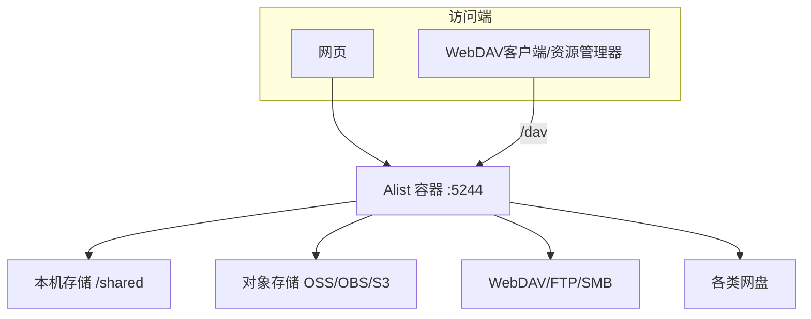

# 10 Alist 云盘文件服务

> 定位：CloudLab 的"文件服务 + 多存储聚合 + WebDAV"，把服务器目录和对象存储统一成网页网盘
> 服务器：华为云 Flexus · 目录 `/opt/cloudlab/alist`
> 日期：2026-10-19

---

## 一、项目介绍

**Alist** 是一个开源的**多存储网盘 / 文件列表程序**：把本地目录、对象存储、各类网盘、FTP/SMB 等多种来源的存储，统一挂载到一个网页界面，支持浏览、上传下载、分享、在线预览、离线下载，并通过 **WebDAV** 标准协议对外暴露。

- 技术栈：Go、Docker、WebDAV、S3 兼容对象存储
- 运行端口：5244
- 规划域名：`files.cloud321.cloud`（旧规划名 `drive.`，以 NPM 最终配置为准）
- 镜像：`xhofe/alist`

### 多存储聚合架构



### 为什么选 Alist（内存决策）

| 服务 | 内存 | 结论 |
|---|---|---|
| Halo（Java） | 300~500MB | ❌ 2G 内存紧张，暂缓 |
| **Alist（Go）** | **30~50MB** | ✅ 轻量，优先部署 |

---

## 二、要做什么

1. Docker 部署 Alist，数据持久化
2. 挂载本机存储（共享目录）
3. 体验文件上传
4. 用 Windows 原生 WebDAV 挂载成网络位置
5. 了解常用功能（多存储、分享、预览、离线下载、权限）

---

## 三、可能遇到的问题

1. 初始管理员密码需从日志获取
2. 根目录上传报 `storage not found`
3. 只读挂载不能上传
4. Windows 原生 WebDAV 默认拒绝 HTTP（需改注册表）
5. 域名 80/443 曾受未备案阻断（2026-10-29 备案通过后解除）

---

## 四、实际部署经历

### 1. 编排文件、启动

```bash
mkdir -p /opt/cloudlab/alist && cd /opt/cloudlab/alist
cat > docker-compose.yml << 'EOF'
services:
  alist:
    image: xhofe/alist:latest
    container_name: alist
    restart: unless-stopped
    ports:
      - '5244:5244'
    volumes:
      - ./data:/opt/alist/data
      - /opt/cloudlab/shared:/mnt/shared:ro
    environment:
      - PUID=0
      - PGID=0
      - UMASK=022
EOF

mkdir -p /opt/cloudlab/shared
echo "CloudLab Alist 测试文件" > /opt/cloudlab/shared/readme.txt

iptables -I INPUT -p tcp --dport 5244 -j ACCEPT
service iptables save
docker-compose up -d
```

### 2. 获取初始密码

```bash
docker logs alist 2>&1 | grep -A2 'password'
# Successfully created the admin user and the initial password is: xxxxx
```

- 默认账号 **admin**，密码随机生成，登录后改密；
- 日志里 `Transmission failed` 是离线下载工具未配置，不影响使用，可忽略。

### 3. 挂载本机存储

- 网页登录 → 管理 → 存储 → 添加：
  - 驱动：**本机存储（Local）**
  - 显示文件夹名称（挂载路径）：`/shared`
  - 根文件夹路径：`/mnt/shared`
- 保存后首页可见 `shared` 文件夹。

> 注意区分："挂载路径"是 Alist 网页里显示的路径；"根文件夹路径"是**容器内**实际路径。

### 4. 踩坑：根目录上传报错

- **现象**：在根目录上传，报 `failed get storage: storage not found; rawPath: /cloud`；
- **根因**：Alist 根目录只是**挂载点列表，本身不是存储**；上传带 `cloud/` 前缀时，试图在根目录创建无存储的路径；
- **解决**：先**进入 `shared` 文件夹**，在存储内部再上传；选文件时不选文件夹本身，避免带路径前缀。

### 5. 去掉只读以支持上传

```bash
sed -i 's|/mnt/shared:ro|/mnt/shared|' docker-compose.yml
docker-compose up -d
```

- 配置在 `./data` 中，重建不丢失；
- 去掉 `:ro` 后即可在网页上传、新建、删除；
- 验证：`ls -l /opt/cloudlab/shared`。

### 6. WebDAV 挂载（Windows 原生）

Windows 自带 WebDAV 客户端默认只允许 HTTPS，需改注册表支持 HTTP：

```powershell
# 1. 允许 Basic Auth over HTTP（默认 1=仅SSL；2=允许HTTP）
Set-ItemProperty -Path "HKLM:\SYSTEM\CurrentControlSet\Services\WebClient\Parameters" -Name BasicAuthLevel -Value 2
# 2. 启动 WebClient 服务
Start-Service WebClient
# 3. 打开"添加网络位置"向导
Start-Process rundll32.exe -ArgumentList "shwebsvc.dll,AddNetPlaceRunDll"
```

在向导中：
- 网络地址：`http://服务器公网IP:5244/dav`
- 账号：admin / Alist 密码
- 完成后"此电脑"出现网络位置，可像本地盘一样读写。

### 7. 备案通过后的状态（2026-10-29）

- 域名 80/443 曾被未备案阻断（全过程见 [[07 网站ICP备案]]），备案通过后阻断解除；
- `files.cloud321.cloud` 已完成 NPM 反代 + HTTPS 证书，网页走 `https://files.cloud321.cloud`、WebDAV 走 `https://files.cloud321.cloud/dav`；
- `http://公网IP:5244` 仍可访问，但仅作为排障时的直连通道，不再对外演示；
- 待办：把站点 80 端口补上 Force SSL 强制跳转（清单见 [[12 根域名门户与域名收尾配置]] 第七节）；Alist 为自用后台，不做公开导航入口。

---

## 五、常用功能

### 1. 多存储聚合（核心）
支持 30+ 驱动：
- 本机、FTP/SFTP、SMB、WebDAV
- 网盘：阿里云盘、百度、夸克、115、OneDrive、Google Drive
- **对象存储（S3 兼容）**：阿里云 OSS、腾讯云 COS、**华为云 OBS**、AWS S3、MinIO
- 可添加多个存储，分别挂到不同路径

### 2. WebDAV
- 路径 `/dav`，所有挂载存储统一暴露
- 电脑/手机/笔记软件可用标准协议挂载

### 3. 文件管理
- 浏览、上传（含拖拽）、新建、重命名、复制、移动、删除
- 单文件 / 多文件打包下载
- 全局搜索（后台开启索引加速）

### 4. 文件分享
- 右键生成分享链接，可设密码、有效期，对方无需账号

### 5. 在线预览
- 图片、视频、音频、PDF、文本/代码在线预览
- 视频在线播放（转码需 ffmpeg）

### 6. 离线下载
- HTTP/磁力链接，配合 Aria2/Transmission/qBittorrent
- 可做服务器文件中转站

### 7. 多用户与权限
- 建用户、分配角色、**基础路径**（限定可见目录）、关闭上传/分享

### 8. 后台
- 签名（防盗链）、元信息/索引、备份与恢复、站点设置

---

## 六、核心概念（面试重点）

- **WebDAV**：基于 HTTP 的文件读写协议，把 Web 服务器变成可写网络盘；
- **S3 兼容对象存储**：Alist 可对接 OBS/OSS/MinIO，体现云存储知识；
- **多存储聚合**：统一不同协议/位置的文件入口，是存储网关思路；
- **挂载路径 vs 实际路径**：应用层映射与容器内路径分离。

---

## 七、踩坑记录与关键经验

| 问题 | 根因 | 解决 |
|---|---|---|
| 初始密码未知 | 随机生成 | 从 `docker logs` 获取 |
| 根目录上传失败 | 根目录非存储 | 进入挂载路径再上传 |
| 不能上传 | 只读挂载 | 去掉 `:ro` 重建 |
| WebDAV 连不上 | 默认仅 HTTPS | 改 BasicAuthLevel=2 |
| 域名打不开 | 未备案 | 2026-10-29 备案通过（07），阻断解除；反代切换见 07 第六章 |

> 核心经验：
> 1. 文件读写必须落在某个**已挂载存储**内，根目录只是挂载点；
> 2. 小内存服务器优先选 Go 这类轻量服务，Java 重应用要看资源；
> 3. Windows 原生 WebDAV 走 HTTP 需开 BasicAuthLevel；
> 4. 标准协议（WebDAV）+ 多存储聚合，是运维"文件服务"的典型方案。

---

## 八、项目不足与扩展

- 目前仅挂载本机目录，未对接真实对象存储（可加 OBS/MinIO）；
- 未配置离线下载工具（Aria2 等）；
- 多用户/权限未细化；
- 对外访问已随备案通过开放；NPM 域名反代列入 [[07 网站ICP备案]] 第六章 收尾实操手册；
- 收尾时在 NPM 配置 `files.cloud321.cloud` 并启用 HTTPS（旧规划名 `drive.cloud321.cloud`，以最终 NPM 配置为准）。
