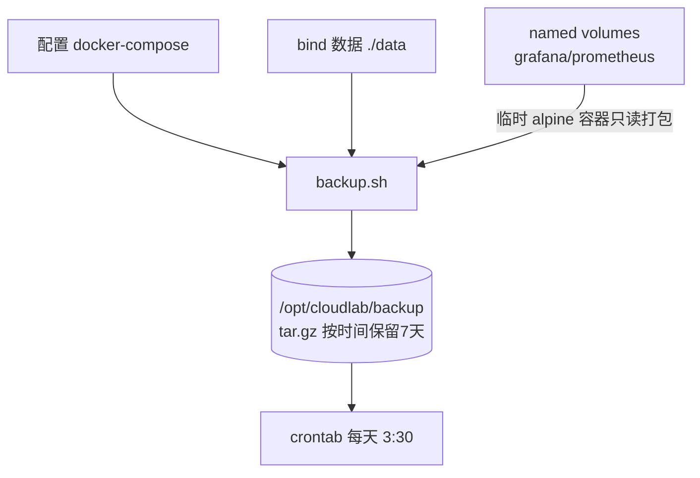
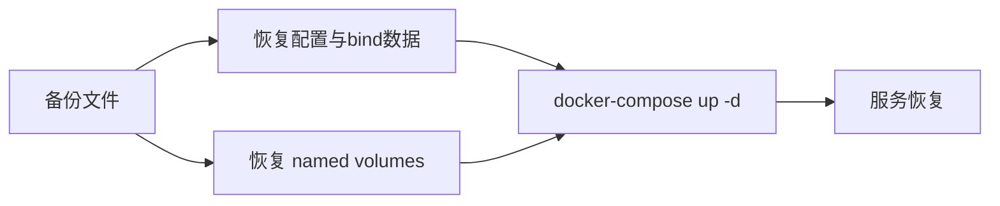

# 11 自动备份与恢复

> 定位：CloudLab 的"数据安全"保障，含备份脚本、恢复流程、定时任务，是运维核心能力体现
> 服务器：华为云 Flexus · 脚本 `/opt/cloudlab/backup/backup.sh`
> 日期：2026-10-19

---

## 一、项目介绍

容器可以随时重建，但**配置和数据是独有的**，一旦误删、磁盘损坏、操作失误就会丢失。备份的目标是"**数据不丢、故障可恢复**"。

- 备份对象：各服务 docker-compose 配置、bind-mount 数据、Docker named volumes
- 备份方式：bash 脚本打包压缩，按时间保留最近 N 份
- 定时执行：crontab 每天 3:30
- 备份位置：`/opt/cloudlab/backup`（本地，后续可扩展异地）

### 备份架构



---

## 二、要做什么

1. 编写备份脚本，覆盖配置、bind 数据、named volumes
2. 记录容器/镜像清单（便于恢复）
3. 加保留策略，自动清理旧备份
4. 验证备份可恢复
5. 配置 crontab 定时执行

---

## 三、可能遇到的问题

1. named volume 不在 cloudlab 目录，普通 tar 打包不到
2. 运行中热备数据库可能不一致
3. 备份只放本地，磁盘损坏会一起丢
4. 定时任务时间/路径写错导致不执行

---

## 四、备份脚本

```bash
#!/bin/bash
set -u

CLOUDLAB_DIR=/opt/cloudlab
BACKUP_DIR=$CLOUDLAB_DIR/backup
RETENTION_DAYS=7
TIMESTAMP=$(date +%Y%m%d-%H%M%S)
LOG_FILE=$BACKUP_DIR/backup.log

log() {
    echo "[$(date '+%Y-%m-%d %H:%M:%S')] $*" | tee -a "$LOG_FILE"
}

mkdir -p "$BACKUP_DIR"
log "==================== 开始备份 $TIMESTAMP ===================="

# 1. 备份 cloudlab 目录（排除 backup 自身）
FILES_ARCHIVE=$BACKUP_DIR/cloudlab-files-$TIMESTAMP.tar.gz
log "1/3 打包 cloudlab 配置与数据..."
tar czf "$FILES_ARCHIVE" --exclude="$BACKUP_DIR" -C /opt cloudlab 2>>"$LOG_FILE"
[ -f "$FILES_ARCHIVE" ] && log "    完成: $(du -h "$FILES_ARCHIVE" | cut -f1)" || log "    失败"

# 2. 备份所有 named volumes（自动发现）
log "2/3 备份 Docker named volumes..."
for vol in $(docker volume ls -q); do
    log "    volume: $vol"
    docker run --rm \
        -v "$vol":/data:ro \
        -v "$BACKUP_DIR":/backup \
        alpine sh -c "tar czf /backup/volume-${vol}-${TIMESTAMP}.tar.gz -C /data ." 2>>"$LOG_FILE"
done

# 3. 记录环境信息
log "3/3 记录环境信息..."
docker ps -a --format '{{.Names}}\t{{.Image}}' > "$BACKUP_DIR/containers-$TIMESTAMP.txt"
docker images --format '{{.Repository}}:{{.Tag}}' > "$BACKUP_DIR/images-$TIMESTAMP.txt"

# 4. 清理过期备份
log "清理 ${RETENTION_DAYS} 天前的备份..."
find "$BACKUP_DIR" -type f \( -name "*.tar.gz" -o -name "*.txt" \) -mtime +$RETENTION_DAYS -print -delete >> "$LOG_FILE" 2>&1

# 5. 汇总
log "本次备份:"
ls -lh "$BACKUP_DIR"/*$TIMESTAMP* | tee -a "$LOG_FILE"
log "磁盘剩余: $(df -h /opt | tail -1 | awk '{print $4}')"
log "==================== 备份完成 ===================="
```

### 脚本逐段讲解

1. **配置变量**：目录、保留天数、时间戳、日志文件；
2. **日志函数**：所有操作带时间戳写入 `backup.log`，可追溯；
3. **打包 cloudlab**：`-C /opt cloudlab` 进入 `/opt` 再打包，保留相对路径；`--exclude` 排除备份目录；
4. **named volume**：`docker run --rm` 起临时 alpine，以只读挂载 volume，在容器内打包到挂载的 backup 目录；
5. **环境清单**：记录容器/镜像，恢复时知道起什么；
6. **保留策略**：`find -mtime +7 -delete` 删除 7 天前的；
7. **汇总**：列出本次备份和磁盘剩余。

### 运行结果（实测）

```
cloudlab-files-...tar.gz        728K   配置+bind数据
volume-monitor_grafana-data...  21M    Grafana 数据
volume-monitor_prometheus-data  955K   Prometheus 数据
containers/images .txt          清单
```

---

## 五、恢复流程（重点）



### 1. 恢复配置与 bind-mount 数据

```bash
# 备份内是 cloudlab/... 相对路径，解到 /opt
tar xzf /opt/cloudlab/backup/cloudlab-files-XXXX.tar.gz -C /opt
```

### 2. 恢复 named volume（以 Grafana 为例）

```bash
# 确保 volume 存在
docker volume create monitor_grafana-data
# 用临时容器把数据解回 volume
docker run --rm \
  -v monitor_grafana-data:/data \
  -v /opt/cloudlab/backup:/backup \
  alpine sh -c "tar xzf /backup/volume-monitor_grafana-data-XXXX.tar.gz -C /data"
```

Prometheus 同理（`monitor_prometheus-data`）。

### 3. 重建容器

```bash
cd /opt/cloudlab/monitor && docker-compose up -d
# 各服务目录依次执行
```

### 4. 验证

- `docker-compose ps` 各容器 Up；
- 登录 Grafana、Vaultwarden 确认数据回来；
- 检查 NPM 配置、Kuma 监控项。

---

## 六、定时任务

```bash
# 每天 3:30 执行（避开整点，先去重再写入）
( crontab -l 2>/dev/null | grep -v 'backup.sh'; echo "30 3 * * * /opt/cloudlab/backup/backup.sh" ) | crontab -
crontab -l
```

- 脚本内部已写日志，可长期查看 `backup.log`；
- 选 3:30 是避开整点高峰，业务低峰期执行。

---

## 七、核心概念（面试重点）

### 1. 备份方式
- **全量备份**：每次备份全部数据（简单、恢复快，但占空间）
- **增量/差异备份**：只备份变化部分（省空间，恢复复杂）
- 我们当前是按天全量、短保留。

### 2. 3-2-1 原则
- **3** 份数据副本；
- **2** 种不同存储介质；
- **1** 份异地（离线/云）。
- 当前只满足"本地多份"，**异地是下一步改进点**。

### 3. RTO / RPO
- **RTO（恢复时间目标）**：故障后多快能恢复（越小越好）；
- **RPO（恢复点目标）**：能容忍丢多久的数据（每天备份 → RPO≈1天）。

### 4. 数据一致性
- **冷备**：先停服务再备份，数据一致但有中断；
- **热备**：运行中备份，可能不一致，靠快照/事务/锁保证；
- 我们直接 tar，对 SQLite（WAL 模式）一般可恢复；关键数据库应 `docker exec` 用 `.backup` 或先停容器。

---

## 八、踩坑记录与关键经验

| 问题 | 根因 | 解决 |
|---|---|---|
| tar 打包不到 volume | volume 不在项目目录 | 临时容器挂载 volume 打包 |
| 备份损坏风险 | 热备数据不一致 | 关键库先停或用专用备份 |
| 定时任务不执行 | 路径/时间写错 | 绝对路径 + crontab -l 检查 |
| 备份只在本地 | 磁盘损坏全丢 | 加异地备份（对象存储） |

> 核心经验：
> 1. **备份必须验证可恢复**，否则等于没备份；
> 2. 用临时容器 + volume 是备份 Docker named volume 的标准方法；
> 3. 定时任务用绝对路径，日志可追溯；
> 4. 思路从"能备份"升级到"能恢复 + 异地 + 有 RTO/RPO"。

---

## 九、项目不足与扩展

- **异地备份（首要）**：脚本里加 `scp` 到其他机器，或上传对象存储（华为云 OBS，用 `obsutil`/S3 兼容接口），满足 3-2-1；
- 关键数据库改用专用一致性备份；
- 可加备份失败告警（钉钉/邮件）；
- 可做全量+增量，降低空间占用；
- 后续与项目 README 一起包装，作为运维"数据安全"能力的完整展示。
