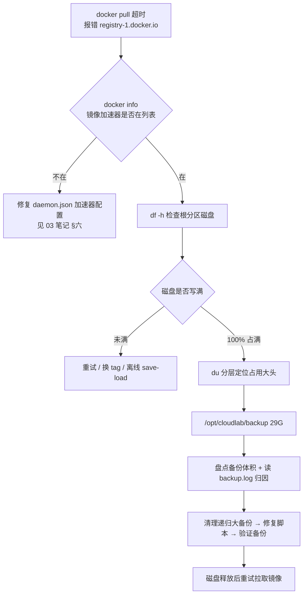

# 13 备份磁盘占满线上排障与备份脚本修复

> 定位：一次由 `docker pull` 超时引出的线上排障。报错指向 Docker Hub 官方源，逐层排查后发现**真实根因不是网络、不是加速器，而是根分区被备份目录写满**；元凶是备份脚本的 `tar --exclude` 路径写法错误，导致备份把旧备份递归打包进新备份。
> 服务器：华为云 Flexus · CentOS 7.9 · 2 核 2G · 公网 EIP `110.41.63.156`
> 备份体系参见 [[11 自动备份与恢复]]；镜像加速器背景参见 [[03 docker云环境配置]] §六。
> 状态：✅ 已修复（2026-10-29，脚本更新、备份恢复正常、磁盘释放约 27G）

---

## 一、这篇笔记讲什么（结论先行）

### 1.1 触发场景

部署根域名门户时，在 `/opt/cloudlab/portal` 目录执行：

```bash
docker pull nginx:alpine
```

多层镜像已经下载完成（进度条到 100%），最后报：

```text
Get "https://registry-1.docker.io/v2/": net/http: request canceled
while waiting for connection (Client.Timeout exceeded while awaiting headers)
```

### 1.2 一句话结论

**报错域名是误导信息。** 加速器配置正常、网络链路也通，真正原因是根分区 40G 已经 100% 写满，镜像层无法落盘解压，收尾阶段失败，错误被 Docker 包装成"连接官方源超时"。

### 1.3 排障主线



### 1.4 本次排障沉淀的判断顺序

镜像拉取失败，按下面顺序排除，不要一上来就换加速器、改 DNS：

1. **加速器配置是否生效**（`docker info` 看 `Registry Mirrors`）；
2. **磁盘是否写满**（`df -h`，成本最低、最容易被忽略）；
3. **网络与加速器缓存**（进度条能否到 100%、其他镜像能否拉取）；
4. 以上都正常，再考虑重试、换 tag、离线导入。

---

## 二、动手前先懂：相关概念与原理

### 2.1 docker pull 的完整流程：下载完成 ≠ 拉取成功


- 进度条跑到 100% 只代表**第②步网络下载完成**；
- 第③步解压、写层、提交都需要磁盘空间；磁盘满时这一步失败，错误经常被包装成网络超时；
- 所以"进度条到 100% 还报错"时，必须先查 `df -h`，不能直接判定为网络抖动。

### 2.2 镜像加速器什么时候会回退官方源

加速器只做镜像层缓存代理：加速器本地有该 tag 的清单和层时走内网；**缓存不全时，Docker 回退到官方 `registry-1.docker.io` 取清单**，国内直连官方容易超时。判断加速器是否生效，唯一可靠依据是 `docker info` 的 `Registry Mirrors` 列表，而不是报错里出现哪个域名。

### 2.3 tar --exclude 的路径匹配规则（本次根因原理，重点）

旧备份脚本打包命令：

```bash
tar czf "$FILES_ARCHIVE" --exclude="$BACKUP_DIR" -C /opt cloudlab
```

其中 `BACKUP_DIR=/opt/cloudlab/backup`。

**关键机制**：`-C /opt` 先把工作目录切换到 `/opt`，归档内部成员路径是**相对路径** `cloudlab/backup/...`；而 `--exclude` 的模式匹配的是**归档成员路径**，不是文件系统上的绝对路径。

| 写法 | 模式内容 | 与归档成员 `cloudlab/backup/...` 是否匹配 | 结果 |
|---|---|---|---|
| 旧版（错误） | `--exclude=/opt/cloudlab/backup`（绝对路径） | 不匹配 | 排除规则静默失效，backup 目录被打进包 |
| 新版（正确） | `--exclude=cloudlab/backup`（相对路径） | 匹配 | backup 目录被排除 |

> 同类坑：`--exclude` 模式不做"前缀自动补全"，路径形态必须和 `-C` 之后归档内的相对路径一致。规则失效时 tar 不报错、不警告，只表现为备份体积异常偏大。

### 2.4 find -mtime +N 保留策略的含义与边界

脚本清理逻辑：

```bash
find "$BACKUP_DIR" -type f \( -name "*.tar.gz" -o -name "*.txt" \) -mtime +7 -print -delete
```

- `-mtime +7`：删除**修改时间超过 7×24 小时**的文件；
- 7 天窗口内的文件无论多大都不会被删；
- 本次事故中清理命令本身一直在正常执行（日志可证），但因为每天新备份都包含过去 7 天的旧备份，**窗口内总量随天数叠加增长**，保留策略拦不住递归膨胀。

### 2.5 gzip 压缩的 CPU 与 IO 特征

volume 备份命令在临时 alpine 容器内执行 `tar czf`，`z` 参数表示 gzip 压缩：

- gzip 是**单线程 CPU 密集型**操作，压缩期间会吃满一个 CPU 核；
- 时序数据库（Prometheus、Grafana）文件多、单文件小，压缩开销高于普通目录；
- 备份结束后 CPU 与 IO 会自行回落，属于一次性资源占用，不是故障；
- 观察指标区分：`top` 里 `us/sy` 高是 CPU 计算，`wa` 高是磁盘 IO 等待。

### 2.6 磁盘满与 OOM 的区别

| 现象 | 本质 | 典型报错 | 排查命令 |
|---|---|---|---|
| 磁盘满 | 块设备无可用空间 | `No space left on device`、写文件失败、镜像解压失败 | `df -h`、`du -xh /` |
| OOM | 内存不足，内核杀进程 | `Out of memory: Killed process`、容器反复重启 | `dmesg -T`、`free -h`、`docker ps` |

`dmesg` 里的 OOM 记录是**历史累计**的，必须按时间戳逐条甄别，不能看到 OOM 字样就判定为本次事故造成。

---

## 三、排障目标清单

1. 判断镜像拉取失败属于"加速器配置错 / 网络抖动 / 磁盘满"中的哪一类；
2. 定位磁盘占用大头，区分 Docker 镜像、容器日志、备份目录、系统日志；
3. 在不影响 8 个运行容器和数据卷的前提下安全清理；
4. 修复备份脚本，防止递归打包复发；
5. 手动执行一次完整备份并验证备份可用、体积正常；
6. 复核系统状态：容器在线、无新增 OOM、IO 回落。

---

## 四、实操排障全过程（主线）

### 步骤 1：确认镜像加速器配置是否生效

- **目标**：排除"加速器没配好导致直连官方源"。
- **入口**：服务器命令行。
- **操作**：

  ```bash
  cat /etc/docker/daemon.json
  docker info | grep -A5 "Registry Mirrors"
  ```

- **预期结果**：`Registry Mirrors` 列表中出现华为云 SWR 专属加速器地址（配置背景见 03 笔记 §六）。
- **验证**：三个加速器地址都在列表中，说明配置已加载，排除分支 A。
- **出问题看哪**：地址缺失或拼写错误时，按 03 笔记 §六"最终方案"恢复 `daemon.json`，执行 `systemctl daemon-reload && systemctl restart docker` 后再次 `docker info` 复核。

### 步骤 2：检查磁盘空间，发现根分区写满

- **目标**：排除磁盘因素。
- **操作**：

  ```bash
  df -h
  docker system df
  ```

- **实测结果**：

  ```text
  /dev/vda1  40G  40G  0  100%  /
  ```

  Docker 侧：镜像 11 个（8 个在用）共 6.069GB，可回收仅 535.1MB；容器 115MB；命名卷 238.4MB。
- **判断**：Docker 只占约 6G，根分区却已 100%，**大头不在 Docker 内部**，必须继续分层定位。
- **注意**：此时不要执行 `docker system prune -a` 或 `--volumes`，会误删在用镜像和数据卷。

### 步骤 3：分层定位占用大头

- **目标**：找出 40G 磁盘被谁占用。
- **操作**：

  ```bash
  du -xh / 2>/dev/null | sort -rh | head -20
  ```

  `-x` 表示不跨文件系统，避免把 overlay、proc 等重复路径计入。
- **实测结果**：

  | 路径 | 占用 | 说明 |
  |---|---|---|
  | `/opt/cloudlab/backup` | 29G | 备份目录，本次元凶 |
  | `/var/lib/docker` | 6.0G | 镜像与容器层，正常范围 |
  | `/usr` | 2.3G | 系统与运行库，正常 |

- **判断**：29G 集中在备份目录，下一步盘点备份文件。

### 步骤 4：盘点备份目录，识别递归膨胀规律

- **目标**：确认备份体积增长模式，区分"正常备份"和"递归膨胀包"。
- **操作**：

  ```bash
  ls -lht /opt/cloudlab/backup/ | head -40
  ls -lhS /opt/cloudlab/backup/*.tar.gz | head -20
  ```

- **实测体积时间线**：

  | 日期 | cloudlab-files 大小 | volume 备份 | 状态 |
  |---|---|---|---|
  | 10/21 | 113M | ✅ | 早期备份 |
  | 10/22 | 426M | ✅ | 开始包含旧备份 |
  | 10/23 | 757M | ✅ | 持续膨胀 |
  | 10/24 | 1.6G | ✅ | |
  | 10/25 | 5.8G | ✅ | |
  | 10/26 | 9.0G | ✅ | 磁盘剩余 8.6G |
  | 10/27 | 11G（残缺） | ❌ | `No space left on device`，volume 容器起不来，清单 txt 为 0 字节 |
  | 10/28 | 996K（残缺） | ❌ | 磁盘满，打包中途失败 |
  | 10/29 | 3.1M（残缺） | ❌ | 同上 |

- **判断**：体积按历史备份总量叠加增长，符合"备份把旧备份一起打包"的递归特征；10/27 之后的产物都是磁盘满状态下的残缺包，不能作为恢复源。

### 步骤 5：读备份日志，完成归因

- **目标**：确认保留策略是否失效、脚本在哪一步中断。
- **操作**：

  ```bash
  tail -80 /opt/cloudlab/backup/backup.log
  crontab -l
  cat /opt/cloudlab/backup/backup.sh
  ```

- **日志核对结论**：
  1. **crontab 正常**：`30 3 * * * /opt/cloudlab/backup/backup.sh` 每天 3:30 准时触发；
  2. **清理命令正常**：10/28 删除了 10/19 的旧备份，10/29 删除了 10/20 的旧备份，`find -mtime +7` 一直在执行；
  3. **根因一：exclude 失效**（见 2.3），每次打包都包含 backup 目录；
  4. **根因二：窗口叠加**（见 2.4），7 天保留策略拦不住窗口内递归增长；
  5. **磁盘满连锁失败**：gzip 写不下 → volume 临时容器创建 overlay2 失败 → 清单文件写成 0 字节。

### 步骤 6：安全清理，只保留最新可用备份

- **目标**：释放磁盘空间，同时保留最近一份完整备份作为兜底。
- **清理前原则**：
  - 不进 `/var/lib/docker` 手动删文件，避免破坏 overlay2 层结构；
  - 不删两个命名卷（`monitor_grafana-data`、`monitor_prometheus-data`）；
  - 先列清单核对文件名和大小，再执行删除。
- **操作（第一批：删除 6 个递归大备份）**：

  ```bash
  cd /opt/cloudlab/backup
  rm -f cloudlab-files-20261022-033001.tar.gz \
        cloudlab-files-20261023-033001.tar.gz \
        cloudlab-files-20261024-033001.tar.gz \
        cloudlab-files-20261025-033001.tar.gz \
        cloudlab-files-20261026-033001.tar.gz \
        cloudlab-files-20261027-033001.tar.gz
  df -h /
  ```

- **操作（第二批：旧 volume 备份、10/21 递归包、0 字节清单）**：

  ```bash
  rm -f volume-monitor_prometheus-data-20261025-033001.tar.gz \
        volume-monitor_grafana-data-20261025-033001.tar.gz \
        volume-monitor_prometheus-data-20261024-033001.tar.gz \
        volume-monitor_grafana-data-20261024-033001.tar.gz \
        volume-monitor_prometheus-data-20261023-033001.tar.gz \
        volume-monitor_grafana-data-20261023-033001.tar.gz \
        volume-monitor_prometheus-data-20261022-033001.tar.gz \
        volume-monitor_grafana-data-20261022-033001.tar.gz \
        volume-monitor_prometheus-data-20261021-033001.tar.gz \
        volume-monitor_grafana-data-20261021-033001.tar.gz
  rm -f cloudlab-files-20261021-033001.tar.gz
  rm -f images-20261027-033001.txt   containers-20261027-033001.txt \
        images-20261028-033001.txt   containers-20261028-033001.txt \
        images-20261029-033002.txt   containers-20261029-033002.txt
  ```

- **保留内容**：10/26 的 volume 备份一套、清理后新生成的完整备份；10/28、10/29 两份残缺 cloudlab-files 等新备份验证通过后再删。

### 步骤 7：修复 backup.sh

- **目标**：消除递归打包根源，调整清理时机，补上失败感知。
- **入口**：`/opt/cloudlab/backup/backup.sh`。
- **改动 1（根因修复）**：exclude 改为归档内相对路径。

  ```bash
  # 旧（错误）
  tar czf "$FILES_ARCHIVE" --exclude="$BACKUP_DIR" -C /opt cloudlab 2>>"$LOG_FILE"

  # 新（正确）
  tar czf "$FILES_ARCHIVE" --exclude=cloudlab/backup -C /opt cloudlab 2>>"$LOG_FILE"
  ```

- **改动 2（清理前置）**：把"清理 7 天前备份"从打包之后提前到打包之前，先腾空间再写新备份。
- **改动 3（失败显式记录）**：tar 与 volume 打包检查命令退出码，成功写"完成"，失败写"失败"，不再把残缺文件当成有效备份。
- **备份原脚本**：

  ```bash
  cp /opt/cloudlab/backup/backup.sh /opt/cloudlab/backup/backup.sh.bak-20261029
  ```

- **语法校验（不执行备份）**：

  ```bash
  bash -n /opt/cloudlab/backup/backup.sh && echo "语法 OK"
  grep -c $'\r' /opt/cloudlab/backup/backup.sh   # 应输出 0；大于 0 先 sed 去回车
  ```

### 步骤 8：手动执行备份并完成三项验证

- **目标**：确认脚本修复生效、备份体积正常、备份包不含 backup 目录。
- **操作**：

  ```bash
  /opt/cloudlab/backup/backup.sh
  ```

- **实测结果**：cloudlab-files 25M，Grafana volume 53M，Prometheus volume 36M，日志记录"完成"，磁盘剩余 27G。
- **验证 ① 体积正常**：

  ```bash
  ls -lht /opt/cloudlab/backup/cloudlab-files-*.tar.gz | head -3
  ```

  正常量级为几百 K 到几十 MB，不应出现 GB 级文件。
- **验证 ② 排除规则生效（关键）**：

  ```bash
  LATEST=$(ls -t /opt/cloudlab/backup/cloudlab-files-*.tar.gz | head -1)
  tar tzf "$LATEST" | grep "cloudlab/backup" | head
  ```

  **输出为空**才算成功；若列出 `cloudlab/backup/...`，说明 exclude 仍未生效，停下来复查 2.3 的路径写法。
- **验证 ③ volume 备份恢复**：

  ```bash
  ls -lht /opt/cloudlab/backup/volume-*.tar.gz | head -3
  tail -30 /opt/cloudlab/backup/backup.log
  ```

  日志中不再出现 `no space left on device`，两个 volume 均记录"完成"。
- **最后删除两份磁盘满时期的残缺旧备份**：

  ```bash
  rm -f /opt/cloudlab/backup/cloudlab-files-20261028-033001.tar.gz \
        /opt/cloudlab/backup/cloudlab-files-20261029-033002.tar.gz
  df -h /
  ```

### 步骤 9：回到主线，拉取门户镜像

- **目标**：磁盘释放后完成 portal 镜像拉取。
- **操作**：

  ```bash
  cd /opt/cloudlab/portal
  docker pull nginx:1.27-alpine
  ```

- **注意**：以 `docker-compose.yml` 中声明的 tag 为准，不要手动拉另一个 tag 造成镜像冗余。

### 步骤 10：复核系统状态，确认备份过程没有伤到在线服务

- **操作**：

  ```bash
  top -bn1 | head -15
  free -h
  dmesg -T | grep -iE "killed process|out of memory" | tail -10
  docker ps
  ```

- **判断标准**：
  - 8 个容器全部 `Up`；
  - `dmesg -T` 最新 OOM 记录早于本次备份时间，本次没有新增 OOM；
  - 备份结束后 `wa`（IO 等待）回落到低位；
  - `available` 内存未耗尽、Swap 未被吃满。

---

## 五、修复前后脚本对照

| 项目 | 旧版 | 新版 |
|---|---|---|
| 排除备份目录 | `--exclude=/opt/cloudlab/backup`（绝对路径，匹配失效） | `--exclude=cloudlab/backup`（归档内相对路径，匹配生效） |
| 清理时机 | 打包新备份之后清理旧备份，磁盘紧张时新备份先写失败 | 先清理过期备份，再打包新备份 |
| 失败判断 | 只要文件存在即视为成功，残缺包被当成有效备份 | 检查退出码，日志明确标记"完成 / 失败" |
| 日志记录 | 无命令级失败状态 | tar、每个 volume 分别记录成功或失败 |

完整脚本以服务器 `/opt/cloudlab/backup/backup.sh` 为准；备份体系设计、恢复流程见 [[11 自动备份与恢复]]。

---

## 六、踩坑记录与关键经验

| 问题现象 | 根因 | 解决办法 |
|---|---|---|
| `docker pull` 报 `registry-1.docker.io` 连接超时，加速器配置正常 | 根分区 100% 写满，层无法落盘解压，错误被包装成网络超时 | 先 `df -h`，磁盘满则先清理再重试 |
| 备份包体积一天比一天大，按历史总量叠加 | `--exclude` 绝对路径与 `-C` 后的归档相对路径不匹配，排除失效 | 改用 `--exclude=cloudlab/backup` |
| 7 天保留策略没有拦住大文件 | `-mtime +7` 只删 7 天前文件，窗口内递归叠加失控 | 修复 exclude 让备份体积回到正常量级；清理前置先腾空间 |
| 10/27 后 volume 备份失败、清单 txt 为 0 字节 | 磁盘满导致临时容器创建 overlay2 失败、文件无法写入 | 释放磁盘空间；脚本增加退出码判断并记录失败 |
| 备份期间 CPU 飙高 | `tar czf` 的 gzip 单线程压缩时序数据库文件，CPU 密集 | 凌晨低峰执行；后续可用 `--cpus=1` 限制压缩容器 CPU |
| `dmesg` 中存在多条 OOM 记录 | 均为历史记录（Halo Java、Grafana 曾被内核 OOM 杀掉后自动拉起），非本次备份造成 | 用 `dmesg -T` 按时间甄别；后续加容器内存上限与 JVM 堆限制 |

### 6.1 关键经验

1. **报错域名不等于故障位置**：Docker 回退官方源时，网络错误会掩盖磁盘、权限等其他问题；排障必须按"配置 → 磁盘 → 网络"分层排除。
2. **备份脚本的 exclude 要和打包目录切换路径一起核对**：改打包命令时同步检查 exclude 形态。
3. **备份有效性需要主动验证**：备份包体积、能否解包、排除规则是否生效，都要在脚本修复后实测，不能假设脚本"应该正常"。
4. **小规格机器备份属于资源密集任务**：2G 内存机器同时承担在线服务与压缩备份，需要控制并发资源占用，并关注 OOM 历史。

---

## 七、项目不足与后续扩展

1. **容器内存上限**：当前各容器未设置 `mem_limit`，Halo（Java）与 Grafana 是内存大户，建议在 compose 中为每个容器加上内存上限，防止单服务吃光整机内存。
2. **JVM 堆限制**：Halo Java 进程默认堆范围偏大，应通过环境变量设置最大堆（如 `-Xmx256m` 量级），与 09 笔记的内存优化措施配套。
3. **备份失败告警**：当前失败只写入本地日志，无人感知；应接入 [[06 Uptime Kuma服务状态监控]] 或邮件/机器人通知，备份退出码非 0 即告警。
4. **备份前空间预检**：打包前检查根分区剩余空间，低于阈值直接中止本次备份并记录，避免写出残缺 tar。
5. **异地备份**：当前备份与运行数据同在一块磁盘，磁盘损坏会同时丢失；按 11 笔记 §九 规划，后续上传华为云 OBS 或另一台机器，满足 3-2-1 原则。
6. **Prometheus 保留策略**：`monitor_prometheus-data` 备份体积增长较快，应核对 Prometheus 本地时序数据保留周期，避免历史指标无限堆积（参见 [[08 Grafana Prometheus资源监控]]）。

---

## 八、面试话术

### 8.1 一分钟口述版本

> 有一次部署门户容器，`docker pull nginx` 一直报连不上 Docker Hub 官方源。我先查 `docker info`，加速器配置是正常的；再 `df -h` 发现 40G 根分区已经 100% 写满。用 `du -xh /` 分层定位，29G 都在备份目录。盘点备份包体积后发现从几百 M 涨到 11G，指数式增长。读备份日志排查后定位到根因：备份脚本里 tar 的 `--exclude` 用了绝对路径，配合 `-C /opt` 打包时，归档内是相对路径，排除规则没匹配上，导致每次备份都把上一轮旧备份又打进去，递归膨胀。7 天清理策略只能删 7 天前的文件，窗口内的膨胀包它拦不住。
>
> 处理上分两步：先按保留原则删掉递归大备份、只留最新一套 volume 备份；然后修脚本——exclude 改成归档内相对路径、清理动作前置到打包之前、加上退出码判断。手动跑一遍新备份，验证包内不含 backup 目录、体积回到 25M、两个 volume 备份成功，磁盘释放到 27G。整个过程中 8 个容器没有重启，也没有新增 OOM。

### 8.2 高频问答

**Q1：为什么不先怀疑网络？**
A：加速器在 `docker info` 里正常加载，且镜像层进度条能到 100%，说明网络链路是通的。下载完成后失败，问题集中在落盘阶段，所以下一步先查磁盘。

**Q2：tar 的 `--exclude` 为什么会匹配失败？**
A：`-C /opt` 切换目录后，归档成员路径是 `cloudlab/backup/...` 这种相对路径；`--exclude=/opt/cloudlab/backup` 是绝对路径，两个字符串形态不一致，tar 不做路径归一化，规则就静默失效了。改成 `--exclude=cloudlab/backup` 即可。

**Q3：既然配了 7 天自动清理，为什么还会堆积？**
A：`find -mtime +7` 只删除超过 7 天的文件；递归膨胀发生在最近 7 天窗口内，每天的新备份又包含窗口内全部旧备份，总量持续增长，保留策略在根因存在时无法兜底。先修复 exclude，体积回归正常，保留策略才能发挥作用。

**Q4：清理时怎么保证不丢数据？**
A：不进 Docker 目录删层结构，不执行 `prune -a` 和 `--volumes`；只删备份目录里的旧 tar，保留最新一套 volume 备份；运行中的配置和数据本来就在 `/opt/cloudlab` 目录与命名卷里，备份只是副本。

---

## 九、历史备查（已完成过程，不参与当前操作主线）

### 9.1 排障时的原始观测摘要（2026-10-29 22:00 前）

- `docker system df`：Images 11 / Active 8 / 6.069GB / 可回收 535.1MB；Containers 8 / 115MB；Local Volumes 2 / 238.4MB；Build Cache 0B。
- `du -xh /`：`/opt/cloudlab/backup` 29G，`/var` 6.9G，`/var/lib/docker` 6.0G，`/usr` 2.3G。
- 修复后手动备份：`cloudlab-files-20261029-220052.tar.gz` 25M，Grafana volume 53M，Prometheus volume 36M，磁盘剩余 27G。
- 备份结束后 `top`：load average `0.84 / 1.23 / 0.75`；`wa` 96.8% 为磁盘 IO 收尾等待，CPU 计算占用接近空闲；`free -h` available 约 201M，Swap 仅使用 6.3M。

### 9.2 历史 OOM 记录（非本次事故，备查）

`dmesg` 中早于本次备份的记录：grafana 进程曾被 OOM 杀掉（时间戳 305258 / 305259 / 305439）；Halo 的 java 进程曾被 OOM 杀掉（时间戳 499043 / 517678），随后由 `restart: unless-stopped` 自动拉起。对应 `docker ps` 中 grafana、halo 的 Up 天数与重启后时长一致。
