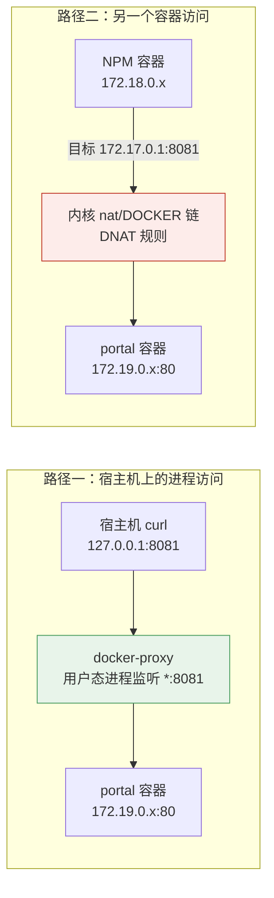

# 15 NPM 跨容器反代 502 排障实录

> **定位**：一次完整的"宿主机能通、容器不通"故障排查过程记录，从现象到根因到规避方案。
> **环境**：CentOS 7.9 · Docker 24.0.9 · NPM（jc21/nginx-proxy-manager）· portal（nginx:1.27-alpine）
> **故障时间**：2026-10-29 21:30 ~ 22:40（约 70 分钟）
> **当前状态**：✅ 已解决。`https://cloud321.cloud` 正常返回门户页，改用容器名转发，宿主机 8081 端口已彻底移除。
> **遗留**：根因的最后一环（DNAT 规则指向何处）未实测确认，见第七章「未闭环的疑点」。

---

## 一、这篇笔记解决什么问题

给 NPM 新建一条反代规则，NPM 后台配得完全正确，宿主机上 `curl` 也拿到了 200，但浏览器访问域名就是 **502 Bad Gateway**。

这种情况的迷惑性在于：**你验证的每一层都是好的**——域名解析对、NPM 规则生成了、上游端口在监听、宿主机能访问、防火墙没拦。五个"正常"凑在一起，却导出一个"不通"的结果。

本篇要回答三个问题：

1. 为什么 `curl 127.0.0.1:8081` 能通，NPM 容器访问同一个端口却不通？
2. `No route to host`、`Connection refused`、`timeout` 三个报错有什么区别，各自指向什么？
3. 遇到这种"看起来无解"的问题，什么时候该继续查、什么时候该换方案绕过去？

---

## 二、基础概念：一次反代请求到底经过了谁

### 2.1 容器访问宿主机端口，有两条完全不同的路

这是本篇最核心的知识点。同样是从 A 到 B，走哪条路由**完全取决于发起方是谁**。



| 发起方 | 实际走的机制 | 依赖什么 |
|---|---|---|
| 宿主机上的进程（含 `curl 127.0.0.1`） | `docker-proxy` 用户态进程 | 只要 `ss -tlnp` 能看到 `/usr/bin/docker-proxy` 在监听就行 |
| 另一个容器 | 内核 `nat` 表的 `DOCKER` 链做 **DNAT** | 依赖 DNAT 规则存在，且 `to:` 目标 IP 是**当前活的容器 IP** |

**这就是"本机通、容器不通"的全部根源**：两条路依赖的东西不一样。`docker-proxy` 好好的，不代表 DNAT 规则是好的。

### 2.2 三个报错的区别（最快的诊断入口）

| 报错 | errno | 谁发的 | 含义 | 下一步查什么 |
|---|---|---|---|---|
| `Connection refused` | `ECONNREFUSED` | 目标主机 | 包送到了，但那个端口**没有进程监听** | 端口号是否填错、服务是否真的起来了 |
| `No route to host` | `EHOSTUNREACH` | **中间设备或内核** | 包**压根没送到**目标，被拒绝了 | 路由、DNAT 规则、防火墙 DROP |
| `Connection timed out` | `ETIMEDOUT` | 无响应 | 包发出去了，**没有任何回应** | 防火墙静默丢包（DROP 而非 REJECT）、安全组 |

**判断技巧**：`refused` 是**目标**在说话，`no route` 是**路由/内核**在说话。前者说明路是通的，后者说明路不通。这个区别能立刻把一个模糊的"连不上"拆成两个方向完全不同的排查路径。

本文的故障现场给的就是 `No route to host`——这一条信息就把"服务没起"这个方向排除了。

### 2.3 `172.17.0.1` 是什么，为什么大家都爱填它

Docker 默认会创建 `docker0` 网桥，宿主机侧地址固定为 `172.17.0.1`。用 `docker run -p` 或 compose 的 `ports:` 发布端口时，Docker 会生成一条 DNAT 规则：

```
外部/容器 → 宿主机任意IP:8081  →  DNAT  →  容器的 172.19.0.x:80
```

所以"容器里填 `172.17.0.1` 访问宿主机发布的端口"曾是标准做法。但它有三个隐含前提：

1. `docker0` 必须处于 **UP** 状态（有容器接入它，或者手动拉起）；
2. DNAT 规则必须存在，且目标 IP 与容器**当前** IP 一致；
3. 发起方容器必须能**路由到** `172.17.0.0/16`。

本项目后来全部改用 compose 部署，每个服务各自独立网络（`npm_default`、`halo_default`、`portal_default`…），**没有一个容器接入 `docker0`**，于是它变成 `NO-CARRIER / state DOWN`。前提 1 就此崩塌。

> 这也是本篇的工程结论：**在 compose 时代，"填网关 IP"是个脆弱的反模式**，正确做法是让容器加入同一网络、用容器名互访（见第五章）。

---

## 三、故障现象

在 NPM 中为根域名建好规则：

| 字段 | 值 |
|---|---|
| Domain Names | `cloud321.cloud` `www.cloud321.cloud` |
| Scheme | http |
| Forward Hostname | `172.17.0.1` |
| Forward Port | `8081` |
| SSL | Let's Encrypt 已签发成功 |

浏览器访问 `https://cloud321.cloud` → **502 Bad Gateway**（NPM 的 openresty 报的）。

而服务器上直接访问上游，一切正常：

```bash
curl -s -o /dev/null -w "%{http_code}\n" http://127.0.0.1:8081/
# 200
curl -s http://127.0.0.1:8081/ | grep -o CloudLab | head -1
# CloudLab
```

**注意这里已经出现了本篇的核心矛盾**：上游是活的，反代是配好的，中间那一段却断了。

---

## 四、排查主线（按实际执行顺序）

> 每一步都记录了"为什么查这个"和"查完排除了什么"。排障的价值不在于命令，而在于**每一步砍掉了哪个可能性**。

### 步骤 1：确认 NPM 规则是否真的生成、是否正确匹配

- **目标**：排除"规则没保存成功"和"域名没匹配上"；
- **操作**：

```bash
# 规则文件是否存在、server_name 是否匹配
docker exec npm sh -c "grep -rhE 'server_name' /data/nginx/proxy_host/ | head -20"
```

- **预期结果**：

```
server_name cloud321.cloud www.cloud321.cloud;
server_name blog.cloud321.cloud;
...
```

- **结论**：✅ 域名匹配正常。同时得到一个重要判断依据——**如果规则没匹配上，你看到的会是 NPM 默认页（`Congratulations!`），而不是 502**。既然返回 502，说明请求已经进了这条规则，问题在它往下游转发的那一段。
- **排除了**：规则未保存、域名拼写错误、默认站点兜底。

### 步骤 2：查 iptables 有没有拦截

- **目标**：验证"是不是防火墙把 8081 挡了"这个最常见的猜测；
- **操作**：

```bash
iptables -L INPUT -n | head -3
iptables -L INPUT -n --line-numbers | grep -E "8081|DROP|REJECT" | head -10
```

- **预期结果**：

```
Chain INPUT (policy ACCEPT)
target     prot opt source               destination
ACCEPT     tcp  --  0.0.0.0/0            0.0.0.0/0            tcp dpt:8090
```

第二条命令**无输出**。
- **结论**：✅ `INPUT` 链默认策略是 `ACCEPT`，且整条链里没有任何 `DROP`/`REJECT` 规则。
- **排除了**：本机 iptables 拦截。（顺带说明：华为云安全组也与此无关——容器访问宿主机自己的 IP，流量不出网卡，不经过安全组。）

### 步骤 3：确认上游端口在宿主机上的监听状态

- **目标**：排除"容器没发布端口"或"绑到了 127.0.0.1"；
- **操作**：

```bash
ss -tlnp | grep 8081
curl -s -o /dev/null -w "via_172.17.0.1=%{http_code}\n" http://172.17.0.1:8081/
```

- **预期结果**：

```
LISTEN 0 1024  *:8081  *:*  users:(("docker-proxy",pid=5627,fd=4))
LISTEN 0 1024 [::]:8081 [::]:*  users:(("docker-proxy",pid=5635,fd=4))
via_172.17.0.1=200
```

- **结论**：✅ 监听在 `*:8081`（不是 `127.0.0.1:8081`），且宿主机用 `172.17.0.1` 这个地址访问也返回 200。
- **排除了**：compose 的 `ports` 写成了环回绑定、端口没发布。
- **⚠️ 注意这个"200"是本篇最大的陷阱**：宿主机上 `curl 172.17.0.1:8081` 返回 200，会让人误以为"`172.17.0.1` 这个地址是通的"。其实这个请求走的是 `docker-proxy`（路径一），**完全没有验证 DNAT（路径二）**。地址能通 ≠ 容器能通过它通。

### 步骤 4：从 NPM 容器内部发起连接（关键一步）

- **目标**：把测试位置从"宿主机"挪到"发起方容器"，这是整个排障的转折点；
- **操作**：NPM 镜像里**没有 `wget`/`curl`**，用 bash 内建的 `/dev/tcp` 代替：

```bash
docker exec npm bash -c 'if exec 3<>/dev/tcp/172.17.0.1/8081; then echo TCP_OK; else echo TCP_FAIL; fi'
```

- **实际结果**：

```
TCP_FAIL
bash: connect: No route to host
bash: line 1: /dev/tcp/172.17.0.1/8081: No route to host
```

- **结论**：🔴 **故障复现了，而且拿到了根因方向的证据**——宿主机 200，容器 `No route to host`。同一个目标地址、同一个端口，只因为发起方不同，结果完全不同。这直接证明了问题在"容器 → 宿主机端口"这一段，与 portal 容器本身、与 NPM 规则内容都无关。
- **注意**：是 `No route to host`，不是 `Connection refused`。按 2.2 节，这意味着**包没送到**，而不是"没人在听"。至此所有"服务没起/端口填错"的方向全部作废。

### 步骤 5：做对照实验，确认是"一个端口"还是"整个网段"

- **目标**：区分"8081 这一个端口有问题"和"`172.17.0.1` 整个地址不可达"；
- **操作**：

```bash
docker exec npm bash -c 'for p in 8081 8090 5244 3001 8080; do
  if exec 3<>/dev/tcp/172.17.0.1/$p 2>/dev/null; then echo "$p OK"; else echo "$p FAIL"; fi
done'
```

- **实际结果**：

```
8081 FAIL
8090 OK     # Halo
5244 OK     # Alist
3001 OK     # Uptime Kuma
8080 OK     # Vaultwarden
```

- **结论**：这是整轮排查中**信息量最大的一次测试**。它同时否掉了两个假说：

| 假说 | 若成立则应为 | 实际 | 判定 |
|---|---|---|---|
| `docker0` DOWN 导致 `172.17.0.1` 整体不可达 | 5 个端口全 FAIL | 4 OK 1 FAIL | ❌ **排除** |
| 8081 端口被防火墙拦 | 全 OK 或全 FAIL，与端口无关 | 只有 8081 FAIL | ❌ **排除** |

- **留下的唯一解释**：`172.17.0.1` 这个地址本身可达，**唯独 8081 这一条转发规则坏了**。故障范围从"网络"精确缩小到"一条 DNAT 规则"。
- **方法提炼**：**这是变量控制法的典型应用**——固定所有条件（同一个发起容器、同一个目标地址、同一个测试方法），只让"端口"这一个变量变化。如果当时只测 8081 就下结论"`172.17.0.1` 不通"，方向会彻底跑偏，去查 `docker0`、去查路由表，全是白费。

### 步骤 6：交叉验证 `docker0` 的状态（解释为什么会有这个误判）

- **目标**：确认 `docker0` 状态，理解"为什么直觉会指向它"；
- **操作**：

```bash
ip -4 addr show docker0 | head -4
docker inspect npm --format '{{range $k,$v := .NetworkSettings.Networks}}{{$k}} gateway={{$v.Gateway}}{{end}}'
docker network ls
```

- **实际结果**：

```
3: docker0: <NO-CARRIER,BROADCAST,MULTICAST,UP> mtu 1500 qdisc noqueue state DOWN
    inet 172.17.0.1/16 brd 172.17.255.255 scope global docker0

npm_default gateway=172.18.0.1
```

- **结论**：`docker0` 确实是 `NO-CARRIER / DOWN`（没有任何容器接入默认网桥），NPM 真正的网关是 `172.18.0.1`。**但结合步骤 5，这不足以解释"只有 8081 不通"**。所以它能解释"为什么这个方案脆弱"，不能解释"为什么这次偏偏是它挂"。
- **这个交叉验证的价值**：它让我们没有停在一个"听起来很合理"的结论上。`docker0` DOWN 是个真实存在的隐患，但把它当作本次故障的唯一根因，就是**用一个正确的观察得出错误的因果**——排障中最容易犯的错。

---

## 五、解决方案：不再经过宿主机端口

### 5.1 思路

既然"经过宿主机端口"这条链路（`docker-proxy` + DNAT + 网桥状态）存在这么多隐含前提，**就不要走它**。让 portal 加入 NPM 所在的 `npm_default` 网络，NPM 用**容器名**直连，流量走网桥二层转发，完全不碰 DNAT、不碰 `docker-proxy`、不碰宿主机端口。


**三点收益**：

1. 不依赖任何 IP，Docker 网络重新分配也不会 502；
2. 宿主机少一个对外开放的端口（`8081` 彻底消失，安全组也不用管了）；
3. 少一跳转发，路径更短。

**一点代价**：portal 依赖外部网络 `npm_default` 已存在，所以不能单独 `docker-compose down` 掉 NPM 后再起 portal（实际影响很小，NPM 是常驻服务）。

### 5.2 改 compose

- **入口**：服务器 `/opt/cloudlab/portal/docker-compose.yml`
- **操作**：先备份，再整文件替换（用 `cat >` 覆盖，不要用 `vi` 手改，避免缩进出错）

```bash
cd /opt/cloudlab/portal
cp docker-compose.yml docker-compose.yml.ip.bak

cat > docker-compose.yml << 'EOF'
services:
  portal:
    image: nginx:1.27-alpine
    container_name: portal
    restart: unless-stopped
    volumes:
      - ./html:/usr/share/nginx/html:ro
      - ./nginx.conf:/etc/nginx/conf.d/default.conf:ro
    mem_limit: 64m
    networks:
      - npm_net
    logging:
      driver: json-file
      options:
        max-size: "5m"
        max-file: "3"

networks:
  npm_net:
    external: true
    name: npm_default
EOF
```

**关键差异**：

| 项 | 改前 | 改后 |
|---|---|---|
| `ports:` | `"8081:80"` | **整段删除** |
| `networks:` | 默认 `portal_default` | 加入外部网络 `npm_default` |
| 网络名写法 | — | `external: true` + `name: npm_default`（两者必须都写） |

> `external: true` 缺了 `name:`，compose 会按"项目名_网络名"拼成 `portal_npm_net` 去找，找不到就报 `network portal_npm_net declared as external, but could not be found`。

### 5.3 重建并验证容器间连通

- **操作**：

```bash
docker-compose up -d --force-recreate
docker-compose ps
docker exec npm bash -c 'if exec 3<>/dev/tcp/portal/80; then echo TCP_OK; else echo TCP_FAIL; fi'
```

- **预期结果**：

```
NAME     IMAGE               STATUS         PORTS
portal   nginx:1.27-alpine   Up (healthy)   80/tcp          ← 注意：没有 0.0.0.0 映射

TCP_OK
```

- **验证宿主机端口确实消失了**：

```bash
ss -tlnp | grep 8081
# 无输出
```

### 5.4 改 NPM 规则

- **入口**：NPM 后台 → Hosts → Proxy Hosts → 编辑 `cloud321.cloud` → Details

| 字段 | 从 | 改成 |
|---|---|---|
| Forward Hostname / IP | `172.17.0.1` | `portal` |
| Forward Port | `8081` | `80` |

- **注意**：SSL 标签**不用动**，不需要重新签发证书。
- **预期结果**：保存后立即生效（NPM 会自动 reload），无需要手动重启容器。

### 5.5 最终验证

```bash
curl -s https://cloud321.cloud | grep -o "<title>[^<]*</title>"
# <title>CloudLab · 云平台服务导航</title>
```

浏览器打开 `https://cloud321.cloud`，确认服务卡片可点击、页脚备案号可跳转工信部。

---

## 六、经验总结

### 6.1 踩坑表

| 现象 | 根因 | 解决办法 |
|---|---|---|
| NPM 返回 502，但宿主机 `curl 上游端口` 是 200 | 宿主机走 `docker-proxy`，容器走 `nat/DOCKER` 的 DNAT，两条路依赖不同 | 在**发起方容器内**测试（`/dev/tcp`），而不是在宿主机测 |
| 容器内报 `No route to host` | 包没送到目标（路由/DNAT 问题），不是端口没监听 | 与 `Connection refused` 区分：后者才是服务没起 |
| NPM 容器里 `wget`/`curl` 都不存在 | NPM 基于 alpine，精简镜像不含这两个工具 | 用 `bash -c 'exec 3<>/dev/tcp/host/port'` 测连通性 |
| `proxy_pass` 在规则文件里 grep 不到 | NPM 把转发语句放在公共的 `conf.d/include/proxy.conf`，规则文件里只有 `set $server`/`set $port` 变量 | 查这两个变量，而不是 grep `proxy_pass` |
| 只有某一个端口不通，其他同 IP 端口正常 | 单条 DNAT 规则失效（目标 IP 与容器当前 IP 不符等） | 做对照实验锁定范围，再考虑改用容器名直连绕开 |
| `docker0` 显示 `NO-CARRIER / state DOWN` | 全部服务都用 compose 独立网络，没有容器接入默认网桥 | 别再把 `172.17.0.1` 当转发地址，用容器名 + 共享网络 |

### 6.2 三条方法论

**① 在故障发生的那个位置测试，不要在"看起来等价"的位置测试。**

这轮排查前 40 分钟全部浪费在这里：宿主机 `curl` 返回 200，我据此认为"上游没问题"，但真正发起请求的是 NPM 容器，不是宿主机。**"我这边能访问"永远不等于"它那边能访问"**——这句话在任何分布式排障里都成立，NPM、K8s、微服务调用都一样。

**② 用对照实验把"一个点"和"一个面"分开。**

步骤 5 那五条 `/dev/tcp` 是整个排障的胜负手。只测 8081 会得出"`172.17.0.1` 不通"，从而跑去查 `docker0`、查路由表、查 `ip_forward`——全是错方向。测了 5 个端口才看清是"单点故障"而非"网段故障"。

**③ 观察正确 ≠ 因果正确。**

`docker0` 确实是 DOWN，这是事实。但把它当成本次 502 的根因就是错的——因为同样走 `172.17.0.1` 的另外 4 个端口是通的。排障时最容易犯的错不是"没找到异常"，而是**抓住第一个异常就停止思考**。异常必须能解释全部现象，否则它只是巧合。

### 6.3 什么时候该"修"，什么时候该"绕"

这次最终没有修 DNAT 规则，而是换了一条链路。判断依据是：

- 这条链路有 **3 个隐含前提**（`docker0` UP、DNAT 有效、目标 IP 未过期），任何一个破了就 502，且报错信息会指向错误的方向；
- 它依赖**手工维护的 IP**，而 IP 会随容器重建漂移；
- 有**成本相当、但结构更简单**的替代方案（容器名直连）。

**当一个方案的失败模式比它的功能更复杂时，换方案比重修更划算。** 但要能说清换掉了什么、付出了什么代价（第五章末尾那一条），否则"绕过"就变成了"逃避"。

---

## 七、未闭环的疑点（诚实记录）

**唯一没能确认的一环**：8081 那条 DNAT 规则到底坏在哪里。

由于最终选择了绕过，没有继续深挖。以下两条命令本可以给出结论，留作以后复现时验证：

```bash
# 1. 看宿主机上 8081 与 8090（已知正常）的 DNAT 规则差异
iptables -t nat -L DOCKER -n | grep -E "8081|8090"

# 2. 看 Docker 自己记录的端口映射目标
docker port portal
```

**两个待验证的假说**：

| 假说 | 机制 | 可验证特征 |
|---|---|---|
| A. DNAT 规则指向了已废弃的容器 IP | portal 容器被多次 `--force-recreate`，容器 IP 变了，但 DNAT 规则仍指向旧 IP → 宿主机查不到该地址，回 ICMP host-unreachable → `No route to host` | `iptables` 里 `to:` 的 IP 与 `docker inspect portal` 的当前 IP 不一致 |
| B. 跨网段路由缺失 | portal 原在 `portal_default`（另一网段），NPM 在 `172.18.0.0/16`，DNAT 到跨网段目标时转发失败 | NPM 容器内 `ip route` 无对应网段路由 |

**倾向 A**：它同时解释了"为什么只有 8081 挂"（其他 4 个容器从未重建过，DNAT 规则一直有效）和"为什么是 `No route to host` 而不是 `refused`"（宿主机在转发环节就失败了）。但**这是推断，不是实测**，所以标为未闭环。

> 保留这一节的原因：面试时被追问"根因到底是什么"，答"我绕过去了，但我知道最可能是 DNAT 指向了废弃 IP，验证方法是这两条命令"——比编一个闭合的因果链更可信。**承认边界不是扣分项，假装查清才是。**

---

## 八、面试话术

### 8.1 一分钟口述版

> 给 NPM 加一条反代规则，域名能解析、证书也签下来了，但访问返回 502。我一开始在服务器上 `curl` 上游端口，返回 200，看起来上游完全正常，一度以为是防火墙，查了 iptables 发现 INPUT 链是 ACCEPT、没有任何 DROP 规则，也排除了。
>
> 转折点是我不再在宿主机上测，而是进到 NPM 容器内部测——结果报 `No route to host`。同一个地址、同一个端口，宿主机通、容器不通。我又拿 4 个已知正常的端口做对照，发现都通，只有这一个端口不通，于是把范围从"网络不可达"缩到"单条转发规则失效"。
>
> 根因是宿主机访问走 `docker-proxy` 用户态转发，而容器访问走内核 `nat/DOCKER` 链的 DNAT，两条路依赖的东西不一样，所以"本机能通"完全无法证明"容器能通"。最后我没有去修那条 DNAT 规则，而是把 portal 容器加入 NPM 所在的 Docker 网络、改用容器名直连，同时把宿主机上那个端口删掉——少一个暴露面，也不再依赖任何 IP。
>
> 这件事让我记住的是：**要在故障发生的位置测试**。宿主机上的 `curl` 和容器里的连接请求，中间隔着一条完全不同的路径。

### 8.2 高频追问

| 追问 | 怎么答 |
|---|---|
| 为什么不直接修 DNAT？ | 那条链路有 3 个隐含前提（`docker0` UP、DNAT 有效、IP 未过期），失败模式比功能还复杂；容器名直连结构更简单，且顺带删掉一个对外端口。但我保留了两条验证命令，能确认它到底坏在哪。 |
| `No route to host` 和 `Connection refused` 区别？ | `refused` 是目标主机在说话，说明包到了、只是没进程监听；`no route` 是路由或内核在说话，说明包根本没送到。前者查端口和服务，后者查路由和转发规则。 |
| 怎么在精简镜像里测端口连通性？ | NPM 镜像没有 `wget`/`curl`，用 bash 内建的 `/dev/tcp`：`exec 3<>/dev/tcp/host/port`，成功退出码 0。注意要 `bash` 而不是 `sh`，dash 不支持。 |
| 除了容器名，还有什么跨容器通信方式？ | 三种：加入同一自定义网络用容器名（推荐，自带 DNS）；`--link`（已废弃）；走宿主机发布端口（本次故障来源）。 |
| 这次最大的收获？ | 不是记住了某个命令，而是学会了"对照组"：单个现象说明不了什么，只有让一个变量变、其他都不变，才能定位。 |

---

## 九、关联笔记

| 笔记 | 关系 |
|---|---|
| [[04 部署NginxProxyManager反向代理网关]] | NPM 的基础部署与规则配置 |
| [[12 根域名门户与域名收尾配置]] | portal 容器的来源与本篇故障的业务背景（§9.5 保留了简版记录，细节以本篇为准） |
| [[03 docker云环境配置]] | Docker 网络与镜像加速；本篇依赖的自定义网络概念见该篇 |
| [[02 NPM反向代理网关扩展]] §2.3、§3.6 | Compose 项目网络机制、后端端口收敛——本篇故障正是"没收敛、靠端口转发"的代价 |
