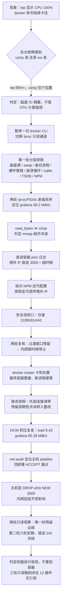
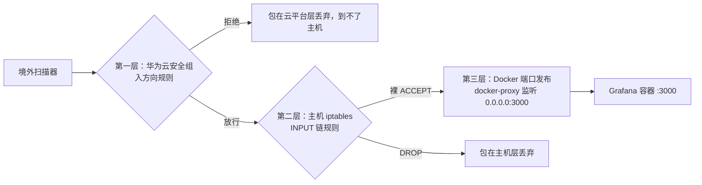
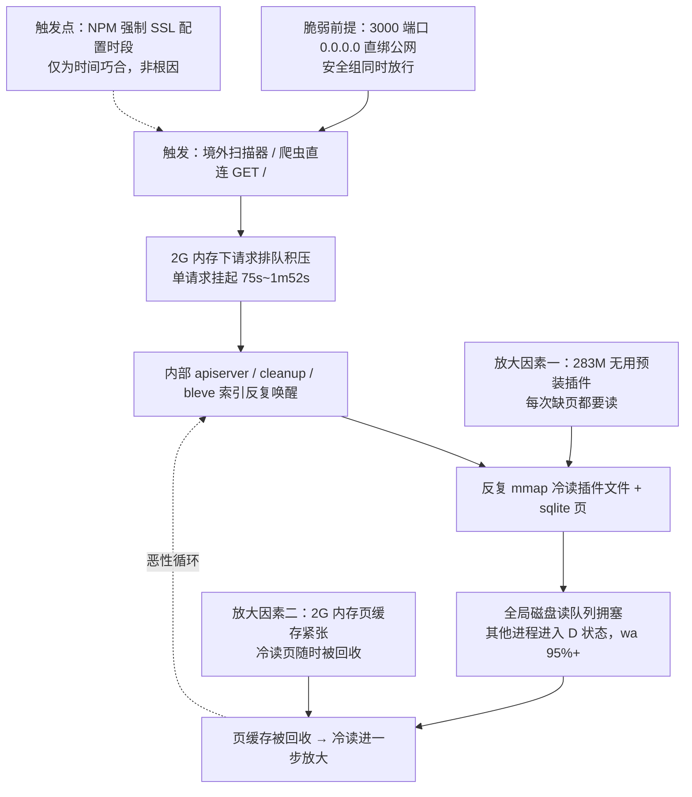

# 16 Grafana 公网暴露触发 IO 饱和排障实录

> **定位**：一次"配完 NPM 强制 SSL 后整机 CPU 100%、wa 长期 95%+"的线上排障。逐层排除后定位：**Grafana 3000 端口以 `0.0.0.0` 直绑公网，被境外扫描流量直连**；2G 内存下请求排队超时，内部任务反复唤醒重建索引、冷读插件文件，最终把全局磁盘 IO 队列打满。NPM 强制 SSL 只是时间触发点，不是根因。
> **服务器**：华为云 Flexus · CentOS 7.9 · 2 核 2G · 40G 根分区 · 公网 EIP `110.41.63.156`
> **事故时间**：2026-10-30 09:45 ~ 16:40（上午主事故）；19:00 积压复发一轮，19:14 主机层 iptables 二次止血，19:38 第二轮观察确认自行收敛；19:52 ~ 20:02 完成插件引用三轮只读甄别。
> **当前状态**：✅ 云层安全组 + 主机 iptables 两层均已切断 3000 公网新连接；两轮观察确认整机脱离 IO 拥塞、错误计数冻结；🔄 12 个无用插件（283M）引用甄别已闭合，清理脚本 `plugin-cleanup2.sh` 于 20:12 被执行、**结果未知（备份/停容器/删除/启动状态均未确认，见 7.5 与 9.6.6）**；容器内存上限、端口收口、iptables 规则持久化等结构性整改见第七章，均未执行。
> **后续（20:12 → 22:12）**：cleanup2 执行结果查清、第三次 IO 复测达标、发现 backgroundinstaller 自动重装插件、phase1 禁用预装、紧急处置、阶段一闭合——**完整续录见 [[17 Grafana插件自动重装与止血收尾排障续录]]**；7.5 未决项的闭合状态见 17 §7.2。
> **配套方法篇**：本篇讲"这次事故怎么查出来的"；可迁移的整机 IO 排查流程与 `/proc` 采样工具集见 [[03 Linux-IO拥塞排查方法论与proc采样工具集]]（扩展讨论）。
> **关联**：Grafana 与 Prometheus 部署背景见 [[08 Grafana Prometheus资源监控]]；NPM 网关与反代配置见 [[04 部署NginxProxyManager反向代理网关]]；同类线上排障见 [[13 备份磁盘占满线上排障与备份脚本修复]]、[[15 NPM跨容器反代502排障实录]]。

---

## 一、这篇笔记讲什么（结论先行）

### 1.1 触发场景

给 NPM 六个站点陆续开启 Force SSL（强制 HTTP 跳 HTTPS）之后，用户反馈"CPU 又跑满了"。现场第一屏 `top`：

```text
%Cpu(s): 30.1 us, 3.3 sy, 66.6 wa, 0.0 hi, 0.0 si, 0.0 st, 0.0 id
KiB Mem: total 1.8G, used 1.4G, free 约 95M available
KiB Swap: total 1.0G, used 6.3M
```

`docker stats`、`docker ps` 先后卡住不返回，整机负载一路冲到 50 以上。

### 1.2 一句话结论

**报错现象是"CPU 跑满"，本质却是"磁盘 IO 堵死"**：`wa`（IO 等待）长期 95% 以上，`us/sy`（CPU 计算）加起来只有几个百分点。真正的 IO 大户是 Grafana 容器——它的 3000 端口没有经过 NPM，直接 `0.0.0.0:3000` 绑在公网网卡上，境外扫描器直连进来，在 2G 内存上堆积超时请求，触发内部清理任务、搜索索引反复重建，反复冷读插件文件和 sqlite 页，把全局 IO 队列压垮。

### 1.3 排障主线



### 1.4 本次排障沉淀的判断顺序

接到"机器卡了"，先分清是哪一类瓶颈，再动手定位，不要一上来就 `top` 找 CPU 高的进程：

1. **先看 CPU 时间构成**：`us/sy` 高是 CPU 计算瓶颈，`wa` 高是等磁盘，`si/so` 高是内存抖动换页；
2. **整机排除项按成本从低到高**：磁盘空间 → swap → 是否有备份/压缩类重任务 → 硬件与文件系统报错；
3. **再定位大户**：两轮 `/proc/<pid>/io` 差值采样，避免被进程累计计数误导；
4. **最后看日志锁定触发源**：外部流量看 `remote_addr`，内部循环看超时、索引、清理任务；
5. **daemon 卡死时绕开它**：`docker ps/stats/logs/inspect` 都走 dockerd，IO 拥塞期会阻塞，直接读 `/proc`、cgroup 和容器 json 日志文件；
6. **收口要逐层核对**：云安全组、主机 iptables、Docker 端口发布是三层独立防护，关了一层不等于关了另外两层；
7. **删除类变更前先做只读引用甄别**：先查数据源表、结构化解析仪表盘 JSON、查注册表与自动安装声明，证据闭合再备份、停止、删除、验证、回滚留预案。

> 这套通用流程与命令口径沉淀在方法篇 [[03 Linux-IO拥塞排查方法论与proc采样工具集]]，本篇只记录本次事故的实际走法。

---

## 二、动手前先懂：相关概念与原理

### 2.1 `wa` 是什么：CPU 在等磁盘，不是在算东西

`top` / `vmstat` 的 CPU 时间分五类，排障时先看占比最大的是哪一类：

| 指标 | 含义 | 高了说明什么 | 下一步方向 |
|---|---|---|---|
| `us` | 用户态程序计算 | 应用本身在密集计算（压缩、加密、算法） | 找 CPU 大户进程 |
| `sy` | 内核态操作 | 系统调用、上下文切换频繁 | 检查网络/文件系统调用风暴 |
| **`wa`** | **IO 等待**：进程发起读/写后被阻塞，CPU 空转等磁盘返回 | **磁盘队列堵了**，CPU 闲着但没法接新任务 | 找读/写盘大户，不是找 CPU 大户 |
| `hi` / `si` | 硬中断 / 软中断（网络包处理、磁盘中断） | 中断风暴 | 查 `/proc/interrupts` 与网卡收包量 |
| `id` | 空闲 | — | — |
| `st` | 被虚拟化层偷走的时间 | 宿主机超卖（云主机才需要看） | 联系云厂商 |

本次现场 `us 1%、sy 2%、wa 95~97%、id 0`：CPU 几乎没有在计算，全部时间在等磁盘返回。**此时去 `top` 按 CPU 排序找"谁占了 CPU"是错的方向**——IO 拥塞期所有进程 CPU 占比都很低，但它们都卡在等盘。

### 2.2 读盘的两条路径：`read()` 循环与 mmap 缺页

进程读文件有两种机制，在 `/proc/<pid>/io` 里留下的特征完全不同，这是本次定位读盘性质的关键判据。

| 机制 | 过程 | `/proc/<pid>/io` 特征 |
|---|---|---|
| `read()` 系统调用循环 | 进程主动调 `read()` 把文件内容读进自己的缓冲区 | `rchar`（系统调用读到的字符数）与 `read_bytes`（实际从磁盘读入的字节数）**量级接近**；`syscr`（读系统调用次数）高 |
| **mmap 缺页** | 进程把文件映射进自己的虚拟地址空间，访问到没在内存里的页时触发**缺页中断**，由内核从磁盘把页换入 | `read_bytes` 可以**远大于** `rchar`；进程日志里看不到反复 `read()` 的痕迹 |

16:39 新进程（PID 16928）累计计数：`read_bytes ≈ 105.25 GiB`，`rchar ≈ 902.8 MB`，相差约 122 倍——典型 mmap 缺页特征；事故窗口旧进程（PID 4716）的背离倍数更大（约 2270 倍，见 9.1）。被映射的对象是：Grafana 二进制、依赖 `.so`、插件目录下的 JS/JSON/资源文件、`grafana.db` 及其页缓存。

### 2.3 2G 小内存上，页缓存回收如何放大冷读

Linux 会把读过的文件页留在内存里当**页缓存（page cache）**，下次访问直接命中内存，不再读盘。但本机只有 1.8G 物理内存，常驻进程已经把内存贴满：

| 进程 | RSS（16:39 实测） |
|---|---|
| Halo Java | 557 MiB |
| Uptime Kuma | 145 MiB |
| Grafana | 139 MiB |
| NPM node | 76 MiB |
| Prometheus | 44 MiB |

内存紧张时内核按 LRU 规则回收页缓存，Grafana 映射过的插件页、代码页被挤出内存；下一次定时任务唤醒、用户请求到达时，这些页又要重新从磁盘缺页读入。**插件越多、映射文件越大，被回收后冷读的代价越高**——这就是事故平息后 Grafana 仍然持续冷读的结构性原因，详见第四章步骤 9 与第七章整改项。

### 2.4 公网暴露面的三层防护：云安全组 ≠ 主机 iptables ≠ Docker 端口收敛

一台云服务器对外暴露服务，要同时穿过多层，任何一层敞开都可能被扫描到：



- **第一层 安全组**：云平台虚拟防火墙，包没到主机网卡就被过滤；
- **第二层 主机 iptables**：包进入网卡后的主机内核防火墙；本次 firewalld 未运行，INPUT 顶部 9 条无网卡/无源 IP/无状态限定的裸 ACCEPT 直接放行 3000，排在 `ESTABLISHED` 与兜底 REJECT 之前——安全组收口不等于主机层收口；
- **第三层 Docker 端口发布**：compose 里写 `ports: ['3000:3000']`，等价于 `0.0.0.0:3000`，`docker-proxy` 在所有网卡上监听；即使前面两层收口，**容器层的监听依然存在**，一旦规则松动就重新暴露。

本次事故时三层中前两层都敞开：安全组放行 3000、主机 iptables 裸 ACCEPT 放行 3000，compose 端口直绑。止血顺序：先收第一层（安全组，云控制台操作，最快），19:14 再补第二层主机层 DROP；第三层端口收口属于结构性整改，见 7.4。

### 2.5 NPM 反代时，日志里的 `remote_addr` 是谁

判断"流量是不是经过 NPM 进来的"，要看后端日志记录的 `remote_addr`：

- **直连后端**：TCP 连接的对端就是客户端真实 IP，`remote_addr` 记录境外扫描器 IP；
- **经过 NPM 反代**：TCP 连接的对端是 NPM 容器（或 docker 网关 IP `172.21.0.1` / `172.17.0.1`），后端默认看到的是**反代侧 IP**，不是访客真实 IP；
- 后端要拿到真实访客 IP，必须开启 `auth.proxy` 并信任 NPM 传入的 `X-Forwarded-For` 头（Grafana 对应 `[auth.proxy] enabled = true` 与 `header_name` 配置）。

本次实测 Grafana 生效配置：`[auth.proxy] enabled = false`、`[auth.anonymous] enabled = false`，没有任何 `GF_` 环境变量覆盖。因此 Grafana 日志的 `remote_addr` 取 TCP 对端——**日志里出现境外 IP，只能是直连 3000，不可能是 NPM 反代透传过来的**。这一条排除了"NPM 配置错误把境外流量引进来"的假设。

### 2.6 `docker restart` 为什么会卡死

`docker restart` 的流程是 CLI 经 Unix socket 请求 dockerd → dockerd 通知 containerd 停止旧容器（先发 SIGTERM，等优雅退出，超时再 SIGKILL）→ 启动新容器。IO 拥塞期：

- dockerd 自身要读写日志、状态文件，被 IO 队列阻塞，响应 CLI 极慢；
- 旧容器收到 SIGTERM 后，内部清理任务还在排队，优雅退出窗口内退不出来；
- CLI 一直等 dockerd 返回，前台命令就挂住；`Ctrl+C` 只杀掉 CLI 等待进程，**dockerd 侧的停止动作和旧容器进程不会被一起带走**，出现"命令中断了、旧进程还活着"的中间态。

### 2.7 已排除方向速查（避免重复验证）

以下方向在本次排障中已用证据排除，后续复盘不要重复走：

| 排除方向 | 证据 |
|---|---|
| 磁盘写满 | `df -h` 根分区剩余 27G（30% 使用率） |
| swap / 内存抖动 | `vmstat` 的 `si/so = 0`，Swap 仅用 6.3M |
| 备份进程抢占 | 无 `tar` / `gzip` / backup.sh 进程；crontab 备份在凌晨 3:30 |
| 磁盘硬件 / 文件系统故障 | `dmesg -T` 无 I/O error、无 ext4 报错、无新增 OOM |
| Grafana 崩溃重启循环 | 旧进程 `etime` 8 天以上，不是反复拉起的短命进程 |
| sqlite 膨胀 / 锁 | `grafana.db` 仅 2.2M |
| Prometheus TSDB 查询风暴 | 采样读速 0.37 MiB/s，可忽略 |
| NPM 配置错误 | npm node 读速 0.005 MiB/s；见步骤 6 的配置核对 |
| NPM 透传境外 IP | `auth.proxy` 关闭，`remote_addr` = TCP 对端（见 2.5） |
| 匿名访问被滥用 | `[auth.anonymous] enabled = false` |

---

## 三、排障目标清单

1. 判断"CPU 100%"属于 CPU 计算瓶颈、内存抖动还是磁盘 IO 拥塞；
2. 在 dockerd 响应阻塞的前提下，找到不依赖 `docker` CLI 的只读采集通道；
3. 逐项排除 2.7 列出的干扰方向，把故障范围缩到单个容器；
4. 用两轮差值采样量化每个容器的实时读速，区分主源头与次要进程；
5. 从容器日志锁定外部触发源（IP、路径、耗时、错误类型）；
6. 确认 NPM 反代链路是否为流量入口，排除配置误判；
7. 先止血（切断外部直连），再复核止血效果，区分"过渡窗口残留"与"稳态残留"；
8. 记录 `docker restart` 卡死的现场状态，给出不重复踩坑的处置纪律；
9. 安全组收口后复核主机 iptables 第二层，补齐主机层止血，并用两轮只读观察判定机器是否自行收敛；
10. 插件精简前完成数据源 / 仪表盘 / 注册表三轮只读甄别，确认 12 个预装插件无引用，给出备份、删除、验证、回滚闭环。

---

## 四、实操排障全过程（主线）

> 每一步记录"为什么查这个"和"查完排除了什么"。排障的价值不在命令本身，而在每一步砍掉了哪个可能性。全程只读优先，变更动作（安全组、重启）均由本人在控制台与终端执行。

### 步骤 1：第一屏判读，确认是 IO 拥塞而不是 CPU 瓶颈

- **目标**：把故障大类定下来，避免方向走错。
- **操作**：

  ```bash
  top
  free -h
  vmstat 1 3
  ```

- **实测现象**：
  - `top` CPU 行：`us 30.1、sy 3.3、wa 66.6、id 0`；后续采样 `wa` 升到 95~97%；
  - `free`：total 1.8G，available 约 95M，Swap 仅用 6.3M；
  - `vmstat 1 3`：`bi`（块设备读）100k~118k 块/秒（约 50~60 MB/s），`bo`（写）≈ 0，`si/so = 0`，`b`（D 状态进程数）13~15，`us/sy` 仅 1%/2%。
- **判定**：纯读 IO 饱和，无换页、无写风暴；CPU 计算不是瓶颈，问题在磁盘读队列。
- **纪律**：此时不要按 CPU 占用排序找进程，IO 拥塞期进程 CPU 占比都失真。

### 步骤 2：docker CLI 陆续卡住，切换到 /proc 只读通道

- **目标**：在 dockerd 响应阻塞时仍能继续采集证据。
- **现象**：`docker stats --no-stream`、`docker ps` 先后卡住无返回。
- **判定**：dockerd 自身被 IO 队列阻塞（依据见 2.6），此后**暂停一切 `docker xxx` 命令**，包括 `docker logs`、`docker inspect`、`docker stats`、`docker ps`。
- **替代通道**：

  | 原 docker 命令 | 只读替代 |
  |---|---|
  | `docker ps` 找容器 PID | 遍历 `/proc/<pid>/cgroup`，匹配容器 ID 前缀 |
  | `docker stats` 看资源 | `/proc/<pid>/io`、`/proc/<pid>/stat`、`/proc/<pid>/status` |
  | `docker logs <容器>` | 直读 `/var/lib/docker/containers/<容器ID>/*-json.log` |
  | `docker inspect` 看配置 | 读 compose 文件 `/opt/cloudlab/<svc>/docker-compose.yml` 与 NPM 规则目录 |

- **方法篇对应章节**：[[03 Linux-IO拥塞排查方法论与proc采样工具集]] 第五章"daemon 卡死时的只读通道"。

### 步骤 3：第一轮分层排除，砍掉非 IO 大户方向

- **目标**：在定位大户之前，先把 2.7 表里的干扰项逐一排除。
- **操作与结论**：

  ```bash
  df -h                                   # 磁盘：剩余 27G，排除磁盘满
  dmesg -T | tail -50                     # 无 I/O error、无 ext4 报错、无新 OOM
  ps -eo pid,comm | grep -E 'tar|gzip|backup'   # 无备份压缩进程
  ls -lh /var/lib/docker/volumes/monitor_grafana-data/_data/grafana.db  # 2.2M，排除 sqlite 膨胀
  ```

  - `vmstat` 的 `si/so = 0`、Swap 仅 6.3M，排除内存抖动换页；
  - Grafana 进程 `etime` 8 天以上，排除崩溃后反复重启循环；
  - Prometheus 采样读速 0.37 MiB/s，排除 TSDB 查询风暴；
  - NPM node 读速 0.005 MiB/s，排除 NPM 配置错误触发的后端重试。

### 步骤 4：两轮 /proc/PID/io 差值采样，锁定读盘大户

- **目标**：用窗口差值而不是累计计数定位实时读速。
- **原理**：`/proc/<pid>/io` 里的 `read_bytes` 是进程启动以来的累计值，不能直接比较；必须记录两轮快照、算差值、除以窗口秒数，得到 MiB/s。
- **操作**：对已知容器主进程分别记录第一轮 `read_bytes`，`sleep 15`，再记第二轮，差值换算。事故窗口 15 秒实测结果：

  | 容器 | 读速 MiB/s | 判定 |
  |---|---|---|
  | **grafana** | **68.2** | 主源头 |
  | vaultwarden | 6.58 | 次要候选 |
  | uptime-kuma | 1.86 | 次要 |
  | halo（java） | 1.83 | 次要 |
  | prometheus | 0.37 | 可忽略 |
  | alist | 0.12 | 可忽略 |
  | npm node | 0.005 | 排除 |

- **性质判定**：Grafana `read_bytes` 累计远大于 `rchar`（事故窗口约 2270 倍背离），符合 2.2 的 mmap 缺页特征，不是 `read()` 循环。
- **卷内体积核对**：数据卷内插件目录占了卷空间的绝大部分（16:39 复测为 283M，占卷 99.3%，清单见 7.2），全部为官方镜像预装、本机用不到的数据源与应用插件。

### 步骤 5：直读容器 json 日志，锁定外部直连与内部超时链

- **目标**：确认触发源是外部流量还是内部任务循环。
- **操作**：绕过 `docker logs`，直接读容器日志文件：

  ```bash
  LOG=$(ls /var/lib/docker/containers/78579bc93e2b*/*-json.log | head -1)
  grep -E 'timeout|deadline|Post-timeout|cleanup|evicted|Building index' "$LOG" | tail -40
  grep 'Request Completed' "$LOG" | tail -25
  ```

- **事故窗口日志证据**（09:45–09:58，UTC 时间）：
  - 大量境外 IP 直连 `GET /` 返回 302，单请求挂起 75s、97s、1m36s、1m42s、1m52s；
  - 伴随 `http: Handler timeout`、`context deadline exceeded`、`Post-timeout activity`；
  - cleanup jobs 一次耗时 **8m24s**；
  - bleve 内存索引反复重建（repositories 一次 24.9s）；内存压力下索引缓存被挤出（事故期外部请求持续冲击、挤出频繁），下一次访问再重建。
- **判定**：外部直连 → 请求在 2G 内存上排队超时 → 内部 apiserver、cleanup、搜索索引反复被唤醒 → 反复读插件文件与 sqlite 页 → 全局 IO 队列拥塞，其他进程进入 D 状态。

### 步骤 6：核对 NPM 反代配置，排除"反代透传境外 IP"假设

- **目标**：确认境外 IP 不是经 NPM 转发进来的。
- **操作**：NPM 规则真实路径为 `/data/nginx/proxy_host/`（单数；`proxy-hosts/` 复数目录不存在），代理定义存 `/data/database.sqlite`。六份规则提取结果：

  | conf | 域名 | 反代目标 | WebSocket | Force SSL |
  |---|---|---|---|---|
  | 1 | vault.cloud321.cloud | `172.17.0.1:8080` | 否 | 是 |
  | 5 | status.cloud321.cloud | `172.17.0.1:3001` | 是 | 是 |
  | 6 | blog.cloud321.cloud | `172.17.0.1:8090` | 是 | 是 |
  | 7 | files.cloud321.cloud | `172.17.0.1:5244` | 是 | 是 |
  | 8 | cloud321.cloud / www.cloud321.cloud | `portal:80`（容器名直连） | 否 | 是 |
  | 9 | monitor.cloud321.cloud | `172.17.0.1:3000` | 否 | 是 |

- **Grafana 生效配置核对**：`[auth.proxy] enabled = false`、`[auth.anonymous] enabled = false`，无 `GF_` 环境变量覆盖；`remote_addr` 取 TCP 对端、不读 `X-Forwarded-For`。
- **判定**：日志中的境外 IP 必为直连 3000，NPM 不是境外流量入口，假设排除。
- **附带发现**：除门户外五个后端都填 `172.17.0.1`（默认 bridge 网关）+ 宿主机映射端口回连，因此后端端口映射**当前不能先删**——NPM 未接入后端共享 Docker 网络，端口收口必须先改网络拓扑（见第七章整改项，与 [[15 NPM跨容器反代502排障实录]] 第五章的容器名直连方案一脉相承）。

### 步骤 7：安全组止血，切断外部直连

- **目标**：用最快路径断掉外部扫描流量，不动容器配置。
- **操作**：华为云控制台安全组入方向，仅保留 `22`、`80`、`81`，关闭其余所有入口（含 3000、3001、8090、5244、8080、443）。
- **止血后第一轮复核（10:25，UTC 02:25）**：
  - `ss -tnp | grep 3000` 对端仅剩 `172.21.0.1`、`172.17.0.1` 内网地址；实测 3000/3001/5244/8090/8080 外部全部打不开；
  - 但 19 秒采样 Grafana 仍 **71.17 MiB/s**，vaultwarden 3.83、halo 2.27、prometheus 0.30；`vmstat` wa 88~89%；
  - 日志 02:20–02:27 仍出现 `34.12.243.235`（Google Cloud）、`176.65.144.34`（DigitalOcean 荷兰）、`103.196.9.12/.186`（香港 VPS），`/login` 两次 500，排队 1m24s / 1m29s / 1m45s。
- **判定**：这是安全组规则生效过渡窗口内的直连残留（已建立连接与队列中的请求尚未排空），不是规则没生效。
- **止血后第二轮复核（14:39，UTC 06:39）**：
  - 内部超时链停止：cleanup 回到 17~23ms，日志不再出现 timeout / deadline / 500；
  - Grafana 读速降到 **29.91 MiB/s**（538.4 MiB / 18s），vaultwarden 0.99，halo 归零；
  - wa 在 35%→80% 之间波动，未回到个位数——残留读盘来自 2G 内存下周期性唤醒 + 页缓存回收冷读，见步骤 9。

### 步骤 8：`docker restart grafana` 卡死的现场与处置教训

- **经过**：15:01 执行 `docker restart grafana`，前台无返回；15:11 `top` 快照：

  ```text
  load average: 54.84, 57.17, 43.96
  %Cpu(s): 0.5 us, 3.2 sy, 96.3 wa, 0.0 id
  Tasks: 181 total, 1 running, 179 sleeping, 0 stopped, 1 zombie
  ```

  - **旧 Grafana PID 4716 仍存活**（状态 `S`，TIME+ 105:59），`Ctrl+C` 只中断了 CLI 等待，旧容器没被停掉，处于"没重启成功、旧进程还活着"的中间态；
  - D 状态进程分散在 kuma 2354、npm node 20487、nginx 20458、node-exporter 13254。
- **纪律**：卡死期间不再敲任何 `docker restart/stop/start/ps/stats`，避免命令在 daemon 队列堆积。
- **后续结果**：容器最终在 15:22 前后完成重建（`dmesg -T` 15:22:34 记录 veth 重建），新 Grafana 进程接管，旧 PID 4716 被替换。
- **教训记录**：IO 拥塞期不要把"重启"当成第一手段——重启会重复冷启动冷读；且 daemon 卡死时重启命令会进入无人可控的中间态。先观察、先止血，等整机队列松动后再谈重启。

### 步骤 9：16:39 稳态快照判读（脚本化采样第一轮结果）

- **采集方式**：编写只读采样脚本 `io-snapshot.sh`，全程不调用 `docker` CLI，两轮 15 秒 `/proc/<pid>/io` 差值采样，22 组证据一次性落盘到 `/root/io-snapshot-<时间戳>.txt`（脚本设计见方法篇第六章）。
- **整机已恢复的证据**：

  | 指标 | 事故中 15:11 | 16:39 稳态 |
  |---|---|---|
  | load average | 54.84 / 57.17 / 43.96 | **0.51 / 0.82 / 0.94** |
  | D 状态进程 | 多个 | **0 个** |
  | `wa` | 96.3% | 0~8%，`id` 86~97% |
  | Grafana 主进程 | PID 4716（旧，运行 8 天+） | PID 16928（新，运行 1h17m） |
  | 内部超时链 | timeout / deadline / 500 / cleanup 8m24s | cleanup 18.9~45.2ms，索引重建 0.5ms~981ms，无 timeout/500 |
  | 3000 外部连接 | 境外 IP 直连 | **连接列表为空** |

- **本轮窗口读速（15 秒差值，MiB/s）**：

  | 容器 | 读速 | rchar 增量 | 性质 |
  |---|---|---|---|
  | grafana 16928 | **45.82** | 0.03 MiB | mmap 缺页冷读（主残留） |
  | vaultwarden 11060 | 4.51 | 0 | mmap sqlite 页 |
  | halo 31561 | 1.92 | 0 | JVM mmap 类/jar 冷读 |
  | node-exporter | 0.30 | 0.05 MiB | 可忽略 |
  | prometheus | 0.27 | 0.03 MiB | 可忽略 |
  | portal / npm / alist / kuma | 0.00 | 0 | 无读盘 |

- **请求日志现状**：最近 25 条全部 `GET / → 302`，`remote_addr=172.21.0.1`（docker 网关，NPM 反代回连），每分钟整一次；耗时多数 15~37ms，间歇出现 774~978ms 的慢请求，与 bleve 索引重建周期吻合（稳态实测周期见下方 18:00 复测段）。
- **残留冷读的三个叠加因素**（详见 2.3 与第七章）：
  1. 插件目录 283M，占数据卷 285M 的 99.3%，全部为本机用不到的插件；
  2. 内存贴边（available 178M），页缓存留不住 Grafana 映射页；
  3. bleve 内存索引缓存到期被淘汰、下次访问重建（稳态实测约 30 分钟一轮，见下方复测段）。

#### 18:00 第二轮复测（整机空闲约 1 小时 21 分钟后）

> 对应脚本第二轮输出 `io-snapshot-20261030-180029.txt`，用来区分"冷启动余温"与"稳态周期性冷读"，判读标准见 7.1。

**整机对比（16:39 → 18:00）**：

| 指标 | 16:39 | 18:00 | 判读 |
|---|---|---|---|
| load average | 0.51 / 0.82 / 0.94 | 1.18 / 0.58 / 0.48 | 1 分钟尖峰由周期事件贡献，5/15 分钟继续回落，未过载 |
| available 内存 | 178M | 175M | 依旧贴边，页缓存紧张条件未变 |
| Swap / si/so | 6.3M / 0 | 6.3M / 0 | 无换页抖动 |
| D 状态进程 | 0 | 仅 node-exporter 瞬时 1 个（`wait_on_page_bit_killable`，采完即回 S） | 全局队列未堵 |
| 3000 活跃连接 | 空 | 空；日志 25 条对端全为 `172.21.0.1` | 外部直连已彻底排除 |
| 日志错误 | 无 timeout/500 | 依旧无 timeout / deadline / 500 | 内部超时链未复发 |

**15 秒窗口读速对比（MiB/s）**：

| 容器 | 16:39 | 18:00 | 变化 |
|---|---|---|---|
| grafana 16928 | **45.82** | **22.15** | 下降约一半，仍为主残留 |
| vaultwarden 11060 | 4.51 | 0.37 | 大幅回落 |
| halo 31561 | 1.92 | 0.89 | 回落 |
| node-exporter 13254 | 0.30 | 0.41 | 持平可忽略 |
| prometheus 13246 | 0.27 | 0.22 | 持平可忽略 |
| portal / npm / alist / kuma | 0.00 | 0.00 | 无读盘 |

**稳态周期性的三条证据**：

1. **累计差值反推平均速率**：两次快照间隔约 81 分钟，Grafana `read_bytes` 增量 **109.54 GiB**，`rchar` 增量仅 **9.11 MiB**，平均约 **23.1 MiB/s**，与本轮窗口 22.15 MiB/s 吻合——读速不是一次性冷启动余温，而是 81 分钟内持续叠加出来的稳态量级；
2. **mmap 背离依旧**：18:00 时刻 `read_bytes 214.79 GiB` vs `rchar 870.1 MiB`，约 **253 倍背离**，读盘仍来自 mmap 缺页，不是 `read()` 循环；
3. **慢请求与索引重建周期对齐**：25 条中六条 878~892ms（09:54:20、09:55:20、09:56:20、09:58:20、09:59:20、10:00:20，UTC），其余 8~25ms；09:57:43 dashboard 索引重建（`elapsed=883.8ms`）前后各有三条慢请求，对应"缓存已淘汰、索引尚未在内存"的空窗与重建后的冷读，正常请求只在索引驻留期间出现。

**稳态周期口径（替代事故期的模糊观察）**：

- bleve 索引 `index evicted from cache`：09:08:53 → 09:38:53，**间隔 30 分钟**；重建时点 08:57:43 → 09:27:42 → 09:57:43，同样约 **30 分钟一轮**；
- cleanup jobs 多数 25~38ms；本轮窗口内出现两次拉长：09:25:44 一次 **8.997s**、09:35:35 一次 **973.9ms**，属周期性内存压力抖动，远未达到事故期 8m24s 的积压程度，但列入后续观察；
- 索引重建各资源耗时：repositories 2.86~9.23ms、playlist <1ms、folder <1.6ms、dashboards 18.6~883.8ms——dashboard 索引是每次周期内最长的一次冷读。

**复测判定（对照 7.1 阈值）**：Grafana 22.15 MiB/s 落在 **10~30 MiB/s 中间区间**——既不是 5 以下的冷启动余温（新进程已运行 2h38m，冷启动阶段早已过去），也不是 30 以上的稳态饱和。按预案：**先执行 7.2 插件精简，再复测读速**。

#### 19:00 第三轮快照（积压复发，`io-snapshot-20261030-190008.txt`）

18:00 复测后约 1 小时，用户反馈登录页 504、网页加载缓慢，第三轮只读快照现场再次抬升：

| 指标 | 18:00 稳态 | 19:00 复发 | 判读 |
|---|---|---|---|
| load average | 1.18 / 0.58 / 0.48 | **9.43 / 6.89 / 5.81** | 1 分钟与 5/15 分钟同步抬高，积压正在形成 |
| available 内存 | 175M | 161M | 依旧贴边，无换页（Swap 6.3M，si/so=0） |
| `wa` | 0~5% 为主 | 多轮 94~97%，`bi` 100k~120k 块/秒 | 仍是读 IO 拥塞，不是 CPU 计算 |
| Grafana 16928 窗口读速 | 22.15 MiB/s | **85.28 MiB/s** | 回到事故期量级，仍是 mmap 冷读（rchar 增量仅 0.01 MiB） |
| halo 31561 | 0.89 | 5.49 | 被 IO 队列连带拖慢 |
| prometheus 13246 | 0.22 | 2.30 | 连带抬升 |
| vaultwarden 11060 | 0.37 | 1.32 | 连带抬升 |
| alist 21492 | 0.00 | 0.11 | 可忽略 |

- 各进程 CPU% 普遍极低（grafana 仅 1.2%），**瓶颈仍是 IO 等待而非 CPU 计算**，与上午主事故同一性质；
- 日志（UTC 10:33–10:59）再现内部超时链：`Handler timeout`、`context deadline exceeded`、`Post-timeout activity`；cleanup 一次拉长到 **2m9.01s**；dashboard bleve 索引重建一次 **17.99s**；三条 `status=500`、两条 `status=401 no user found`（`remote_addr=223.104.85.146`，事后确认是用户本人手机热点 NAT 相邻地址，账号填错，非爆破，见 7.5 与 9.6）；
- 3000 ESTAB 仅剩两条内网网桥连接；dmesg 无新 I/O error、无 ext4 报错、无新 OOM。

#### 19:04 net-audit：定位主机 iptables 第二层漏点（`net-audit-20261030-190438.txt`）

安全组收口后外部仍能扫到 3000，需要核对主机层防火墙是否同时敞开：

1. **firewalld 状态**：`inactive / not running`，主机层实际由 iptables 接管；
2. **INPUT 链顶部 9 条裸 ACCEPT**（无网卡限定、无源 IP 限定、无连接状态限定，`0.0.0.0/0`）依次放行 8090、5244、**3000**、3001、81、8080、443、80、22，排在 `RELATED,ESTABLISHED` 规则与末尾 `REJECT` 兜底**之前**；其中 3000 规则累计 **278K 包 / 22M**；
3. **DOCKER 链 3000 计数为 0**：外部流量走的是 INPUT 顶部裸 ACCEPT，不是 Docker 转发链；`DOCKER-USER` 为空链（`-j RETURN`），没有额外防护；
4. **3000 监听**：`docker-proxy` PID 16887（IPv4 `0.0.0.0:3000`）、16892（IPv6 `:::3000`）仍双栈直绑；
5. **日志 remote_addr 分组为全天累积口径**（脚本未按小时过滤）：境外扫描 IP 是安全组拒绝规则添加前的历史累积；`223.104.85.146` 经本机出口核对为用户手机热点 NAT 相邻地址（本机出口 `223.104.85.144`，珠海中国移动 4G/5G 段，局域网 `192.168.48.249/24`，网关 `192.168.48.23`），两条请求 referer 分别为 `http://110.41.63.156:81/` 与 `https://monitor.cloud321.cloud/login`，判定为用户本人浏览器；`59.82.83.112`（中国电信段）身份未最终甄别，列入 7.5 未决项；
6. **安全组规则复核（三张控制台截图，19:25）**：实例仅绑定一个安全组 `sg-default-smb`，共 12 条入站规则——优先级 1 拒绝 IPv6 全部 `::/0`；允许 IPv4/IPv6 全部，**源地址为 `sg-default-smb`（同安全组实例互访，公网不匹配该规则）**；优先级 2 拒绝 IPv4 TCP 8080、3001、**3000**、5244、8090，允许 81、22、443、80。用户确认"安全组只有一个，没有其他放行"——**云层对 3000 的拒绝规则对公网生效**，历史境外 IP 为拒绝规则添加前的累积日志。

#### 19:14 主机层 iptables 临时止血（`close-3000-20261030-191411.txt` + `iptables-backup-20261030-191411.txt`）

云层安全组已拒绝 3000，但主机 INPUT 顶部裸 ACCEPT 仍在；为补齐第二层，先 `iptables-save` 全量备份到 `/root/iptables-backup-20261030-191411.txt`，再在 INPUT 第 1 行插入：

```text
DROP  tcp  --  eth0  *  0.0.0.0/0  0.0.0.0/0  tcp dpt:3000 ctstate NEW
```

- 规则只拦截 **eth0 上新发起的 3000 连接**，内网回连（`172.21.0.1`、`172.17.0.1` 经 docker0/网桥）与本机回环不受影响；
- 操作后本机自测 `127.0.0.1:3000 HTTP=302，0.044s`，内网路径未误伤；
- 止血瞬间 load 回落到 **2.74**；vmstat 前两轮 wa 3%，后三轮仍出现 76% / 90% / 97% 周期尖峰——队列残留尚未排空；
- **规则仅运行时生效，重启服务器即丢失**；规则清理与持久化列入 7.4 结构性整改；回滚命令：`iptables -D INPUT 1`，或 `iptables-restore /root/iptables-backup-20261030-191411.txt`。

#### 19:22 第一轮观察（`observe-grafana-20261030-192249.txt`）

止血后 5 轮（每 30 秒）只读趋势观察，Grafana PID 16928 全程未变：

- 轮 1~3 安静（wa 1~4%，curl 毫秒级）；轮 4/5 周期性 IO 尖峰复发：wa 69%→96%，load 9.09；轮 4 curl 一次超时、两次 6.965s / 6.995s，轮 5 一次超时、两次 4.006s / 0.978s；
- 3000 出现两条内网半连接：`CLOSE-WAIT 172.21.0.1:45662 ↔ 172.21.0.3:3000`、`FIN-WAIT-2 172.17.0.1:3000 ↔ 172.20.0.2:50450`（kuma 容器反向访问 3000，用途未甄别，列入 7.5）；
- **错误日志累计计数 242，全程未新增**；cleanup 22.026s → 4.017s → 5.978s，逐步回落；
- 150 秒窗口 Grafana `read_bytes` 增量 11.53 GiB，均值 **73.29 MiB/s**，`rchar` 增量仅 793,811 字节（0.01 MiB/s），mmap 冷读背离继续；最后一条 `context deadline exceeded` 为 11:05:50 UTC。

#### 19:38 第二轮观察：判定机器自行收敛，不重启 Grafana（`observe-round2-20261030-193813.txt`）

间隔约 13 分钟后第二轮 6 轮只读观察，作为"是否需要重启容器"的决策依据：

| 轮次 | 时间 | load（1 分钟） | wa | 本机 3000 应答 | 3000 连接 | 错误计数 |
|---|---|---|---|---|---|---|
| 1 | 19:38:13 | 0.35 | 3% / 1% | 0.049 / 0.001 / 0.001s | 无 | 242 |
| 2 | 19:38:44 | 0.43 | 3% / 4% | 0.054 / 0.001 / 0.001s | 无 | 242 |
| 3 | 19:39:15 | 0.30 | 3% / 3% | 0.060 / 0.001 / 0.001s | 无 | 242 |
| 4 | 19:39:47 | 0.43 | 3% / 0% | 0.059 / 0.001 / 0.000s | 无 | 242 |
| 5 | 19:40:19 | 0.53 | 3% / 5%（一次 bi 107k 小尖峰，未超时） | 0.994 / 0.001 / 0.000s | 无 | 242 |
| 6 | 19:40:51 | 0.41 | 3% / 0% | 0.054 / 0.001 / 0.000s | 无 | 242 |

- 180 秒窗口 Grafana `read_bytes` 均值 **25.84 MiB/s**、`rchar` 均值 **0.00 MiB/s**，mmap 冷读残留仍在（留待 7.2 插件精简解决），但不再形成积压；
- cleanup 11:35:34 UTC 仅 **32.49ms**；bleve dashboards 索引重建 2.98s；上一轮的 CLOSE-WAIT / FIN-WAIT-2 半连接已被进程自行回收；
- 收尾 load 0.41、wa 0%、available 179M；**判定：不需要重启 Grafana，机器已自行收敛**；残留冷读转入插件精简整改。

#### 19:52–20:02 插件引用三轮只读甄别（tempo 子串误报闭合）

7.2 插件清理前，必须先确认仪表盘/数据源没有引用待删插件。三轮脚本全部只读（`mode=ro`），证据链见 7.2 与 9.6：

1. **`tempo-check.sh`（19:52，第一版）**：三处口径错误（resource 表无 `kind` 列、`value` 为 bytes 未解码、其他表列名误判），但已锁定唯一命中行 `name=rYdddlPWk`；
2. **`tempo-check2.sh`（19:59，修正版）**：按真实 group/resource 列、bytes 解码、全库表扫描复核——resource 表仅两组：`advisor.grafana.app/checktypes` 5 行、`dashboard.grafana.app/dashboards` 1 行；唯一命中行即仪表盘 `rYdddlPWk`（228,751 字符）；面板 type 全集 `bargauge, dashboard, datasource, gauge, linear, link, prometheus, query, row, special, stat, timeseries`，无任何外部插件 type；`plugin_setting` 表为空；
3. **`plugin-final-check.sh`（20:02，最终定性）**：含 `tempo` 片段的单词全集仅 **`temporary`**；独立单词 `tempo` 命中 **0 次**；命中点 @52901 原文为图例 `"WritebackTmp – FUSE temporary writeback buffers"`，`tem**pora**ry` 前四字母拼成 `tempo`，**子串误报确认**；`resource_history` 同一仪表盘旧版本同性质；data_source 复核仅 prometheus；12 个插件目录原位 283M 未删。

---

## 五、根因链条与责任分层

### 5.1 完整因果链



### 5.2 三层归因：触发、放大、脆弱前提

| 层级 | 内容 | 责任 |
|---|---|---|
| **脆弱前提（结构问题）** | Grafana 3000 未经 NPM 收敛，`0.0.0.0` 直绑；安全组与容器层双层防护只靠单层 | 部署时端口发布方式留下的暴露面（08 §4.3 当时为调试需要放行 3000） |
| **触发因素（外部事件）** | 境外扫描器对公网开放端口的例行探测；Force SSL 切换只是时间点重合 | 不可控，只能靠收口暴露面规避 |
| **放大因素（资源条件）** | 2G 内存贴边、283M 无用插件、bleve 索引 TTL 淘汰 | 容量规划与镜像精简问题，决定了"被扫一下就倒"的脆弱程度 |

### 5.3 为什么 NPM 强制 SSL 不是根因

- NPM node 进程读速 0.005 MiB/s，可忽略；
- 六个站点规则在事故前后配置未变，Force SSL 只是 80→443 的 301 跳转；
- 境外 IP 全部出现在 Grafana 直连日志，未经过 NPM（2.5 已证）；
- 真正的时间关系：扫描器一直在探测开放端口，开启 Force SSL 前后的操作只是让排障在那个时段被注意到。

---

## 六、踩坑记录与关键经验

### 6.1 踩坑表

| 问题现象 | 根因 | 解决办法 |
|---|---|---|
| 现象是"CPU 100%"，`top` 却找不到 CPU 大户 | `wa 95%+` 是 IO 等待，不是计算占用；IO 拥塞期进程 CPU 占比都失真 | 先看 CPU 时间构成分类，wa 高就走读/写盘大户定位路线 |
| `docker stats`、`docker ps` 卡住不返回 | dockerd 自身被 IO 队列阻塞，CLI 等待 daemon 应答 | 暂停 docker CLI，改走 `/proc`、cgroup、容器 json 日志只读通道 |
| 读速判断被累计计数误导 | `/proc/<pid>/io` 是启动以来累计值，进程启动时间长就会虚高 | 两轮快照差值 ÷ 窗口秒数，得到实时 MiB/s |
| 误以为进程在反复 `read()` 文件 | `read_bytes ≫ rchar` 是 mmap 缺页，文件被映射而非循环读 | 对照 rchar 与 syscr 判断读盘机制，再决定是查代码循环还是查页缓存/插件体积 |
| 安全组收口后 Grafana 读速仍高 | 两个来源叠加：过渡窗口残留连接 + 稳态周期性冷读 | 分两轮复核：第一轮看残留是否排空，第二轮看内部超时链是否停止；残留冷读另立整改项 |
| 怀疑 NPM 把境外 IP 透传进来 | Grafana `auth.proxy` 关闭，`remote_addr` 就是 TCP 对端；境外 IP 只能来自直连 | 核对反代身份传递配置，再用 NPM 规则文件交叉验证 |
| `docker restart` 前台挂死，Ctrl+C 后旧进程还在 | CLI 被中断，daemon 侧停止动作未完成，容器处于中间态 | 卡死期间不重复敲 docker 命令；待队列松动后按只读通道确认 PID 与 cgroup 归属，再决定处置 |
| 安全组关了端口，主机 iptables 仍裸 ACCEPT 放行 | 云层与主机是两层独立防护；INPUT 顶部 9 条无网卡、无源 IP、无状态限定的裸 ACCEPT 先于 `ESTABLISHED` 与兜底 REJECT 生效，DOCKER 链未参与 3000 转发 | 收口必须两层同时核对；主机层规则只拦 eth0 NEW 连接、保留内网回环；临时规则重启丢失，必须列入持久化整改 |
| 裸 `grep tempo` 命中仪表盘，误判存在 Tempo 数据源 | `tempo` 是 `temporary` 的前四个字母，子串匹配不能证明存在独立插件/数据源 | 甄别数据库内容必须用单词边界 + 结构化 JSON 解析（`type` / `pluginId` 字段），先看 `data_source` 表全量记录再扫仪表盘正文 |
| 脚本在终端"卡住没输出"，误以为进程死了 | 脚本把整段输出重定向到文件，终端只在结束时打印路径；IO 拥塞期 `docker stop`、备份打包本身也会长时间无回显 | 先跑只读诊断脚本看进程树、最新输出文件与 `/proc/<pid>/io` 增量，不凭"没输出"判断卡死 |
| 插件目录体积异常大 | 官方镜像预装了本机用不到的十余个数据源/应用插件 | 稳定后盘点清单、精简插件（7.2，证据已闭合；cleanup2 20:12 执行结果待查） |

### 6.2 三条排障方法论

**① 先分类，再定位；不要拿着现象直接找进程。**
"机器卡了"至少有 CPU 忙、内存抖、IO 堵三种完全不同的故障类别，`top` CPU 行的 `us/sy/wa` 一秒钟就能分开。类别错了，后面所有命令都在错误方向上累积证据。

**② 每一步排除一个假设，证据要能写进记录。**
步骤 3 逐项排除磁盘、swap、备份、硬件、崩溃循环、sqlite、TSDB、NPM，每一项都对应一条命令和一个实测结果。排障笔记里"我觉得是某某"不算证据，"命令 + 实测输出 + 排除结论"才算。

**③ 观测到异常 ≠ 因果成立。**
`docker0` DOWN、NPM 节点内存波动、某个次要进程读速偏高，都是现场观察到的事实，但它们解释不了"境外 IP 直连 + 75 秒超时 + cleanup 8 分钟"这组核心现象。根因必须能串起全部主要症状；单个孤立异常只是巧合，这一条与 [[15 NPM跨容器反代502排障实录]] §6.2 ③ 的教训一致。

---

## 七、项目不足与后续整改（截至笔记成文尚未执行）

> 以下项目前只完成了止血与现状判读，整改动作需要在第二轮采样确认稳态后按顺序推进；每条都标注了前置条件，避免把"计划"写成"已完成"。

### 7.1 残留冷读复测（18:00 已完成第二轮，结论：转入 7.2）

**判定阈值（复测前预设）**：整机空闲 15 分钟后重跑只读采样脚本，对比 Grafana 读速：
- 降到 5 MiB/s 以下：冷启动余温，继续观察；
- 仍在 30 MiB/s 以上：页缓存留不住是稳态问题，执行 7.2 插件精简；
- 中间值（10~30 MiB/s）：先精简插件再复测。

**实测结果（2026-10-30 18:00，`io-snapshot-20261030-180029.txt`，明细见步骤 9 复测段）**：Grafana **22.15 MiB/s**，落入 **10~30 中间区间**；81 分钟累计差值反推均值 23.1 MiB/s，排除冷启动余温。**结论：不回退观察、不直接上内存上限，先执行 7.2 插件精简，精简完成后第三次复测，再按读速决定是否需要 7.3 的 `mem_limit` 调整。**

**补充观察（2026-10-30 19:38，`observe-round2-20261030-193813.txt`）**：主机层止血后第二轮 180 秒窗口 Grafana 读速均值 **25.84 MiB/s**、`rchar` 均值 0.00 MiB/s，仍在同一中间区间；整机 load 0.30~0.53、wa 0~5%、错误计数 242 冻结，积压已自行收敛，残留冷读性质不变，继续按 7.2 处置。

> 遗留观察：cleanup 18:00 轮出现 8.997s / 973.9ms 两次拉长；19:00 复发轮 cleanup 一次 2m9.01s；19:38 收敛后回到 32.49ms。若精简插件后 cleanup 仍周期性超过 1s，再单列排查。

### 7.2 精简无用插件（降低 mmap 冷读面）

> **状态（2026-10-30 20:02 归档时点）**：三轮只读甄别已闭合，12 个插件确认无引用；清理脚本 `plugin-cleanup2.sh` 已备好，20:12 被执行后现场疑似卡住，**备份/停容器/删除/启动结果未知**，待下一轮接手先按 7.5 第一节查清。执行主体为用户本人，助手只提供脚本、判读标准与回滚方案。

#### 7.2.1 待删清单（数据卷 `monitor_grafana-data/_data/plugins/`，20:02 实测共 283M）

**数据源类 7 个**：

| 插件 | 体积 / 版本 | 本机是否使用 |
|---|---|---|
| loki | 42M / 13.2.4 | 否 |
| elasticsearch | 39M / 12.9.3 | 否 |
| influxdb | 35M / 13.1.10 | 否 |
| stackdriver | 31M / 12.6.4 | 否 |
| grafana-pyroscope-datasource | 32M / 13.0.9 | 否 |
| zipkin | 28M / 12.4.12 | 否 |
| opentsdb | 27M / 13.0.5 | 否 |

**应用类 5 个**：

| 插件 | 体积 / 版本 | 本机是否使用 |
|---|---|---|
| grafana-lokiexplore-app | 19M / 3.1.0 | 否 |
| grafana-pyroscope-app | 12M / 3.0.0 | 否 |
| grafana-exploretraces-app | 10M / 3.1.0 | 否 |
| grafana-metricsdrilldown-app | 10M / 3.0.0 | 否 |
| grafana-advisor-app | 3M / 1.1.1 | 否 |

Prometheus 是 Grafana **内置**数据源类型，不读 plugins 目录文件，删除上述插件不影响现有 Prometheus 数据源与仪表盘。

#### 7.2.2 放行证据（三轮只读，全部落盘备查）

| 证据项 | 实测结果 | 来源脚本 / 快照 |
|---|---|---|
| `data_source` 表 | 仅 1 条：`id=1, name=prometheus, type=prometheus, url=http://prometheus:9090, access=proxy`；无 loki / elasticsearch / influxdb / opentsdb / stackdriver / zipkin / pyroscope / tempo / jaeger | plugin-audit2、tempo-check2、plugin-final-check 三次复核一致 |
| 旧版 `dashboard` 表 | 空 | plugin-audit2 |
| 新版 unified storage `resource` 表 | 仅两组：`advisor.grafana.app/checktypes` 5 行、`dashboard.grafana.app/dashboards` 1 行（仪表盘 UID `rYdddlPWk`） | tempo-check2 |
| 仪表盘面板 type 全集 | `bargauge, dashboard, datasource, gauge, linear, link, prometheus, query, row, special, stat, timeseries`，无外部插件 type | tempo-check2 |
| `tempo` 关键词 | 独立单词命中 **0 次**；唯一命中为图例文案 `FUSE temporary writeback buffers` 中 `temporary` 的子串；`resource_history` 同性质 | plugin-final-check |
| `plugin_setting` 表 | 空，数据库无外部插件注册/启用记录 | tempo-check2 |
| compose 自动安装 | grafana 服务段仅 `image / container_name / restart / ports / volumes`，**无 environment、无 command、无 `GF_INSTALL_PLUGINS`**，删目录后不会自动重装 | plugin-audit2 |
| provisioning | datasources / dashboards 目录均空 | plugin-audit |
| 运行日志 | 无插件加载失败、无 datasource missing；仅 `plugins.update.checker` 每 10 分钟一次自动更新检查（`pluginsAutoUpdate=false`） | plugin-audit2 |

#### 7.2.3 执行脚本与步骤（`plugin-cleanup2.sh`，服务器 `/root/`）

脚本流程：第 0 步只读终检（data_source 非 prometheus 即中止；Python 结构化扫描 `resource / resource_history / dashboard`，只认 `"type":"外部类型"`、`"pluginId":"外部应用"`，不再做裸子串匹配；compose 无 `GF_INSTALL_PLUGINS` 复核）→ 第 1 步记录现状 → 第 2 步备份 `plugins.tar.gz` + sha256 + `grafana.db` 三件套（db / wal / shm）到 `/root/grafana-plugin-backup-<时间戳>/` → 第 3 步 `docker stop -t 30 grafana`（30 秒未停住即中止，不强制 kill）→ 第 4 步删除 12 个目录并记录各自释放体积 → 第 5 步启动容器、最多 60 秒轮询本机 302、扫描日志插件报错、复核数据源、三次本机计时、记录空间 → 第 6 步打印备份目录与回滚命令。

**执行前注意**：停容器约 1~2 分钟内 `monitor.cloud321.cloud` 经 NPM 反代会短暂 502，属预期；其他站点不受影响。

**回滚预案**（验证失败时）：

```bash
docker stop grafana
rm -rf /var/lib/docker/volumes/monitor_grafana-data/_data/plugins
tar -xzf /root/grafana-plugin-backup-<时间戳>/plugins.tar.gz -C /var/lib/docker/volumes/monitor_grafana-data/_data
docker start grafana
```

#### 7.2.4 遗留数据与后续复测

- `advisor.grafana.app/checktypes` 5 行（`datasource / plugin / ssosetting / config / instance`）是 `grafana-advisor-app` 启动时写入的内置检查类型注册表；删插件目录后这 5 行成为数据库孤儿记录。**本次不动数据库**：Grafana 不再加载 advisor 后不会读取该 group，残留记录不参与运行、不占内存；后续如需清理再单独评估写库操作；
- 插件精简完成、整机空闲 15 分钟后，第三次跑 `io-snapshot.sh` 复测 Grafana 读速；对比基线：16:39 45.82、18:00 22.15、19:38 25.84 MiB/s；复测结果回填本节；
- 若精简后读速仍高于 30 MiB/s，再进入 7.3 内存上限整改。

### 7.3 容器内存上限

> 前置条件：7.2 插件精简并第三次复测后，Grafana 读速仍高于 30 MiB/s 或 RSS 持续挤压整机时，再动 `mem_limit`；不在插件未清理前先限内存，避免把冷读压力转成 OOM 重启。

- Grafana compose 补 `mem_limit`（建议 256~300M 量级），防止它继续挤压整机页缓存；
- Halo Java 是当前内存第一大户（RSS 557M，JVM `-Xmx256m`），复核堆外内存与常驻占用；
- 现状与历史 OOM 背景见 [[13 备份磁盘占满线上排障与备份脚本修复]] §9.2。

### 7.4 网络拓扑与端口收口（结构性整改，全部未执行）

**主机 iptables 现状（19:04 net-audit 实测，截至归档时点）**：

- firewalld inactive；INPUT 链顶部 9 条裸 ACCEPT（无网卡/无源 IP/无连接状态限定，`0.0.0.0/0`）先于 `RELATED,ESTABLISHED` 与末尾 REJECT 兜底；19:14 已在第 1 行插入 `DROP eth0 NEW dpt:3000`，**仅运行时生效，重启丢失**；
- 443、3000、3001、8090、5244、8080、81 等端口仍被 docker-proxy 绑在 `0.0.0.0` 监听，容器端口未收口；DOCKER-USER 为空链，无额外防护。

整改顺序：

1. NPM 与各后端接入共享 Docker 网络，反代目标由 `172.17.0.1:端口` 改为容器名（方案见 [[15 NPM跨容器反代502排障实录]] 第五章）；**前置原因**：除门户外五个后端当前经 `172.17.0.1` 网关回连，拓扑不改就不能先删宿主机端口映射；
2. 后端 `ports` 改为 `expose`，取消 3000 / 3001 / 8090 / 5244 / 8080 的 `0.0.0.0` 直绑，公网只留 80 / 443；
3. 清理 INPUT 顶部裸 ACCEPT，改为"仅放行 22 / 80 / 81 / 443 且限定网卡与状态"的规则，用 `iptables-save` 持久化（`iptables-services` 或 `/etc/sysconfig/iptables`），替代当前临时 DROP；81 管理端口绑定回环或限制源 IP；
4. 收口完成后再在安全组放行 443，恢复六个 HTTPS 站点对外访问；
5. 安全理念与现状对照见 [[02 NPM反向代理网关扩展]] §3.6。

### 7.5 其他遗留观察项与未决问题

**已关闭**：

- 19:00 日志两条 `401 no user found`（`remote_addr=223.104.85.146`）系用户本人手机热点 NAT 相邻地址、账号填错；用户事后找到正确账号密码，库内用户未丢失，不再排查 user 表；
- tempo / Loki / Elasticsearch 等外部插件引用：三轮甄别闭合，唯一命中为 `temporary` 子串，见 7.2.2。

**未决（下一轮接手需先核对）**：

- **`plugin-cleanup2.sh` 执行结果未知**：20:12 用户执行后终端无回显，反馈"又卡住了"；现场快照（FinalShell）：load 41.77 / 16.17 / 7.07、CPU 100%、内存 92%（1.6G/1.8G）、Swap 1%，alist 进程 CPU 49.2%；已交付只读诊断脚本 `cleanup-status.sh`（进程树 + 最新 `plugin-cleanup2-*.txt` 全文 + vmstat + D 状态 + 15 秒 io 采样 + `docker ps` 5 秒超时 + 日志 + plugins 目录 + 备份目录），**诊断输出未回传**。备份是否完成、容器是否停止、12 目录是否已删、容器是否启动成功，均未确认；下一轮接手先读 `/root/plugin-cleanup2-*.txt` 最新输出与 `/root/grafana-plugin-backup-*` 目录状态，不能假设删除已发生或未发生；
- alist 20:12 现场 CPU 49.2% 的性质未定性（抢 IO 还是被队列拖慢），`cleanup-status.sh` 第 5/6 节设计用于回答；
- `59.82.83.112`（中国电信段）两条 `GET /` 302 的来源路径未甄别；用户当前手机热点出口为移动 `223.104.85.144`，该电信 IP 不是本机当前出口；
- 19:00 日志中 `172.17.0.1:3000 ↔ 172.20.0.2`（kuma 容器反向访问 grafana 3000）连接用途未甄别；
- vaultwarden：16:39 窗口 4.51 MiB/s，18:00 复测降到 0.37 MiB/s（累计 `read_bytes 568.5 GiB` vs `rchar 617.7 MiB`，mmap sqlite 特征未变），后续采样继续跟踪是否再次抬升；
- Grafana 对外口径（匿名 Viewer 只读 vs 必须登录）待重新确认；当前实测 `[auth.anonymous] enabled = false`，与 [[12 根域名门户与域名收尾配置]] §6.2 的规划配置不一致，落地前以本次实测为准；
- 备用：Grafana 更新检查、插件检查器等定时任务可在配置中关闭，减少周期性唤醒。

---

## 八、面试话术

### 8.1 一分钟口述版本

> 有一次给 NPM 全站开强制 HTTPS，之后服务器反馈 CPU 跑满。我先看 `top` 的 CPU 时间构成，发现 `wa` 长期 95% 以上、`us/sy` 只有几个百分点——这不是 CPU 算不过来，是进程都在等磁盘读。这时候 `docker stats`、`docker ps` 已经卡住，判断 dockerd 自己被 IO 队列堵了，我就停掉所有 docker 命令，改用 `/proc` 和容器日志文件采集。
>
> 分层排除了磁盘满、swap 抖动、备份进程、硬件报错、sqlite 膨胀、Prometheus 查询风暴和 NPM 配置问题之后，用两轮 `/proc/<pid>/io` 差值采样定位到 Grafana 单进程 68 MiB/s 读盘。它的 `read_bytes` 比 `rchar` 大两个数量级，判断是 mmap 缺页冷读，不是代码里循环读文件。直读容器 json 日志后看到境外 IP 直连 3000，单个请求挂起一分半到两分钟，内部清理任务一次跑八分多钟，搜索索引被反复挤出重建。
>
> 根因是 Grafana 3000 直接绑在公网网卡上、没走 NPM，被境外扫描流量直连；2G 内存下请求排队超时，内部任务反复唤醒冷读插件和数据库页，把全局 IO 队列打满。NPM 强制 SSL 只是时间触发点，不是根因——我核对了 Grafana 的 `auth.proxy` 配置，它关闭时日志 `remote_addr` 就是 TCP 对端，境外 IP 只能来自直连，排除了反代透传。
>
> 止血分两层：先在安全组只留 22、80、81；19 点积压复发后核查发现主机 iptables INPUT 顶部还有 9 条裸 ACCEPT 把 3000 敞开，再在主机层插一条只拦 eth0 新连接的 DROP 规则，内网回连不受影响。之后连续两轮只读观察：第一轮还有周期尖峰、错误计数冻结；第二轮六轮 load 0.3~0.5、wa 0~5%、本机应答毫秒级，判定机器自行收敛，不重启容器。残留的周期性冷读单独列整改项：先做三轮只读甄别确认 12 个预装插件没有任何仪表盘和数据源引用，再清理 283M 插件、第三次复测，然后才谈内存上限和端口收口。整个过程我没有在 daemon 卡死时反复重启容器，证据全部落盘成采样文件归档。

### 8.2 高频问答

**Q1：怎么第一时间判断是 IO 问题而不是 CPU 问题？**
A：看 `top` CPU 行和 `vmstat`：`us/sy` 高是 CPU 计算，`wa` 高是等磁盘，`si/so` 高是内存换页。本次 `wa 95%+、us/sy 个位数`，直接归入 IO 拥塞类；再用 `vmstat` 的 `bi/bo` 区分读饱和还是写饱和。

**Q2：docker 命令都卡住了，还怎么排查？**
A：docker CLI 和 `docker logs/inspect/stats/ps` 都要经 dockerd；daemon 被 IO 阻塞时这些命令会排队等待。替代路径：`/proc/<pid>/cgroup` 匹配容器 ID 前缀反查 PID，`/proc/<pid>/io` 看读写字节，容器日志直接读 `/var/lib/docker/containers/<id>/*-json.log`，全程不经过 daemon。

**Q3：`read_bytes` 和 `rchar` 背离说明什么？**
A：`rchar` 是 read 系统调用读到的字符数，`read_bytes` 是实际落到磁盘的读字节数。两者量级接近说明走 read() 循环；`read_bytes` 远大于 `rchar` 说明读盘来自 mmap 缺页——文件被映射进地址空间，访问未驻留页时由内核换入。据此可以判断该去查代码循环，还是去查页缓存、插件体积和内存压力。

**Q4：安全组收口之后为什么服务还是慢？**
A：要区分两个阶段。刚收口时是过渡窗口：已建立的连接和队列中的请求还在排空，日志里还会看到旧 IP；等内部超时链停止后仍存在的读盘，是本机内存压力导致的周期性冷读，属于结构性残留，和外部攻击无关。两轮采样分别对应这两个阶段，不能混为一谈。

**Q5：为什么不直接重启 Grafana 解决问题？**
A：IO 拥塞期重启会重复冷启动冷读，且 dockerd 卡死时 `docker restart` 会进入中间态——CLI 被中断、旧进程没停。正确顺序是先止血切断外部流量、观察队列松动，再在可控时机做变更；本次旧进程最终是在队列松动后完成重建的。

**Q6：端口收口为什么不能直接在 compose 里删掉 `ports`？**
A：当前 NPM 反代五个后端都填 `172.17.0.1:端口`，依赖宿主机映射端口回连；直接删映射会同时断掉 NPM 转发。正确顺序是先把 NPM 和后端接进同一 Docker 网络、反代目标改成容器名，再删 `ports` 改 `expose`。这和 15 笔记 portal 502 的整改是同一套思路。

**Q7：云安全组收口了，为什么还要查主机 iptables？**
A：云安全组和主机防火墙是两层独立防护，安全组规则不会自动写到主机上。本次安全组拒绝 3000 之后，主机 INPUT 顶部仍有一条无网卡、无源 IP、无状态限定的裸 ACCEPT 放行 3000，Docker 转发链计数为 0，外部连接走的是主机裸规则。收口必须两层同时核对；临时插入的 DROP 规则只在运行时生效，重启会丢，结构性整改时还要清理裸规则并 `iptables-save` 持久化。

**Q8：删插件前怎么证明现有仪表盘没用到它们？**
A：先查 `data_source` 表全量记录——本机只有一条 prometheus，外部数据源类型在库里根本不存在；再结构化解析新版 unified storage 的 `resource` 表仪表盘 JSON，列出面板 type 全集核对；最后查 `plugin_setting` 表和 compose 环境变量，确认没有自动安装记录。甄别时不能用裸关键词 `grep`：本次 `tempo` 命中实际来自图例文案 `temporary writeback buffers` 的子串，必须按单词边界和 JSON 字段识别，否则会误判。

---

## 九、历史备查（已完成过程与原始观测，不参与当前操作主线）

### 9.1 事故窗口采样基线（2026-10-30 上午）

- 初始 `top`：`us 30.1、sy 3.3、wa 66.6、id 0`；内存 total 1.8G、available 约 95M、Swap 6.3M。
- `vmstat 1 3`：`bi` 100k~118k 块/秒（约 50~60 MB/s），`bo ≈ 0`，`si/so = 0`，`b = 13~15`，`us/sy` 1%/2%、`wa` 95~97%。
- 事故窗口 15 秒平均读速：grafana 68.2 MiB/s；vaultwarden 6.58；kuma 1.86；halo 1.83；prometheus 0.37；alist 0.12；npm node 0.005。
- Grafana 累计（事故窗口前）：`rchar 1.95 GiB` vs `read_bytes 4.43 TiB`（约 2270 倍背离，mmap 特征）；vaultwarden `rchar 605 MiB` vs `read_bytes 509.5 GiB`（约 861 倍）。
- 10:25 复核（19 秒窗口）：grafana 71.17、vaultwarden 3.83、halo 2.27、prometheus 0.30、alist 0.007；`wa` 88~89%，`b = 4→8`。
- 14:39 复核（18 秒窗口）：grafana 29.91（538.4 MiB）、vaultwarden 0.99、prometheus 0.36、halo 0。

### 9.2 15:11 卡死现场快照

- `load average: 54.84, 57.17, 43.96`；`Tasks: 181 total, 1 running, 179 sleeping, 0 stopped, 1 zombie`；`%Cpu(s): 0.5 us, 3.2 sy, 96.3 wa, 0.0 id`。
- 内存：used 1.45G、free 84060 KiB、buff/cache 347760 KiB、available 170648 KiB；Swap used 6408 KiB。
- 旧 Grafana PID 4716（状态 `S`，TIME+ 105:59）；D 状态进程：kuma 2354、npm node 20487、nginx 20458、node-exporter 13254。

### 9.3 容器 ID 与进程对照（PID 重启后会变，容器 ID 不变）

| 容器 | 镜像 | 容器 ID 前缀 | 事故期 PID | 16:39 PID |
|---|---|---|---|---|
| grafana | grafana/grafana:latest | `78579bc93e2b` | 4716（旧） | 16928（新） |
| uptime-kuma | louislam/uptime-kuma:2 | `8fdf4d8fe4f0` | 2354 / 2324 | 2324 |
| npm | jc21/nginx-proxy-manager | `5d7149121ea7` | node 20487 | node 20216 |
| halo | halohub/halo:2 | `31597ba84f7c` | 31561 | 31561 |
| prometheus | — | `199a08bc3323` | 13246 | 13246 |
| node-exporter | — | `b96c8b07c465` | 13254 | 13254 |
| alist | xhofe/alist:latest | `73854f883154` | 21492 | 21492 |
| vaultwarden | vaultwarden/server:latest | `e375aed82b87` | 11060 | 11060 |
| portal | nginx:1.27-alpine | `82ba84404608` | — | 10485 |

### 9.4 16:39 稳态快照备查

- `load average: 0.51, 0.82, 0.94`；Mem total 1.8G、used 1.4G、free 65M、cache 368M、available 178M；Swap used 6.3M。
- 读速（15s）：grafana 45.82、vaultwarden 4.51、halo 1.92、node-exporter 0.30、prometheus 0.27，其余 0。
- Grafana 累计：`rchar 902.8 MB`、`read_bytes 105.25 GiB`；vaultwarden `read_bytes 559.27 GiB`、`rchar 615 MB`；halo `read_bytes 518.65 GiB`、`rchar 59.4 MB`。
- 数据卷 285M，plugins 283M（清单见 7.2）；`grafana.db` 2.2M。
- 监听端口：`*:3000 / 3001 / 8090 / 5244 / 8080 / 81 / 80 / 443` 均由 docker-proxy 监听；安全组当时仅放行 22 / 80 / 81，443 未放行，HTTPS 站点对外不可达（待 7.4 整改恢复）。
- `dmesg -T`：无 I/O error、无 ext4 报错、无新增 OOM；15:22:34 仅有容器 veth 重建记录。
- crontab：`30 3 * * * /opt/cloudlab/backup/backup.sh`（备份体系见 [[11 自动备份与恢复]]）。

#### 9.4.1 18:00 第二轮复测快照备查（`io-snapshot-20261030-180029.txt`）

- `load average: 1.18, 0.58, 0.48`；Mem used 1.4G、free 63M、cache 366M、available 175M；Swap used 6.3M，`si/so = 0`。
- 读速（15s）：grafana 22.15、vaultwarden 0.37、halo 0.89、node-exporter 0.41、prometheus 0.22，其余 0。
- Grafana 累计：`rchar 870.1 MiB`、`read_bytes 214.79 GiB`（约 253 倍背离）；81 分钟间隔内 `read_bytes` 增量 109.54 GiB、`rchar` 增量 9.11 MiB，均值约 23.1 MiB/s。
- vaultwarden 累计 `read_bytes 568.51 GiB`、`rchar 617.7 MiB`；halo `read_bytes 526.76 GiB`、`rchar 59.4 MiB`。
- 日志：cleanup 多数 25~38ms，两次拉长 8.997s（09:25:44 UTC）、973.9ms（09:35:35 UTC）；bleve 索引 evicted 间隔 30 分钟，重建 08:57 / 09:27 / 09:57（UTC）；dashboard 索引重建最长 883.8ms；无 timeout / deadline / 500。
- 请求 25 条全部 `remote_addr=172.21.0.1`、`GET / → 302`；六条 878~892ms 慢请求分布在 09:57:43 dashboard 重建前后各三条，其余 8~25ms。
- D 状态仅 node-exporter 13254 瞬时一次（`wait_on_page_bit_killable`）；3000 活跃连接为空；磁盘 40G 用 12G、剩 27G；dmesg 无新硬件 / 文件系统 / OOM 记录。
- 监听端口与 16:39 相同，后端端口仍 `0.0.0.0` 双栈直绑，安全组收口状态未变。

### 9.5 历史 OOM 备查（非本次事故）

Grafana、Halo Java 历史 OOM 记录与自动拉起过程见 [[13 备份磁盘占满线上排障与备份脚本修复]] §9.2，本次 `dmesg` 未出现新增 OOM。

### 9.6 19:00 后现场快照备查（2026-10-30 晚间归档口径）

#### 9.6.1 19:00 第三轮复发快照（`io-snapshot-20261030-190008.txt`）

- `load average: 9.43, 6.89, 5.81`；Mem available 161M；Swap 6.3M，`si/so = 0`；vmstat 多轮 `wa 94~97%`、`bi` 100k~120k 块/秒。
- 15 秒窗口读速：grafana 16928 **85.28** MiB/s；halo 5.49、prometheus 2.30、vaultwarden 1.32、node-exporter 0.31、alist 0.11；grafana CPU% 仅 1.2%。
- Grafana 累计：`rchar 931,419,665`、`read_bytes 419,739,000,832`（390.95 GiB）。
- 日志（UTC 10:33–10:59）：cleanup 一次 `duration=2m9.012s`；dashboard bleve 重建 17.99s；三条 500、两条 401（`223.104.85.146`，账号填错，非爆破）；全天错误累计计数口径见 9.6.2。
- 19:05:37 整机（net-audit 第 8 节）：`load 14.46, 11.43, 8.12`，available 149M，vmstat `wa 96% / 98%`；本机 3000 自测超时。

#### 9.6.2 net-audit 规则与连接备查（`net-audit-20261030-190438.txt`）

- INPUT 链计数（操作前）：8090 144K/11M、5244 104K/9770K、3000 **278K/22M**、3001 1570/203K、81 84596/7916K、8080 200K/16M、443 4975/206K、80 8039/387K、22 1435K/174M；`RELATED,ESTABLISHED` 1944K/5533M；末尾 REJECT 599 包。
- DOCKER 链 3000 计数 **0/0**；NAT DOCKER 表 3000 DNAT 计数 0；`DOCKER-USER` 为空链 `-j RETURN`。
- docker-proxy：PID 16887（IPv4 `0.0.0.0:3000 → 172.21.0.3:3000`）、16892（IPv6 `:::3000`）。
- 日志错误累计计数（全天口径，非近 1 小时）：`context deadline exceeded` 90、`status=401` 75、`Handler timeout` 60、`context canceled` 32、`Post-timeout activity` 16、`status=500` 15。
- 网卡：eth0 `172.31.2.150/20`；docker0 `172.17.0.1/16`（NO-CARRIER DOWN）；六块用户自定义网桥 172.18~172.23；默认路由 `172.31.0.1 dev eth0`。
- 本机出口：`223.104.85.144`（珠海中国移动，手机热点 NAT；局域网 `192.168.48.249/24`，网关/DNS `192.168.48.23`）；日志 `223.104.85.146` 为同一热点 NAT 相邻地址。

#### 9.6.3 主机层止血备查（`close-3000-20261030-191411.txt` + `iptables-backup-20261030-191411.txt`）

- 插入规则：`iptables -I INPUT 1 -i eth0 -p tcp --dport 3000 -m conntrack --ctstate NEW -j DROP`；操作后位于 INPUT 第 1 行。
- 本机自测 `127.0.0.1:3000 HTTP=302，0.044s`；内网回连两条 ESTAB 保留；load 回落到 2.74；vmstat 前五轮 wa 3% → 76% → 90% → 97%（残留尖峰）。
- 回滚：`iptables -D INPUT 1`；完整恢复 `iptables-restore /root/iptables-backup-20261030-191411.txt`。规则运行时生效，重启丢失。

#### 9.6.4 19:22 第一轮观察备查（`observe-grafana-20261030-192249.txt`）

- 窗口 150 秒：grafana `read_bytes` 增量 11,527,204,864 字节（均值 **73.29 MiB/s**），`rchar` 增量 793,811 字节（0.01 MiB/s）。
- 起始计数 `rchar 934,158,051 / read_bytes 488,596,021,248`；结尾 `rchar 934,947,763 / read_bytes 500,119,023,616`。
- 错误计数全程 **242 未新增**；cleanup 22.026s → 4.017s → 5.978s；最后一条 `deadline exceeded` 11:05:50 UTC。
- 收尾 19:25:49：`load 9.68, 5.07, 5.11`；wa 95% / 96%；curl 一次超时、4.006s、0.978s；CLOSE-WAIT 与 FIN-WAIT-2 各一条内网半连接。

#### 9.6.5 19:38 第二轮观察备查（`observe-round2-20261030-193813.txt`，收敛判定基线）

- 六轮 load：0.35 / 0.43 / 0.30 / 0.43 / 0.53 / 0.41；wa：1 / 4 / 3 / 0 / 5 / 0%；本机 curl 三次 0.000~0.994s；3000 无连接；错误计数 **242 冻结**。
- 窗口 180 秒：grafana read 均值 **25.84 MiB/s**、rchar 均值 0.00 MiB/s；起始 `rchar 936,605,228 / read_bytes 523,755,094,016`，结尾 `rchar 936,888,459 / read_bytes 528,632,745,984`。
- cleanup 11:35:34 UTC 32.49ms；bleve dashboards 重建 2.98s；上一轮 CLOSE-WAIT / FIN-WAIT-2 已自行回收。
- 收尾：load 0.41、wa 0%、available 179M、Swap 6.3M。

#### 9.6.6 插件甄别快照备查（19:52 / 19:59 / 20:02）

- `tempo-check2-20261030-195922.txt`：resource 表两组——`advisor.grafana.app/checktypes` 5 行、`dashboard.grafana.app/dashboards` 1 行（UID `rYdddlPWk`，228,751 字符）；面板 type 全集见 7.2.2；`plugin_setting` 空；`resource_history` 另有 1 行同仪表盘旧版本。
- `plugin-final-check-20261030-200201.txt`：含 tempo 片段单词全集仅 `temporary`；独立单词 tempo 0 命中；@52901 原文 `WritebackTmp – FUSE temporary writeback buffers`；advisor checktypes 5 行 name 为 `datasource / plugin / ssosetting / config / instance`；data_source 复核仅 prometheus；12 插件目录原位 283M。
- 20:12 `plugin-cleanup2.sh` 执行现场（屏幕截图(30).png，未定性）：`load 41.77, 16.17, 7.07`、CPU 100%、内存 92%（1.6G/1.8G）、Swap 1%（6M/1024M）；alist CPU 49.2%；终端无过程输出（脚本整段重定向到文件，静默 ≠ 卡死）；`cleanup-status.sh` 诊断输出未回传，备份/停容器/删除/启动状态均未确认，下一轮接手先读 `/root/plugin-cleanup2-*.txt` 与 `/root/grafana-plugin-backup-*`。
