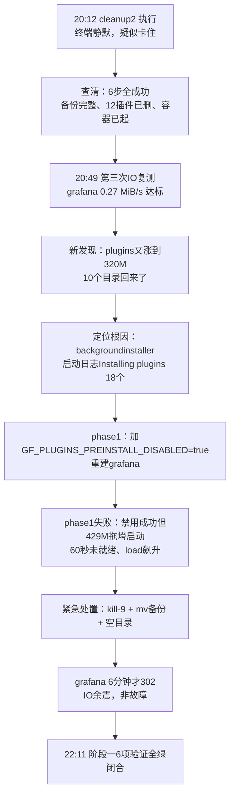
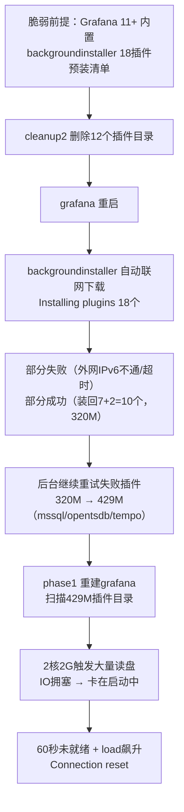

# 17 Grafana 插件自动重装与止血收尾排障续录

> **定位**：[[16 Grafana公网暴露触发IO饱和排障实录]] 的续篇。16 记录到 20:12 执行 `plugin-cleanup2.sh` 后现场疑似卡住、结果未知；本篇接续 20:12 → 22:12 的完整收尾过程，核心是发现 **Grafana 11+ 的 backgroundinstaller 会自动把删掉的插件装回来**，以及围绕这条新根因的禁用、失败、紧急处置与阶段一闭合。
> **服务器**：华为云 Flexus · CentOS 7.9 · 2 核 2G · 40G 根分区 · 公网 EIP `110.41.63.156`
> **事故时间**：2026-10-30 20:12 ~ 22:12（cleanup2 结果查清 → 阶段一闭合）
> **当前状态**：✅ 阶段一闭合——IO 拥塞解除、插件清理持久化、backgroundinstaller 预装已禁用、grafana 秒回 302。**但阶段一闭合后实际访问 monitor 发现负载再次爆满，根因是 Grafana 11+ app platform 的 gpx_ 子进程在 2G 内存机器上结构性过载——完整排障与降级 10.4.10 收尾见 [[18 Grafana app platform过载与降级10x排障收尾]]**。🔄 端口结构性收口（iptables 持久化、ports→expose、NPM 共享网络）仍待执行，但非紧急（安全组已封 3000，grafana 已降级到 10.x 单进程架构）。
> **配套方法篇**：可迁移的 IO 排查流程与工具集见 [[03 Linux-IO拥塞排查方法论与proc采样工具集]]；跨多次排障的证据验证判据见 [[04 排障中的证据验证与判断纪律]]。
> **关联**：前半段实录见 [[16 Grafana公网暴露触发IO饱和排障实录]]；Grafana 部署背景见 [[08 Grafana Prometheus资源监控]]。

---

## 一、这篇笔记讲什么（结论先行）

### 1.1 与 16 号笔记的衔接

16 号笔记停在 20:12：用户执行 `plugin-cleanup2.sh` 后终端静默、截图显示 load 41.77 / CPU 100% / 内存 92%，疑似卡住，备份/停容器/删除/启动状态均未确认（16 §7.5 未决项）。本篇回答三个问题：

1. cleanup2 到底删成了没？
2. 删完之后 IO 真的达标了吗？
3. 为什么后续又出现负载飙升、grafana 起不来？

### 1.2 一句话结论

**cleanup2 完整成功、IO 正式收敛到 0.27 MiB/s，但 Grafana 11+ 内置的 backgroundinstaller 每次启动都自动联网下载 18 个预装插件——删掉多少它装回多少，清理等于白做。** 禁用预装（`GF_PLUGINS_PREINSTALL_DISABLED=true`）本身成功了，但禁用前 plugins 已膨胀到 429M，重建 grafana 时扫描 429M 插件目录再次触发 IO 拥塞、60 秒未就绪。最终通过 `kill -9` + `mv` 秒级备份 + 空目录重启解决，grafana 在 IO 余震中 6 分钟后恢复 302。

### 1.3 收尾主线



---

## 二、动手前先懂：本轮新概念

### 2.1 Grafana 11+ 的 backgroundinstaller 与预装清单

Grafana 11 引入 app platform 后，内置了一个**后台插件安装器（plugin.backgroundinstaller）**，维护一份 18 个插件的预装清单（含 prometheus、loki、jaeger、tempo、stackdriver、grafana-exploretraces-app、grafana-pyroscope-app、grafana-metricsdrilldown-app、grafana-advisor-app 等）。**每次 grafana 启动，backgroundinstaller 都会自动联网从 grafana.com 下载安装这些插件**，已存在的跳过，不存在的下载解压。

本次 cleanup2 删掉 12 个插件目录后重启 grafana，启动日志立刻出现：

```text
plugin.backgroundinstaller msg="Installing plugins"
  plugins="[{ID:grafana-exploretraces-app} {ID:grafana-pyroscope-app}
  {ID:grafana-metricsdrilldown-app} {ID:prometheus} {ID:stackdriver}
  {ID:jaeger} {ID:grafana-advisor-app} {ID:loki} ...共18个]"
plugin.backgroundinstaller msg="Failed to install plugin"
  pluginId=grafana-exploretraces-app error="network is unreachable"
plugin.backgroundinstaller msg="Failed to install plugin"
  pluginId=grafana-pyroscope-app error="context deadline exceeded"
```

部分插件因外网 IPv6 不通或超时安装失败——**一旦外网通畅，全部 18 个都会被装回来**。这就是为什么 cleanup2 删掉的 12 个里，有 7 个在 20:49 又回来了，还额外多了 jaeger 和 grafana-postgresql-datasource；到 phase1 执行前又涨到 429M（新增 mssql 37M、opentsdb 28M、tempo 46M，之前失败的在后台重试成功）。

**禁用方式**（官方文档 + 社区 + 多个生产项目确认）：

```yaml
# docker-compose.yml grafana 段
environment:
  - GF_PLUGINS_PREINSTALL_DISABLED=true
```

等价于 `grafana.ini` 里 `[plugins] preinstall_disabled = true`。设置后启动不再后台下载插件。**Prometheus 数据源是 Grafana 内置 builtin 类型，不读 plugins 目录文件，禁用预装不影响现有 Prometheus 数据源与仪表盘。**

### 2.2 `mv` 与 `tar` 在 IO 压力下的代价差异

清理/备份插件目录有两种方式，在 IO 拥塞环境下代价完全不同：

| 方式 | 机制 | IO 压力下耗时 | 适用场景 |
|---|---|---|---|
| `tar -czf` 打包 | 读取全部文件内容、压缩、写新文件 | 几十秒~几分钟，可能卡死 | IO 正常时的标准备份 |
| **`mv` 改名** | 同一文件系统下只改目录项的 inode 引用，不搬数据 | **秒级**，不读数据 | IO 压力下的紧急备份 |

本次紧急处置用 `mv plugins plugins.bak-manual` 秒级完成 429M 目录的备份，避免了 `tar` 在 IO 拥塞下卡死。**前提：源和目标在同一文件系统**（都在 `/var/lib/docker/volumes/monitor_grafana-data/_data/` 下），跨文件系统 `mv` 会退化为复制+删除，代价等同于 `cp`。

### 2.3 SIGKILL 与 D 状态进程

IO 拥塞期进程常进入 D 状态（不可中断睡眠，卡在内核 IO 调用）。D 状态进程**收不到普通信号**（SIGTERM、SIGINT），但 **SIGKILL（kill -9）在内核 IO 调用返回后最终会生效**——不是立即杀死，而是标记为待杀，等进程从内核态返回时执行。

本次 `kill -9 $(pgrep -f grafana)` 成功杀掉了 grafana 主进程，使容器进入 Exited 状态，为后续 `mv` 备份腾出了文件访问窗口。**这是 dockerd 卡死时绕过 `docker stop` 的有效手段**：`docker stop` 要经 dockerd → containerd → SIGTERM → 等优雅退出 → 超时 SIGKILL，整条链路在 IO 拥塞期都会阻塞；`kill -9` 直接走内核，不依赖 daemon。

### 2.4 load average 三值的"恢复形态"

[[03 Linux-IO拥塞排查方法论与proc采样工具集]] §2.4 讲了恶化形态（1 分钟远高于 15 分钟 = 刚发生）。本轮补充**恢复形态**的判读：

| 形态 | 1分钟 | 5分钟 | 15分钟 | 含义 |
|---|---|---|---|---|
| 恶化中 | 高 | 中 | 低 | `1 > 5 > 15`，故障刚发生，正在堆积 |
| 持续高位 | 高 | 高 | 高 | `1 ≈ 5 ≈ 15`，积压未排完 |
| **恢复中** | **低** | **中** | **高** | **`1 < 5 < 15`，已恢复，平均值正在追下来** |

本次 22:11 实测 `load 1.40 / 9.38 / 15.49`，1 分钟已回落到正常，5/15 分钟仍高——典型的恢复形态。**看到 1<5<15 不要误判为"还在恶化"**，方向是对的，再等 10-15 分钟 5 分钟均值也会降下来。

### 2.5 重建容器 vs 数据卷

`docker compose up -d grafana`（或 `docker start`）只更换容器外壳（进程、网络栈、cgroup），**挂载的数据卷内容不受影响**。本次多次重建 grafana，配置、仪表盘、数据源、grafana.db 全部在卷 `monitor_grafana-data` 里，重建后完好无损。理解这一点才能放心做重建操作——担心的只是启动期间服务短暂中断，不是数据丢失。

---

## 三、收尾目标清单

1. 查清 cleanup2 执行结果（备份/停容器/删除/启动状态）；
2. 第三次 IO 复测，确认 grafana 读速是否达标；
3. 发现并定位插件被自动重装的根因；
4. 禁用 backgroundinstaller 预装，阻止插件继续膨胀；
5. 处置 phase1 失败（429M 插件拖垮启动）；
6. 验证阶段一全部目标闭合。

---

## 四、实操收尾全过程（主线）

> 全程协作纪律与 16 号一致：助手给方案、命令、预期结果、验证标准；服务器实操由用户本人执行。

### 步骤 1：查清 cleanup2 执行结果（20:12 静默 ≠ 卡死）

- **目标**：确认 cleanup2 到底删成了没、容器起没起来、备份在不在。
- **判据**：16 §6.1 已记录"静默重定向 ≠ 卡死"——脚本把整段输出重定向到文件，终端只在结束时打印路径。但当时未回传诊断输出，悬而未决。
- **操作**：用户回传 `plugin-cleanup2-20261030-200658.txt`（cleanup2 自己的执行记录）。
- **实测结果**：**6 步全部成功**。

  | 步骤 | 结果 |
  |---|---|
  | 0. 只读终检 | ✅ data_source 仅 prometheus；三表无外部插件引用；compose 无 GF_INSTALL_PLUGINS |
  | 1. 现状记录 | plugins 283M，grafana Up，load 2.67 |
  | 2. 备份 | ✅ `/root/grafana-plugin-backup-20261030-200658`，plugins.tar.gz 100M + sha256 `812ad4d5...` + grafana.db 2.2M |
  | 3. 停止 | ✅ 20:24:48 完成，Exited(137)（30s 超时后 SIGKILL，正常） |
  | 4. 删除 | ✅ 12 个目录全删，剩余条目数 0 |
  | 5. 启动验证 | ✅ 第 40 秒 HTTP=302；3 次计时 0.013s / 0.001s / 0.000s；data_source 仍仅 prometheus |
  | 6. 汇总 | 就绪状态: 是 |

- **判定**：cleanup2 脚本本身没有任何问题。20:12 截图的 load 41.77 是脚本运行过程中的瞬时尖峰（tar 打包 283M + 停容器 + 删目录 + 重启，在 2 核 2G 上吃满资源），**不是故障复发，也不是卡死**。

### 步骤 2：第三次 IO 复测——达标，拥塞解除

- **目标**：对比四轮 grafana 读速，判定插件清理是否降低了冷读面。
- **实测结果**（`io-snapshot-20261030-204937.txt`，20:49）：

  | 指标 | 实测 | 判定 |
  |---|---|---|
  | grafana read | **0.27 MiB/s** | ✅ 远低于 5 达标线 |
  | D 状态进程 | 空 | ✅ 无不可中断 IO 等待 |
  | wa | 1~4% | ✅（事故期 95%+） |
  | load 1分钟 | 1.19 | ✅（15分钟 8.02 是 cleanup2 残留，正在回落） |
  | 3000 活跃连接 | 空 | ✅ 公网直连已封堵 |
  | grafana wchan | futex_wait_queue_me (S 态) | ✅ 正常等待，非 IO 阻塞 |
  | 内存 | 1.4G used / 180M available | 与基线持平 |

- **四轮趋势**：45.82 → 22.15 → 25.84 → **0.27 MiB/s**。
- **判定**：IO 拥塞正式解除。但注意一个事实——**IO 下降的主因是止血（封掉 3000 公网暴露），不是插件清理**。公网扫描流量打不进来了，apiserver/cleanup/bleve 不再被反复唤醒读盘。插件清理的效果需要先排除 backgroundinstaller 干扰才能评估。

### 步骤 3：新发现——插件被自动重装回来了

- **目标**：复测达标了，但 20:49 快照第 20 节显示 plugins 目录又涨到了 **320M**，包含 10 个插件目录。
- **现象**：cleanup2 删掉的 12 个里，**7 个又回来了**，还额外多了 jaeger 和 grafana-postgresql-datasource。
- **疑问**：compose 没有 `GF_INSTALL_PLUGINS`（16 §7.2.2 已确认），plugins 目录被删后为什么会自己长回来？

### 步骤 4：定位根因——backgroundinstaller

- **目标**：从 cleanup2 日志找插件重装的触发源。
- **操作**：读 cleanup2 日志第 5.1 节（grafana 启动日志）。
- **证据**：见 2.1 的启动日志原文——`plugin.backgroundinstaller msg="Installing plugins"` 明确列出了 18 个预装插件 ID，伴随多条 `Failed to install plugin ... error="network is unreachable"` / `"context deadline exceeded"`。
- **判定**：根因是 Grafana 11+ 的 app platform 内置预装清单。每次启动自动联网下载，删了 plugins 目录 → 重启 → 它又从 grafana.com 把能下的都下回来。当前部分失败只是因为外网 IPv6 不通/超时，**一旦外网通畅全部 18 个都会被装回来，清理等于白做**。
- **禁用方案**：`GF_PLUGINS_PREINSTALL_DISABLED=true`（见 2.1）。

### 步骤 5：phase1——禁用预装并重建 grafana

- **目标**：在 compose 加环境变量，重建 grafana，阻止插件自动重装。
- **方案**：编写 `docker-compose-hardened.yml`（仅 grafana 段加两行 environment，其余不变）+ `phase1-disable-preinstall.sh`（预检 → 备份原 compose → 替换 → 验证 → 重建 grafana → 全套验证）。
- **脚本设计修正**：第一版脚本有逻辑漏洞——假设用户已手动覆盖原 compose 再去"备份"，备份的是新文件、失去回滚意义。修正后**备份放在替换之前**，流程为：预检 hardened 文件（含环境变量？CRLF？）→ 备份原 compose → 替换 → 再次验证 → 重建 grafana。另加 CRLF 自动转换与 `--project-directory` 保险。
- **执行**：21:24 用户执行 `bash /root/phase1-disable-preinstall.sh`。

### 步骤 6：phase1 失败——禁用成功但 grafana 没就绪

- **目标**：验证 phase1 结果。
- **实测结果**（`phase1-20261030-212407.txt`）：

  | 验证项 | 结果 | 判定 |
  |---|---|---|
  | 10.3 环境变量 | `GF_PLUGINS_PREINSTALL_DISABLED=true` 容器内可见 | ✅ 禁用生效 |
  | 10.4 data_source | 仍只有 prometheus | ✅ |
  | 10.5 日志判定 | OK: 启动日志无插件安装行为 | ✅ 预装已禁用 |
  | 10.6 plugins 改前→改后 | 429M → 429M | ✅ 没有再增长 |
  | 第 9 节 等待就绪 | 60 秒，12 次全部 HTTP=000 | ❌ 未就绪 |
  | 10.2 本机 curl | `Connection reset by peer` × 3 | ❌ |
  | load 改前→改后 | 5.97/2.27/2.31 → 13.96/13.56/8.61 | ❌ 反而飙升 |

- **原因分析**：预装禁用成功了，但 **plugins 目录在禁用之前已经膨胀到 429M**（比 20:49 的 320M 又涨 109M，新增 mssql 37M + opentsdb 28M + tempo 46M——backgroundinstaller 在 20:49 后继续后台重试安装之前失败的插件）。grafana 重建后启动时要扫描这 429M 插件目录，在 2 核 2G 机器上触发大量读盘 → IO 拥塞 → grafana 卡在启动中 → `Connection reset` + load 飙升。
- **对照组**：cleanup2 那次 plugins 是空的（1M），重启 40 秒就 302；phase1 这次 429M，60 秒都没起来。**根因就是这 429M 插件目录拖垮了启动。**

### 步骤 7：紧急处置——kill -9 + mv + 空目录重启

- **目标**：grafana 卡在启动中、load 飙升，需要快速清空 plugins 目录再重启。phase1-fix 脚本在 IO 拥塞下卡住（`du -sh` 遍历 429M、`docker stop` 等响应都卡），改为**逐条手动执行**。
- **操作与输出**：

  ```bash
  # 1. Ctrl+C 中断卡住的脚本

  # 2. 直接 kill grafana 进程（不等 docker stop）
  kill -9 $(pgrep -f grafana) 2>/dev/null; echo "killed"
  # → killed

  # 3. mv 备份 plugins（秒级，不读数据）
  mv /var/lib/docker/volumes/monitor_grafana-data/_data/plugins \
     /var/lib/docker/volumes/monitor_grafana-data/_data/plugins.bak-manual \
     && mkdir -p /var/lib/docker/volumes/monitor_grafana-data/_data/plugins \
     && echo "done"
  # → done

  # 4. 启动 grafana
  docker start grafana
  # → grafana

  # 5. 验证
  curl -sS -o /dev/null -w "%{http_code} %{time_total}s\n" --max-time 10 http://127.0.0.1:3000/
  # → 000 0.011s  Connection reset（刚启动，HTTP server 未绑定）
  ```

- **判定**：`docker start` 成功返回，grafana 容器已 Up，但 HTTP server 还在初始化（docker-proxy 转发进去被 reset）。需要等待启动完成。

### 步骤 8：IO 余震中恢复——6 分钟后 302

- **目标**：等待 grafana 就绪，确认 plugins 清空生效。
- **操作**：两轮循环 curl 检测。

  | 轮次 | 时间 | 结果 |
  |---|---|---|
  | 第一轮（启动后 0-40s） | 第5s~第40s | 全部 000，前6次 `Connection reset`，后2次 `Operation timed out` |
  | docker ps 确认 | 启动后约 1 分钟 | `grafana Up 6 minutes` ✅ 容器没崩 |
  | 第二轮（启动后约 6 分钟） | 第5s | **302 0.035s** ✅ |
  | 第二轮 | 第10s | **302 0.304s** ✅ |

- **为什么 6 分钟才 302**：不是故障，是 **IO 余震**。kill -9 之前机器 load 已飙到 45.72，内存页缓存被读盘请求挤空。即使 plugins 已 mv 走、grafana 进程空目录启动很快，但内核还在消化之前积压的 IO 队列、逐步重建页缓存。grafana 自己启动快（空 plugins），但本机 curl 要等内核把 docker-proxy 那条链路的页缓存补回来，所以前 40 秒全 reset/timeout。**等页缓存补到位，302 就出来了**——这就是"系统已恢复、平均值正在追下来"的恢复形态（见 2.4）。

### 步骤 9：阶段一验证——6 项全绿，闭合

- **目标**：确认阶段一全部目标达成。
- **实测结果**（22:11）：

  | # | 验证项 | 实测 | 判定 |
  |---|---|---|---|
  | 1 | load 1分钟 | **1.40** | ✅（5/15分钟 9.38/15.49 是余震残留，恢复形态） |
  | 2 | IO wait | 4% / 5% / 5% | ✅（事故期 95%+） |
  | 3 | grafana 健康度 | 302 / 302 / 302（0.13s→0.001s→0.000s） | ✅ 秒回，越测越快说明页缓存补到位 |
  | 4 | plugins 目录 | **4.0K（空）** | ✅ 已清空 |
  | 5 | 预装禁用环境变量 | `GF_PLUGINS_PREINSTALL_DISABLED=true` | ✅ 生效 |
  | 6 | 日志插件安装行为 | **无输出**（grep 无匹配） | ✅ backgroundinstaller 完全静默 |

- **判定**：阶段一全部目标达成——IO 拥塞解除 + 插件清理持久化 + 自动重装封堵。

---

## 五、根因链条：插件为什么反复膨胀



**与 16 号根因的关系**：16 号的根因是"3000 公网暴露被扫描"（外部触发）；本篇的根因是"backgroundinstaller 自动重装"（内部机制）。两者叠加导致 cleanup2 删了等于没删——删完重启就被装回来，装回来又涨到 429M，429M 又拖垮重建。**只有同时满足"空 plugins + preinstall 禁用"两个条件，才能彻底解决**：

| 对比 | plugins | preinstall | 启动就绪 | 结果 |
|---|---|---|---|---|
| cleanup2 | 空（1M） | 未禁用 | 40秒 302 | ✅ 启动快，但插件被装回 |
| phase1 | 429M | 已禁用 | 60秒未就绪 | ❌ 429M 拖垮启动 |
| **紧急处置** | **空** | **已禁用** | **6分钟 302（IO余震）** | **✅ 启动快且不再膨胀** |

---

## 六、踩坑记录与关键经验

### 6.1 踩坑表

| 问题现象 | 根因 | 解决办法 |
|---|---|---|
| 删掉 plugins 目录后重启，插件又自己长回来 | Grafana 11+ backgroundinstaller 内置 18 插件预装清单，每次启动自动联网下载 | compose 加 `GF_PLUGINS_PREINSTALL_DISABLED=true`；prometheus 是 builtin 类型不受影响 |
| 禁用预装后重建 grafana，反而 load 飙升、60 秒未就绪 | 禁用前 plugins 已膨胀到 429M，重建时扫描 429M 目录触发 IO 拥塞 | 先清空 plugins 再重建；空 plugins + 禁用 = 启动快且不膨胀 |
| phase1-fix 脚本在 IO 拥塞下卡住（跑了 8 分钟） | `du -sh` 遍历 429M、`docker stop` 等 dockerd 响应都阻塞在 IO 队列 | 改为逐条手动执行；`kill -9` 绕过 dockerd 直接内核级杀进程 |
| `docker stop` 在 IO 拥塞期卡死 | 要经 dockerd → containerd → SIGTERM → 等优雅退出，整条链路阻塞 | `kill -9 $(pgrep -f <进程>)` 直接内核级杀，不依赖 daemon |
| 备份 429M 目录用 tar 卡死 | tar 要读取全部文件内容压缩写盘，IO 压力下长时间阻塞 | 同文件系统下用 `mv` 改名，只改 inode 引用、秒级完成 |
| grafana 启动后 curl 返回 000 + Connection reset | HTTP server 还在初始化，docker-proxy 转发进去被 reset | 等待启动完成；循环 curl 检测，出现 302 即成功 |
| grafana 启动后 6 分钟才 302，疑似又卡死 | IO 余震：kill 前页缓存被挤空，内核在消化积压队列、重建页缓存 | 看 load 三值形态：1<5<15 是恢复中，不是恶化；等页缓存补到位自然恢复 |
| 第一版 phase1 脚本备份逻辑有漏洞 | 假设用户已手动覆盖原 compose 再备份，备份的是新文件、失去回滚意义 | 备份放在替换之前；预检不通过不碰原文件 |
| 脚本在终端"卡住没输出"误判为死掉 | 整段输出重定向到文件，终端只在结束时打印路径 | 先跑只读诊断看进程树与最新输出文件，不凭"没输出"判卡死（16 §6.1 已有，本轮再验证） |

### 6.2 本轮沉淀的三条经验

**① 删了会自动装回来的，禁用机制比手动清理更重要。**
cleanup2 完美执行了 6 步，但 backgroundinstaller 在重启瞬间就把成果抹掉。任何"清理类"操作前，必须先确认有没有自动恢复机制（cron、systemd timer、应用内置的 installer/update checker、镜像 entryhook）。**先禁用机制，再清理，否则等于白做。**

**② IO 压力下的备份与停止，要选不读数据的手段。**
`tar` 打包、`docker stop` 等优雅操作都要读写数据，IO 拥塞期会卡死。替代手段：`mv` 同文件系统改名（秒级）、`kill -9` 直接内核杀进程（不等优雅退出）。这些是"暴力但有效"的紧急手段，**只在 IO 拥塞期使用**，正常情况下仍应优先优雅操作。

**③ load 三值形态决定下一步动作，不要只看 1 分钟。**
load 1 分钟高但 5/15 低 → 刚发生，紧急；1 分钟低但 5/15 高 → 恢复中，等待；三值都高 → 持续积压，需干预。**看到 1<5<15 不要急着操作，先确认趋势再决定**——本轮 grafana 6 分钟才 302 期间，load 就是恢复形态，等待是正确选择。

---

## 七、阶段一闭合结论与阶段二前置

### 7.1 阶段一闭合（2026-10-30 22:12）

| 项 | 状态 |
|---|---|
| 紧急 IO 拥塞 | ✅ 已彻底解除 |
| grafana 3000 公网暴露 | ✅ 止血（安全组 + iptables DROP，见 16 §步骤 7/步骤 9.4） |
| 插件自动重装 | ✅ 已禁用（GF_PLUGINS_PREINSTALL_DISABLED=true） |
| plugins 目录 | ✅ 已清空（mv 备份在 `plugins.bak-manual`，建议保留 3 天确认稳定后删） |
| grafana 服务 | ✅ 秒回 302 |

### 7.2 16 号 §7.5 未决项闭合状态

| 16 号未决项 | 本轮状态 |
|---|---|
| plugin-cleanup2.sh 执行结果未知 | ✅ 已闭合：6 步全成功（步骤 1） |
| alist 20:12 现场 CPU 49.2% 性质 | ✅ 间接闭合：cleanup2 执行期的瞬时尖峰，机器恢复后未再现 |
| Grafana 插件引用甄别 | ✅ 已闭合：三轮只读 + cleanup2 执行确认无引用（16 §7.2.2） |

### 7.3 阶段二：端口结构性收口（待执行）

阶段一闭合后，剩余结构性隐患都在阶段二解决（详细方案见 16 §7.4，本轮未改动）：

1. **iptables DROP 3000 是运行时规则，重启会丢**——需 `iptables-save` 持久化；
2. **3000/3001/8090/5244/8080 五个端口仍 `0.0.0.0` 直绑公网**——需 ports 改 expose；
3. **NPM 反代五个后端填 `172.17.0.1:端口`**——需接入共享 Docker 网络、反代目标改容器名；
4. **INPUT 顶部 9 条裸 ACCEPT**——需清理并限定网卡/状态；
5. **安全组还没放行 443**——六个 HTTPS 站点还断着，收口完成后恢复。

**前置信息收集**（阶段二设计需要）：

```bash
docker ps --format 'table {{.Names}}\t{{.Image}}\t{{.Ports}}' && echo "--- 网络 ---" && docker network ls
```

### 7.4 其他遗留观察项

- `plugins.bak-manual`（429M）占空间但不影响 IO，建议保留 3 天确认稳定后删除：`rm -rf /var/lib/docker/volumes/monitor_grafana-data/_data/plugins.bak-manual`；
- vaultwarden 读速跟踪、cleanup 拉长评估、Grafana 匿名访问口径、`59.82.83.112` 电信段来源、`172.17.0.1:3000 ↔ 172.20.0.2` kuma 反向访问用途、公安备案截止 2026-11-28——均沿用 16 §7.5 跟踪，低优先级随主线推进核对。

---

## 八、面试话术

### 8.1 一分钟口述版本

> 删掉 Grafana 283M 无用插件后第三次复测，读速从 45 MiB/s 降到了 0.27，IO 拥塞正式解除。但复测时发现 plugins 目录又涨到 320M——查启动日志发现 Grafana 11+ 内置了一个 backgroundinstaller，每次启动自动联网下载 18 个预装插件，删多少装多少。
>
> 我在 compose 加了 `GF_PLUGINS_PREINSTALL_DISABLED=true` 禁用预装，重建 grafana。禁用本身成功了，启动日志不再有插件安装行为，但 grafana 60 秒都没就绪、load 反而飙到 14——因为禁用之前 plugins 已经膨胀到 429M，重建时扫描 429M 目录在 2 核 2G 上又把 IO 打满了。
>
> phase1-fix 脚本在 IO 拥塞下卡住，我改为逐条手动执行：`kill -9` 直接杀 grafana 进程绕过 docker stop，`mv` 把 429M plugins 改名备份——同文件系统下 mv 只改 inode 引用、秒级完成，不读数据，避免了 tar 在 IO 压力下卡死。然后建空目录、docker start。grafana 6 分钟后才返回 302，前 40 秒全是 Connection reset——这不是又卡死，是 IO 余震：kill 前页缓存被挤空，内核在消化积压队列、重建页缓存。看 load 三值 1.40/9.38/15.49，1 分钟已经正常、5/15 分钟还在追下来，是典型的恢复形态，等页缓存补到位 302 自然出来。最后 6 项验证全绿，阶段一闭合。
>
> 这轮最大的教训是：删了会自动装回来的东西，禁用机制比手动清理更重要——先禁用再清理，否则等于白做；IO 压力下的备份要选不读数据的手段，mv 比 tar 快几个数量级。

### 8.2 高频问答

**Q1：为什么删了插件又自己长回来？**
A：Grafana 11+ 的 app platform 内置了 backgroundinstaller，维护一份 18 个插件的预装清单，每次启动自动从 grafana.com 下载安装。compose 里没有 `GF_INSTALL_PLUGINS` 也会触发，因为这是镜像内置行为。必须用 `GF_PLUGINS_PREINSTALL_DISABLED=true` 禁用，prometheus 数据源是 builtin 类型不受影响。

**Q2：禁用预装成功了，为什么 grafana 还是起不来？**
A：禁用在重建这一刻生效，但 plugins 目录在禁用之前已经膨胀到 429M（backgroundinstaller 在之前几次启动时持续后台安装、重试失败插件）。grafana 启动时要扫描整个 plugins 目录，429M 在 2 核 2G 上触发大量读盘，IO 拥塞导致启动卡住。对比 cleanup2 那次 plugins 是空的，40 秒就 302——说明根因就是 429M 目录本身。解决：先清空 plugins 再重建，空 plugins + 禁用 = 启动快且不膨胀。

**Q3：IO 拥塞期怎么快速停掉 grafana？docker stop 卡死了。**
A：`docker stop` 要经 dockerd → containerd → SIGTERM → 等优雅退出 → 超时 SIGKILL，整条链路在 IO 拥塞期都阻塞。直接 `kill -9 $(pgrep -f grafana)` 走内核，不依赖 daemon。SIGKILL 对 D 状态进程不是立即生效，但内核 IO 调用返回后会执行，最终能杀掉。

**Q4：备份 429M 插件目录为什么用 mv 不用 tar？**
A：tar 要读取全部文件内容压缩写盘，IO 压力下会卡死。mv 在同一文件系统下只改目录项的 inode 引用，不搬数据，秒级完成。前提是源和目标在同一文件系统——都在 `/var/lib/docker/volumes/monitor_grafana-data/_data/` 下。跨文件系统 mv 会退化为复制+删除。这是 IO 压力下的紧急手段，正常情况仍优先 tar 做标准备份。

**Q5：grafana 启动后 6 分钟才返回 302，怎么判断是恢复中而不是又出问题？**
A：看 load 三值形态：1.40/9.38/15.49，1 分钟已正常、5/15 分钟还在追下来，1<5<15 是典型的恢复形态（恶化形态是 1>5>15）。再看 docker ps 确认容器 Up 没崩、wchan 是 futex_wait（S 态正常等待）。综合判断是 IO 余震——kill 前页缓存被挤空，内核在消化积压队列、重建页缓存，等补到位 302 自然出来。如果 40 秒后还在 reset + load 三值都高 + 容器 Restarting，才需要看日志找原因。

**Q6：load 三值的恢复形态和恶化形态怎么区分？**
A：恶化中是 1 分钟远高于 15 分钟（1>5>15），故障刚发生正在堆积；持续高位是三值接近（1≈5≈15），积压未排完；恢复中是 1 分钟低于 15 分钟（1<5<15），已恢复、平均值正在追下来。看到 1<5<15 不要急着操作，先确认趋势——本轮就是等了 6 分钟 302 自然出来，如果当时强行重启可能再次触发 IO 拥塞。

---

## 九、历史备查

### 9.1 cleanup2 执行结果明细（`plugin-cleanup2-20261030-200658.txt`）

- 备份目录：`/root/grafana-plugin-backup-20261030-200658/`
- 备份三件套：`plugins.tar.gz`（100M）+ `plugins.tar.gz.sha256`（`812ad4d5...`）+ `grafana.db` / `grafana.db-wal` / `grafana.db-shm`（2.2M）
- 停止时点：20:24:48，Exited(137)（30s 超时后 SIGKILL）
- 启动就绪：第 40 秒 HTTP=302，三次计时 0.013s / 0.001s / 0.000s
- 删除 12 目录清单：见 16 §7.2.1

### 9.2 第三次 IO 复测明细（`io-snapshot-20261030-204937.txt`）

- grafana read 0.27 MiB/s；D 状态空；wa 1~4%；load 1分钟 1.19 / 15分钟 8.02（cleanup2 残留）；3000 连接空；wchan `futex_wait_queue_me`（S 态）；available 180M。
- 四轮趋势：16:39 45.82 → 18:00 22.15 → 19:38 25.84 → 20:49 **0.27 MiB/s**。

### 9.3 backgroundinstaller 启动日志原文（cleanup2 日志第 5.1 节）

```text
plugin.backgroundinstaller msg="Installing plugins"
  plugins="[{ID:grafana-exploretraces-app} {ID:grafana-pyroscope-app}
  {ID:grafana-metricsdrilldown-app} {ID:prometheus} {ID:stackdriver}
  {ID:jaeger} {ID:grafana-advisor-app} {ID:loki} ...共18个]"
plugin.backgroundinstaller msg="Failed to install plugin"
  pluginId=grafana-exploretraces-app error="network is unreachable"
plugin.backgroundinstaller msg="Failed to install plugin"
  pluginId=grafana-pyroscope-app error="context deadline exceeded"
```

20:49 复测时 plugins 320M（10 目录：7 个回归 + jaeger + grafana-postgresql-datasource + 其他）；phase1 执行前涨到 429M（新增 mssql 37M、opentsdb 28M、tempo 46M）。

### 9.4 phase1 验证明细（`phase1-20261030-212407.txt`）

- 10.3 环境变量：`GF_PLUGINS_PREINSTALL_DISABLED=true` ✅
- 10.4 data_source：仅 prometheus ✅
- 10.5 日志判定：OK 启动日志无插件安装行为 ✅
- 10.6 plugins：改前 429M → 改后 429M ✅（未增长）
- 第 9 节等待就绪：60 秒 12 次全 HTTP=000 ❌
- 10.2 本机 curl：`Connection reset by peer` × 3 ❌
- load 改前 5.97/2.27/2.31 → 改后 13.96/13.56/8.61 ❌
- 汇总就绪状态：否

### 9.5 紧急处置命令序列与输出

```bash
kill -9 $(pgrep -f grafana) 2>/dev/null; echo "killed"
# → killed

mv /var/lib/docker/volumes/monitor_grafana-data/_data/plugins \
   /var/lib/docker/volumes/monitor_grafana-data/_data/plugins.bak-manual \
   && mkdir -p /var/lib/docker/volumes/monitor_grafana-data/_data/plugins \
   && echo "done"
# → done

docker start grafana
# → grafana

curl -sS -o /dev/null -w "%{http_code} %{time_total}s\n" --max-time 10 http://127.0.0.1:3000/
# → 000 0.011s  curl: (56) Recv failure: Connection reset by peer
```

循环检测（第一轮 0-40s 全 000 reset/timeout；docker ps 确认 Up 6 minutes；第二轮第 5s 302 0.035s、第 10s 302 0.304s）。

### 9.6 阶段一验证明细（22:11）

```
load average: 1.40, 9.38, 15.49   （恢复形态 1<5<15）
vmstat wa: 4% / 5% / 5%
grafana curl: 302 0.130s / 302 0.001s / 302 0.000s
plugins: 4.0K（空）
env: GF_PLUGINS_PREINSTALL_DISABLED=true
logs grep backgroundinstaller|Installing plugin|Failed to install: 无输出
```

### 9.7 改后的 compose grafana 段

```yaml
  grafana:
    image: grafana/grafana:latest
    container_name: grafana
    restart: unless-stopped
    environment:                              # 阶段一新增
      - GF_PLUGINS_PREINSTALL_DISABLED=true   # 阻止 backgroundinstaller 自动预装
    ports:
      - '3000:3000'                           # 阶段二改 expose，取消 0.0.0.0 直绑
    volumes:
      - grafana-data:/var/lib/grafana
    links:
      - prometheus
```

其余服务段不变。完整 hardened compose 见交付文件 `docker-compose-hardened.yml`。
