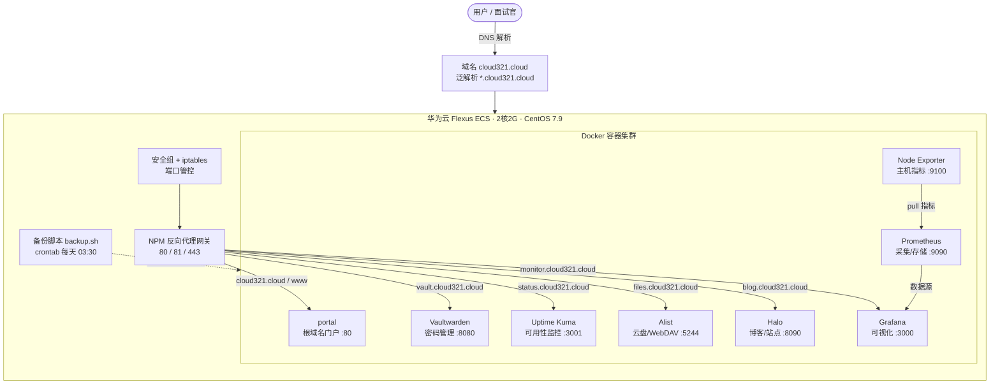

# CloudLab — 基于 Docker 的多云服务云平台

> 一台华为云服务器，用 Docker 从零搭建的**多服务自托管平台**：统一网关、密码管理、可用性监控、资源监控、云盘存储与自动备份。
> 全程真实云环境、可在线访问、可深度排查，配套完整学习笔记。

---

## 一、项目简介

本项目以一台 **2核2G、CentOS 7.9** 的华为云 Flexus 服务器为底座，使用 **Docker + Docker Compose** 容器化部署了 6 大类、9 个容器的自托管服务，并通过 **Nginx Proxy Manager** 统一收敛入口、自动签发 HTTPS 证书，最终实现：

- 多服务共用 **80/443** 端口，通过子域名分流，根域名做统一门户导航；
- 服务可用性（Uptime Kuma）与主机资源（Prometheus + Grafana）双重监控；
- 云盘文件服务 + WebDAV 挂载；
- 定时全量备份配置与数据卷；
- 完整处理了**镜像加速、证书 DNS 验证、防火墙切换、ICP 备案**等真实生产问题。

> 这是一个"麻雀虽小、五脏俱全"的云平台实践，覆盖运维的**入口、安全、监控、存储、数据保护、合规**六大核心领域。

---

## 二、整体架构



---

## 三、服务清单

| 能力域 | 服务 | 端口 | 作用 |
|---|---|---|---|
| 入口网关 | Nginx Proxy Manager | 80 / 81 / 443 | 反向代理、子域名分流、自动 HTTPS |
| 门户/入口 | portal（nginx:alpine） | 不发布（仅 npm_default 内网） | 根域名落地页、服务导航、备案号悬挂 |
| 安全/密码 | Vaultwarden | 8080 | 兼容 Bitwarden 的轻量密码管理 |
| 可用性监控 | Uptime Kuma | 3001 | 服务探活、告警、公开状态页 |
| 资源监控 | Prometheus | 9090 | 指标采集与时序存储 |
| 资源监控 | Node Exporter | 9100 | 主机 CPU/内存/磁盘指标 |
| 资源监控 | Grafana | 3000 | 监控仪表盘与可视化 |
| 存储/文件 | Alist | 5244 | 多云盘聚合、WebDAV、分享 |
| 内容/站点 | Halo | 8090 | 个人博客/建站，主题与插件生态 |
| 数据保护 | backup.sh | — | 定时备份配置与数据卷 |

---

## 四、技术栈

- **云平台**：华为云 Flexus（ECS、安全组、VPC）、华为云 SWR 镜像服务
- **操作系统**：CentOS 7.9、iptables、SELinux、Swap
- **容器**：Docker CE 24.0.9、Docker Compose v2
- **网关/代理**：Nginx Proxy Manager（Nginx + OpenResty + Let's Encrypt）
- **监控**：Prometheus、Node Exporter、Grafana、PromQL
- **存储**：Alist、WebDAV、Docker Volume
- **运维**：Shell、crontab、tar、日志轮转
- **网络/合规**：DNS 泛解析、ACME DNS-01 验证、ICP 备案

---

## 五、核心功能与亮点

1. **统一入口收敛**：多服务通过 NPM 共用 80/443，按域名 `Host` 分流，避免暴露大量端口。
2. **自动化 HTTPS**：Let's Encrypt 证书自动签发与续期，支持强制 HTTPS、HTTP/2、WebSocket。
3. **DNS-01 验证签发通配符证书**：HTTP 验证被后端转发干扰后，改用阿里云 DNS API 验证，可签发通配符证书。
4. **双重监控体系**：
   - 可用性：Uptime Kuma 探活 + 公开状态页；
   - 资源：Prometheus 拉取 Node Exporter，Grafana 展示 Node Exporter Full 仪表盘。
5. **云盘 + WebDAV**：Alist 聚合存储，Windows 原生 WebDAV 挂载为网络驱动器。
6. **自动备份**：脚本自动备份 compose 配置、bind 数据与全部 named volume，定时清理 7 天前备份。
7. **小规格资源优化**：2G 内存下增加 Swap 防 OOM，按内存占用评估服务可行性。
8. **根域名门户 + 全站强制 HTTPS**：独立 nginx 容器承载门户页（服务导航 + 备案号悬挂），所有站点 80 一律 301 跳 443。

---

## 六、关键问题与解决（面试谈资）

| 问题 | 根因 | 解决 |
|---|---|---|
| 官方 yum 源失效 | CentOS 7 已 EOL，源下线 | 更换阿里云镜像源 + EPEL |
| Docker 拉取镜像慢 | 公开加速地址不稳定 | 改用华为云 SWR 专属内网加速器（460MB/s） |
| 容器与 firewalld 冲突 | 防火墙对 Docker 规则处理不一致 | 切换为 iptables，手动放行端口 |
| 证书申请返回 403 | 代理把 `.well-known` 转发给后端，验证失败 | 改用 DNS-01 验证 + 阿里云 RAM 子账号 |
| 域名 80/443 打不开 | 域名解析到国内服务器但未 ICP 备案，被合规阻断 | 2026-10-29 完成华为云个人备案（粤ICP备2026168431号），阻断解除；四站反代与证书已完成，剩余收尾见笔记 12 |
| 2G 内存有 OOM 风险 | 无 Swap、监控栈占内存高 | 新增 1G Swap 并写入 fstab |
| Alist 根目录上传失败 | 根目录只是挂载点列表，非实际存储 | 进入具体存储目录后上传 |
| 根域名 / `monitor` 返回 `Congratulations!` | NPM 内置 `default_host` 兜底站点会响应所有未匹配域名，**状态码 200 具有欺骗性** | 新建 Proxy Host 并签证书；判断标准是「页面标题 + 443 证书」而非状态码（见笔记 12） |
| Grafana 经域名访问，一登录就跳 localhost | `root_url` 仍是默认 `http://localhost:3000`，所有绝对链接都指向它 | 设 `GF_SERVER_ROOT_URL=https://monitor.cloud321.cloud` |
| 用 iptables 封 Docker 映射的端口封不住 | 端口映射走 iptables 的 `DOCKER` 链，不经过 `INPUT` | 从云安全组收敛，或用 `DOCKER-USER` 链 |
| 宿主机 `curl` 通、NPM 反代却 502 | 发布端口有两条路径：宿主机进程走 `docker-proxy`，容器间访问走 `nat/DOCKER` 的 DNAT；该端口 DNAT 未生效，容器侧报 `EHOSTUNREACH`（不是 refused） | 放弃宿主端口，portal 加入 `npm_default`，NPM 用容器名 `portal:80` 转发（排障全过程见笔记 15） |
| Grafana 监控站 IO 饱和、登录即卡死 | **三层根因**：①3000 端口公网暴露被境外扫描，apiserver/cleanup/bleve 反复读盘 ②Grafana 11+ backgroundinstaller 每次启动自动联网重装 18 个插件 ③app platform 为每个内置数据源 fork 独立 Go 子进程（13 个 gpx_），在 2G 内存下触发页缓存颠簸 | 降级 Grafana 11→10.4.10 LTS（单进程架构），gpx_ 13→0、RSS 185M→57M、启动就绪 40s→5s。三层根因逐层剥离的排障全过程见笔记 16/17/18 |

---

## 七、目录结构

```
cloud/
├── README.md                     # 本文件
├── 目录.md                        # 学习笔记索引
├── 01 购买和使用云服务器.md
├── 02 SSH工具选择.md
├── 03 docker云环境配置.md
├── 04 部署NginxProxyManager反向代理网关.md
├── 05 部署Vaultwarden密码管理服务.md
├── 06 Uptime Kuma服务状态监控.md
├── 07 网站ICP备案.md
├── 08 Grafana Prometheus资源监控.md
├── 09 Halo博客部署.md
├── 10 Alist云盘文件服务.md
├── 11 自动备份与恢复.md
├── 12 根域名门户与域名收尾配置.md
├── 13 备份磁盘占满线上排障与备份脚本修复.md
├── 14 README包装与GitHub门面.md
├── 15 NPM跨容器反代502排障实录.md
├── 16 Grafana公网暴露触发IO饱和排障实录.md
├── 17 Grafana插件自动重装与止血收尾排障续录.md
├── 18 Grafana app platform过载与降级10x排障收尾.md
├── 19 服务器全业务只读排查与隐患处置方案.md
├── 站点/                         # 根域名门户（静态页 + nginx 配置）
│   ├── index.html
│   ├── nginx.conf
│   └── docker-compose.yml
└── 扩展讨论/
    ├── 01 云环境和docker配置扩展.md
    ├── 02 NPM反向代理网关扩展.md
    ├── 03 Linux-IO拥塞排查方法论与proc采样工具集.md
    └── 04 排障中的证据验证与判断纪律.md
```

服务器端统一组织在 `/opt/cloudlab/`，每个服务一个目录，包含独立的 `docker-compose.yml`。

---

## 八、快速部署

每个服务均为独立 Docker Compose 单元：

```bash
# 进入服务目录
cd /opt/cloudlab/<service>
# 启动
docker-compose up -d
# 查看状态
docker-compose ps
```

典型 `docker-compose.yml`（以 Vaultwarden 为例）：

```yaml
services:
  vaultwarden:
    image: vaultwarden/server:latest
    container_name: vaultwarden
    restart: always
    ports:
      - "8080:80"
    environment:
      - SIGNUPS_ALLOWED=false
      - WEBSOCKET_ENABLED=true
    volumes:
      - ./data:/data
```

部署前置：
1. 安装 Docker CE 与 Docker Compose；
2. 配置镜像加速（用云厂商内网加速器）；
3. 配置防火墙放行端口；
4. 配置 DNS 解析与 NPM 反向代理；
5. 配置定时备份。

---

## 九、在线演示

> 全部服务在真实公网环境运行，可直接点开验证。ICP 备案 **2026-10-29 通过**（华为云个人备案，粤ICP备2026168431号）。

| 服务 | 访问地址 | 说明 |
|---|---|---|
| **平台门户** | `https://cloud321.cloud` | 服务导航、技术栈、备案号悬挂 |
| 技术博客 | `https://blog.cloud321.cloud` | Halo |
| 服务可用性监控 | `https://status.cloud321.cloud` | Uptime Kuma 公开状态页 |
| 主机资源监控 | `https://monitor.cloud321.cloud` | Grafana 10.4.10 LTS（数据源 Prometheus，Node Exporter Full 仪表盘） |
| 云盘文件 | `https://files.cloud321.cloud` | Alist，WebDAV 路径 `/dav` |
| 密码管理 | `https://vault.cloud321.cloud` | Vaultwarden，已关闭公开注册 |

> - HTTPS 证书由 Let's Encrypt 自动签发与续期；**全站 Force SSL 已 6/6 完成**（80 一律 301 跳 443）；
> - 管理端口（NPM `81` 已在安全组关闭公网访问、Prometheus `9090`、Node Exporter `9100`）不对公网暴露；门户容器不占用任何宿主机端口，直接挂在 NPM 的 Docker 网络上；
> - Grafana 曾因 11+ app platform 架构在 2G 内存下触发 IO 饱和，已降级到 10.4.10 LTS 彻底解决（见笔记 16/17/18）。

---

## 十、关于我

- 求职方向：**Linux 运维工程师 / 云运维**
- 本仓库为个人云平台实战项目，记录从采购、初始化、部署、监控到备份与合规的完整过程
- 笔记采用 Obsidian 管理，通过 Git 同步
- 其他项目：
  - [MyLinux-Vault](https://github.com/10code2/MyLinux-Vault)：Linux 系统学习知识库
  - [ops-host-monitor](https://github.com/10code2/ops-host-monitor)：主机巡检与日志清理脚本

---

> 后续计划：公安备案（截止 2026-11-28，暂缓）；端口结构性收口（ports→expose + NPM 共享网络）与容器内存限制属可选加固。
