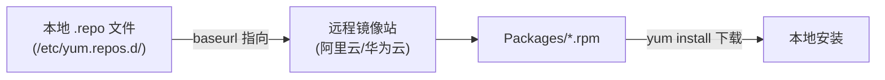
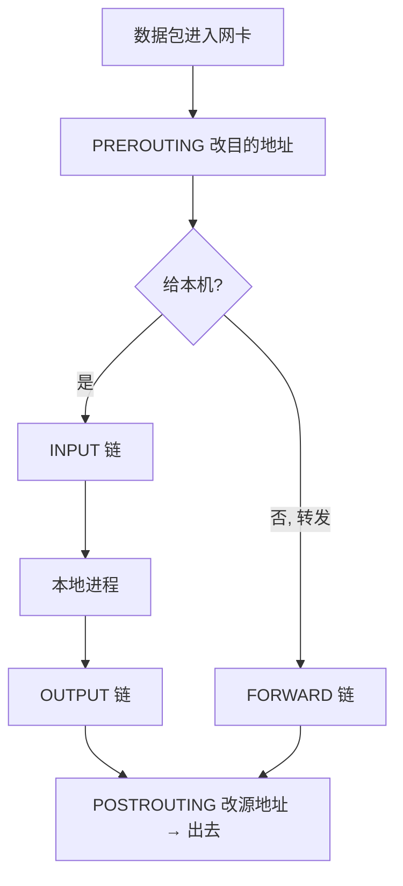
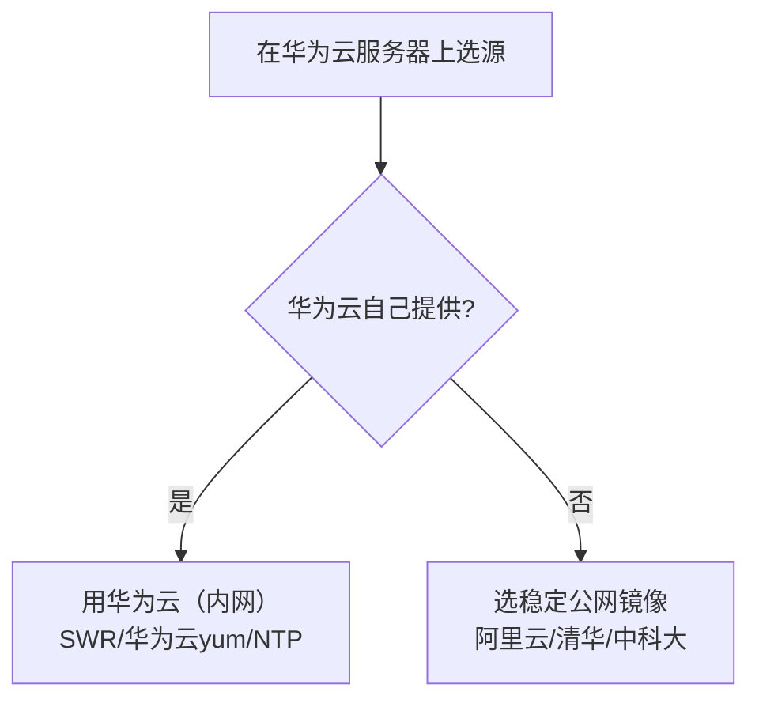

# 01 云环境和 Docker 配置扩展

> 定位：对 [[03 docker云环境配置]] 的深入问答与原理补充，聚焦"为什么这么做"，可作为 03 的配套精读
> 环境：华为云 Flexus · 2核2G · CentOS 7.9
> 日期：2026-10-18

---

## 一、yum 源深入

### 1.1 三个概念先分清（最易混淆）

| 概念 | 是什么 | 位置 |
|---|---|---|
| **源配置文件** | 告诉 yum 去哪个服务器下载 | 本地 `/etc/yum.repos.d/*.repo` |
| **镜像源（仓库）** | 存放大量软件包（.rpm）的服务器 | 远程，如 mirrors.aliyun.com |
| **软件包** | 真正要安装的软件 | 远程服务器上，装的时候才下载 |

> [!important] 关键认知
> `/etc/yum.repos.d/` 是**源配置文件目录**，不是镜像路径。`.repo` 文件里写的是镜像服务器的**地址**（baseurl）。换源的本质 = **改这个地址**。

### 1.2 yum 工作机制



软件包从来不在本地，配置文件只是"地址簿"。

### 1.3 为什么 `mkdir -p backup`

- 把系统自带的旧 `.repo` 移进 `backup` 子目录**备份**，不直接删除；
- 新源出问题可从 backup 恢复；
- `mv *.repo backup/` 不会移动 backup 自身（它是目录、不以 .repo 结尾）。

### 1.4 `-p` 选项（理解要点）

`-p` 两个作用：
1. **递归创建父目录**：`mkdir -p a/b/c`，父目录不存在会一层层全部建出来（普通 mkdir 会失败）——**"前面路径不存在"恰恰是 -p 最有用的场景**；
2. **已存在不报错**：目标目录已存在也不报错，让命令可重复执行（幂等）。

这里 `mkdir -p backup` 主要用作用 2。

### 1.5 镜像源哪里找

| 镜像站 | 地址 |
|---|---|
| 阿里云 | mirrors.aliyun.com |
| 清华 TUNA | mirrors.tuna.tsinghua.edu.cn |
| 中科大 USTC | mirrors.ustc.edu.cn |
| 华为云 | mirrors.huaweicloud.com |
| 网易 | mirrors.163.com |
| 腾讯云 | mirrors.cloud.tencent.com |

- 搜索"CentOS 7 阿里云源"，镜像站帮助页给命令；
- 阿里云 repo 文件有规律：`https://mirrors.aliyun.com/repo/Centos-7.repo`。

### 1.6 EPEL 是什么

**EPEL = Extra Packages for Enterprise Linux**，Fedora 官方维护的**第三方仓库**，为 RHEL 系（CentOS/Rocky/Alma）补充官方源没有的软件。

- **为什么需要**：官方源保守、包少，`htop`、`ncdu`、部分 pip/nginx 等都不在官方源；
- **特点**：免费开源、包不与官方重复、**不会冲突**，是 RHEL 系最常用的第三方源；
- **获取**：
  - 阿里云：`https://mirrors.aliyun.com/repo/epel-7.repo`
  - 官方：`https://docs.fedoraproject.org/en-US/epel/`
  - 或 `yum install epel-release`（自动配置 EPEL）。

---

## 二、iptables 深入

### 2.1 netfilter vs iptables

- **netfilter**：Linux 内核里的数据包过滤框架，真正干活的"防火墙本体"；
- **iptables**：命令行工具，写规则给 netfilter 看。

### 2.2 作用与动作

| 动作 | 含义 |
|---|---|
| ACCEPT | 放行 |
| DROP | 静默丢弃（不回应，对方等到超时） |
| REJECT | 拒绝并回应（对方立刻知道） |
| DNAT/SNAT | 地址转换、端口转发 |

### 2.3 表与链

- **filter 表（默认，过滤）**：
  - **INPUT**：访问本机（项目用这条）
  - **OUTPUT**：本机发出
  - **FORWARD**：经本机转发（Docker 网桥流量）
- **nat 表**：PREROUTING、POSTROUTING，做地址转换。

### 2.4 数据包流转



### 2.5 规则匹配逻辑

- 规则**从上到下逐条匹配，命中即执行动作并停止**；
- 全都不匹配才走链末尾的**默认策略（policy）**；
- 所以规则顺序极其重要。

### 2.6 常用命令

```bash
iptables -L -n                          # 查看（-n 数字显示）
iptables -I INPUT -p tcp --dport 80 -j ACCEPT   # 插入到开头
iptables -A INPUT -p tcp --dport 80 -j ACCEPT   # 追加到末尾
iptables -D INPUT -p tcp --dport 80 -j ACCEPT   # 删除
iptables -F INPUT                        # 清空链
iptables -P INPUT DROP                   # 默认策略
service iptables save                    # 持久化（否则重启丢失）
```

| 参数 | 含义 |
|---|---|
| -p tcp | 协议 |
| --dport 80 | 目标端口 |
| -j ACCEPT | 动作 |

> [!warning] 重点经验：为什么用 -I 不用 -A
> 你的 INPUT 链末尾有兜底拒绝 `REJECT all reject-with icmp-host-prohibited`。
> 用 `-A` 追加，规则排在 REJECT 后面**永远匹配不到**；用 `-I` 插到最前面，才能在兜底之前命中。
> 标准白名单思路：**放行规则插前面，末尾 DROP/REJECT 兜底。**

### 2.7 与 Docker 的关系

- Docker 启动后自动往 iptables 加规则（DOCKER 链、NAT 映射、FORWARD）；
- 容器端口映射、容器上网本质都是 iptables 规则；
- **firewalld 重启会清空重建 iptables，冲掉 Docker 规则**——这就是 firewalld 与 Docker 冲突的根因。

---

## 三、Docker CE 深入

### 3.1 CE 与组件

- **CE = Community Edition 社区版**（免费开源），对应收费的 EE 企业版。

| 组件 | 作用 |
|---|---|
| docker-ce | 守护进程 dockerd（服务端） |
| docker-ce-cli | 命令行客户端 |
| containerd.io | 底层容器运行时 |

工作方式：`docker` 客户端 → dockerd 守护进程 → containerd 干活。

### 3.2 三个核心概念

| 概念 | 类比 | 说明 |
|---|---|---|
| **镜像 Image** | 类 / 光盘 | 只读模板，含应用和环境 |
| **容器 Container** | 实例 | 镜像跑起来的实例 |
| **仓库 Registry** | 应用商店 | 存放镜像，如 Docker Hub、SWR |

一个镜像可启动多个容器。

### 3.3 容器 vs 虚拟机（面试高频）

| 对比 | 虚拟机 | 容器 |
|---|---|---|
| 系统 | 每个有独立 Guest OS | **共享宿主内核**，无独立系统 |
| 体积 | GB 级 | MB 级 |
| 启动 | 分钟级 | 秒级 |
| 密度 | 低 | 高 |

### 3.4 常用命令

```bash
# 镜像
docker pull nginx
docker images
docker rmi nginx

# 容器生命周期
docker run -d --name web -p 8080:80 nginx
docker ps                 # 加 -a 看全部
docker logs web           # 加 -f 实时
docker stop/start/restart web
docker exec -it web bash  # 进入容器
docker rm web
```

### 3.5 docker run 参数

| 参数 | 作用 |
|---|---|
| -d | 后台运行 |
| -p 主机:容器 | 端口映射 |
| -v 主机:容器 | 数据卷（持久化） |
| --name | 容器名 |
| -e 变量=值 | 环境变量 |
| --restart | 重启策略（如 unless-stopped） |
| -it | 交互+终端 |
| --rm | 退出即删 |

### 3.6 为什么要数据卷

容器删除后内部数据全丢。`-v ./data:/data` 把容器数据映射到宿主机，容器重建不丢。

---

## 四、厘清"多个源"（最容易搞混）

### 4.1 两个阿里云源的区别

| | Docker yum 源 | Docker 镜像加速器 |
|---|---|---|
| 给谁用 | yum | Docker 守护进程 |
| 配在哪 | /etc/yum.repos.d/docker-ce.repo | /etc/docker/daemon.json |
| 什么时候 | 装 Docker 时 | 装完后拉镜像时 |
| 下载什么 | **Docker 本体**（RPM） | **容器镜像**（nginx 等） |

- yum 源 = 装 Docker 的渠道；
- 镜像加速器 = Docker 用起来后下载应用的渠道。

### 4.2 系统里实际有三个层次的源

1. **阿里云 yum 基础源**（CentOS-Base.repo）：系统软件 vim/wget；
2. **阿里云 Docker yum 源**（docker-ce.repo）：Docker 本体；
3. **Docker 镜像加速器**（daemon.json）：拉容器镜像。

1、2 是 yum 源（给 yum 用），3 是 Docker 专属。

---

## 五、源选型原则（核心方法论）

> [!important] 原则：用哪家云，就优先用哪家云的源——判断标准是"能不能走内网"

| 路径 | 链路 | 速度 | 占公网带宽 |
|---|---|---|---|
| 华为云服务器 → 华为云 SWR/镜像站 | **内网** | 460M | 否 |
| 华为云服务器 → 阿里云/京东云/清华 | 跨厂商**公网** | 受 2M 限制 | 是 |

> [!warning] 易错事实
> 解决加速器问题的是**华为云 SWR 专属加速器**（速度 2M→460M），**不是京东云**。
> 京东云在京东云机房，华为云服务器访问它只能走公网，没有内网优势。

### 选型决策



### 为什么 Docker 加速器非换不可，yum 源不急

| | 大小 | 频率 | 2M 带宽体感 |
|---|---|---|---|
| Docker 镜像 | 几百 MB | 每次部署 | 慢到超时，**必须换** |
| yum 包 | 几 MB~几十 MB | 初始化一次 | 能接受，**可优化** |

### 验证内网的方法

- 下载测速对比：`curl -o /dev/null -w "%{speed_download}" <url>`；
- 观察华为云**云监控的公网带宽**：走内网时公网带宽几乎不动；
- 最优 yum 源可考虑换 `mirrors.huaweicloud.com`（华为云 ECS 通常走内网/优化链路）。

---

## 六、一句话总结

> **`.repo` 是本地地址簿，镜像源是远程仓库，EPEL 补全官方缺的软件；iptables 是配置 netfilter 的工具、规则按表链组织、白名单用 -I 插前面末尾 DROP；Docker CE 把应用打包成共享内核的轻量容器，靠 -p/-v/-e 运行；记住"用哪家云就优先用哪家云的源走内网"，yum 源装 Docker、镜像加速器帮 Docker 拉镜像。**
