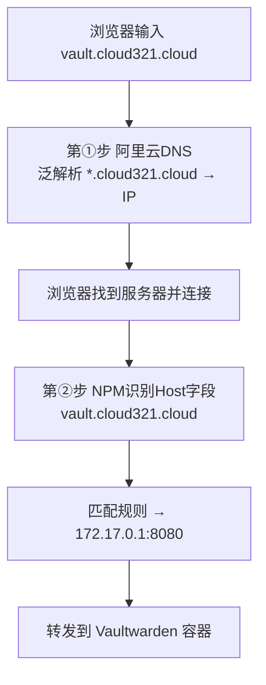
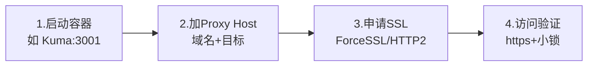

# 02 NPM 反向代理网关扩展

> 定位：对 [[04 部署NginxProxyManager反向代理网关]] 的深入问答与"使用指南"补充，04 讲部署、本篇讲原理和使用
> 环境：华为云 Flexus · 域名 cloud321.cloud
> 日期：2026-10-18

---

## 一、子域名与 NPM 解析原理

### 1.1 子域名不是"注册"来的

- 在阿里云注册的是**主域名** `cloud321.cloud`，注册后拥有完全控制权；
- **子域名（vault./status./blog.）不需要单独注册**，是自己在 DNS 里创建的；
- **不存在"vault.cloud321.cloud 被别人注册"的可能**——别人不拥有主域名，无法在你的域名下创建子域名。

> 比喻：买了一栋楼（主域名），可以随便隔房间（子域名）；别人没法在你的楼里隔房间。

### 1.2 NPM 不做"解析"，只做"识别 + 转发"

一次访问分两步，由两个不同的组件完成：

| 步骤 | 谁做 | 干什么 |
|---|---|---|
| ① DNS 解析 | **阿里云 DNS** | 域名 → IP（泛解析 `*.cloud321.cloud` → IP），让浏览器找到服务器 |
| ② 按域名分流 | **NPM** | 看 HTTP 请求头的 **Host 字段**，匹配规则转发到对应容器 |

> [!important] 关键
> **DNS 负责"找到服务器"（域名→IP），NPM 负责"服务器内部按域名分流"（Host→容器）**。NPM 从不做 DNS 解析。
> 泛解析让所有子域名自动指向服务器（不用改 DNS），但 NPM 面板里仍要为每个服务加一条转发规则。

---

## 二、每个容器都要 docker-compose.yml 吗？

### 2.1 三种组织方式（不强制）

| 方式 | 写法 | 适用 |
|---|---|---|
| ① 一个 yml 写多个服务 | 一个文件 `services:` 下多个 | 服务紧密关联、一起启停 |
| ② 每个服务一个目录+yml（**我们采用**） | 各服务独立目录、独立 yml | 多服务平台，独立启停、隔离 |
| ③ 直接 `docker run` | 不用 yml | 临时测试 |

### 2.2 我们为什么选独立目录

- **单独启停**：重启/升级某个服务不影响其他；
- **数据隔离**：配置、数据卷都在自己目录；
- **好排查**：出问题进对应目录看日志。

### 2.3 Compose 项目机制

- docker-compose **默认以"目录名"作为项目名**（命名空间）；
- 不同目录的 yml 属于不同项目，网络、容器名相互隔离；
- 所以**必须在含 yml 的目录执行**，否则报 `no configuration file`。

---

## 三、NPM 使用指南（部署后如何用）

### 3.1 功能全景

| 菜单 | 功能 | 频率 |
|---|---|---|
| Hosts → **Proxy Hosts** | 网站反向代理（域名→后端） | ⭐⭐⭐ |
| Hosts → **Redirection Hosts** | 网址跳转（重定向） | ⭐⭐ |
| Hosts → Dead Hosts | 维护页/占位 | ⭐ |
| **Streams** | 4 层 TCP 转发（SSH/数据库） | ⭐⭐ |
| **Certificates** | 证书申请、查看、续期 | ⭐⭐⭐ |
| **Access Lists** | 网站加访问密码 / IP 白名单 | ⭐⭐ |
| Settings | 账号、备份、默认站点 | ⭐ |

### 3.2 Proxy Host 完整配置（必会）

**Details 标签页：**

| 选项 | 填什么 | 说明 |
|---|---|---|
| Domain Names | 如 `status.cloud321.cloud` | 可填多个 |
| Scheme | `http`/`https` | 后端协议（多数容器 http） |
| Forward Hostname/IP | `172.17.0.1` 或容器名 | 后端位置 |
| Forward Port | 如 `3001` | 后端端口 |
| Block Common Exploits | 勾选 | 拦截常见攻击 |
| Websockets Support | 实时连接时勾选（Vaultwarden/Kuma） | |
| Cache Assets | 按需 | 缓存静态资源 |
| Access List | 可选 | 绑定访问控制 |

**SSL 标签页：**

| 选项 | 说明 |
|---|---|
| Request a new SSL Certificate | 自动向 Let's Encrypt 申请免费证书 |
| Force SSL | 强制 HTTP 跳 HTTPS |
| HTTP/2 Support | 更快，建议勾 |
| HSTS | 浏览器记住只走 HTTPS（懂了再开） |
| Email / I Agree | 到期通知 + 同意条款 |

**Advanced 标签页**：可写自定义 Nginx 配置片段（高级，一般不用）。

### 3.3 证书管理

- Certificates 查看证书和到期时间；
- **Let's Encrypt 证书有效期 90 天，NPM 自动续期**，前提是 80 端口保持开放；
- 也可上传自己买的证书（Custom）。

### 3.4 其他功能

- **Redirection Hosts**：域名跳转，如 `www.cloud321.cloud` → `cloud321.cloud`（301 永久/302 临时）；
- **Streams**：转发非 HTTP 流量，如换端口连 SSH、转发数据库；
- **Access Lists**：建用户名密码（Basic Auth）或 IP 白名单，再回到 Proxy Host 绑定，保护内部后台；
- **Settings → Backup**：导出配置，迁移/重建恢复。

### 3.5 接入新服务的标准流程

### 3.6 安全理念：后端端口收敛

- **现在（调试态）**：8080、3001 等后端端口直接暴露公网，绕过 NPM，攻击面大；
- **生产态（推荐）**：后端端口只绑定 127.0.0.1 或内网，**公网只开 80/443**，所有流量必须经过 NPM，统一做 HTTPS、WAF、访问控制；
- 做法：端口映射写 `127.0.0.1:8080:80`，安全组不再放行后端端口，NPM 容器仍能通过 172.17.0.1 访问。

> [!important] 反向代理精髓
> **NPM 是唯一入口，后端服务藏在后面**。放行 8080 是为了 IP 调试，正式上线可收回。

### 3.7 实用小技巧

- 改完不生效：先查容器在不在跑、域名解析对不对；
- 证书申请失败：多半是域名没解析到本服务器、或 80 没放行；
- 忘了面板密码：进 NPM 容器按官方文档重置；
- 定期在 Settings 导出配置 + 服务器快照。

---

## 四、一句话总结

> **拥有主域名就拥有所有子域名（不会被别人注册），DNS 把域名解析到 IP、NPM 看 Host 字段分流；docker-compose.yml 不强制每个容器一个，独立目录方便单独启停；NPM 最常用的是 Proxy Host + Certificates，每接入新服务就"启动→加Host→申请SSL→访问"，生产上把后端端口收进 NPM 后面，只暴露 80/443。**
